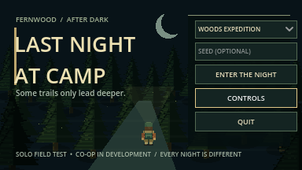
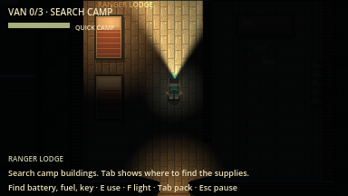
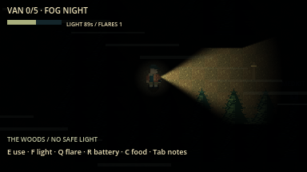
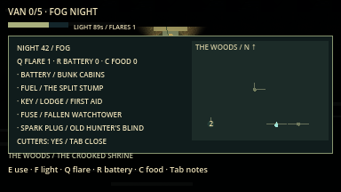
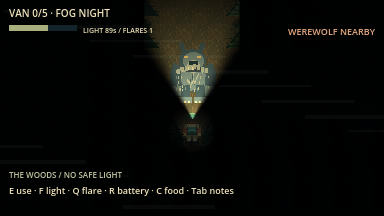
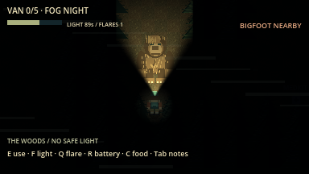
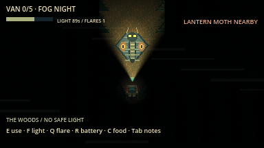
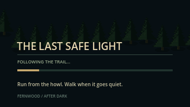
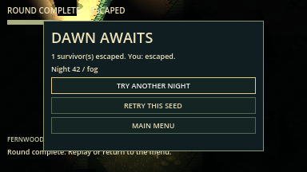

# Last Night at Camp

**Find the parts. Keep your light alive. Get in the van before it leaves.**

An original top-down pixel-art survival horror game built in Godot 4. Explore
Fernwood's cabins, follow twisting trails into the woods, and repair your escape
van while a stalker and roaming cryptids hunt by sight, sound, and light.

**Playable now:** an offline solo prototype with two modes and complete
escape/defeat/replay loops. The intended game is 1–4 player online co-op;
networking is the next milestone and is **not implemented yet**. Run this
prototype from source; standalone desktop packages are a later milestone.



## The first major update

The world now spans **3456×1920**, combining ten furnished camp buildings with a
**1600×1600 woods maze**: 100 connected clearings, loops, dead ends, and six ruined
landmarks. Roofs cut away inside buildings. Native flashlight shadows, cabin
lamps, flares, and headlights provide local light in a nearly black forest.
Soft mist and trunk-shaped shadows keep paths readable; foreground canopy fades
when it covers the camper.

Woods expeditions add five-part repairs, locked caches, survival supplies,
weather, and two cryptids chosen from werewolf, Bigfoot, and lantern moth.
Seeded trails, loot, required extra parts, creature roster, and camp patrols make
each night different. The menu, loading card, field guide, and results share the
new forest palette.

## Play from source

Use **Godot 4.7.2 stable**, standard/GDScript edition. Python 3 is optional for
the helper commands. No plugins, Python packages, or export templates are needed.

1. Clone this repository and enter its folder:

   ```sh
   git clone https://github.com/ChrisTech44/darkwoods.git
   cd darkwoods
   ```

2. Open `project.godot` in Godot and press **F5**, or launch with:

   ```sh
   python3 tools/run_game.py
   ```

3. Choose **Woods Expedition** or **Quick Camp**, optionally enter a positive
   seed, and select **Enter the Night**. Leave the seed blank for a random night.
   **Controls** opens the survivor field guide.

The launcher finds `godot` or `godot4` on PATH, or the macOS app executable.
Set `GODOT_BIN` to another executable if needed. Use
`python3 tools/run_game.py --editor` to open the editor. On Windows,
`py -3` can replace `python3`. See [setup and testing](docs/testing.md).

## Choose your night

| Mode | Repair objective | Threats and exploration |
| --- | --- | --- |
| **Quick Camp** | Battery in the west bunk cabin, fuel in Maintenance, key in the Ranger Lodge. | The camp stalker and a shorter, fixed objective route. Flashlight charge does not drain. |
| **Woods Expedition** | Battery and key in camp location pools; fuel and two extra parts in locked woods caches. | The stalker plus two cryptids, a seeded trail maze, survival supplies, weather, and a draining flashlight. |

Expedition extra parts are drawn from **belt, fuse, tire, and spark plug**.
The pack lists the current requirements and location clues. The woods contains
the split stump, hunter's blind, hollow rock cave, fallen watchtower, crooked
shrine, and rusted scrap cache.

## How to escape

1. **Prepare in camp.** Check **Tab** for component clues. In Woods Expedition,
   find the reusable **boltcutters in Maintenance** before opening locked caches.
   Building doors face south.
2. **Search and collect.** Stand close to an item and press **E**. Walls block
   interaction. In the woods, explore to reveal trails on your field map; it does
   not show the entire maze or undiscovered cache positions.
3. **Repair the van.** Return to its rear and press **E** to install carried
   components. You can make several trips; all required parts must be installed.
4. **Hold E for two seconds** at the rear to start the repaired van. Letting go
   or moving out of range resets the start hold.
5. **Stay aboard.** Starting automatically seats the driver. The van departs
   after **eight seconds**, and passengers are safe inside.

Only boarded survivors extract. The implemented teammate boarding rule is
**E beside the running van**; standing nearby does not count, and downed survivors
cannot board. Teammate boarding and revive currently use local test fixtures,
since connected co-op is still in development.

A round is won when at least one living passenger escapes. The results report
your own outcome too; survivors left outside are left behind.

## Controls

| Key | Action |
| --- | --- |
| **WASD / arrow keys** | Walk and face a direction |
| **Shift** | Sprint while stamina lasts; sprinting makes noise |
| **E** | Take items, open caches with cutters, install parts, enter a running van |
| **Hold E** | Start the repaired van or revive a nearby downed teammate |
| **F** | Toggle the flashlight |
| **Q** | Throw a flare |
| **R** | Use a spare flashlight battery |
| **C** | Eat rations to restore stamina |
| **Tab** | Toggle pack, objective clues, and field map |
| **Esc** | Pause or resume; close the menu's field guide |

## Survive the woods

Walking recovers stamina. Sprint to create distance, then go quiet: enemies
investigate noises and search where they last sensed you. Walls block their
sight; losing line of sight helps break pursuit.

| Supply or condition | Rule |
| --- | --- |
| **Flashlight** | Starts with 90 seconds of charge. In an expedition it drains while lit in the woods, then switches off when empty. Turning it off saves charge. Camp use does not drain it. |
| **Spare battery — R** | Restores up to 70 seconds, capped at 90, and switches the light on. |
| **Flare — Q** | Burns for nine seconds. Repels the stalker, werewolf, and Bigfoot nearby when they can see it; attracts lantern moths. |
| **Rations — C** | Restore full stamina and clear exhaustion. |
| **Medkit** | Automatically consumed on a completed teammate revive, shortening the hold from three seconds to 1.2 seconds. It does not provide a solo self-revive. |
| **Fog** | Shortens enemy sight and the woods flashlight beam. |
| **Rain** | Reduces enemy hearing. |

Expeditions start with two flares, one spare battery, and one ration pack.
Search for additional supplies in camp and scattered woods clearings.
Tools and supplies cannot be used while paused or downed.

The first hit **downs** a survivor. A second hit or **16 seconds of bleeding out**
eliminates them. A living teammate can hold E nearby to revive, with a short grace
period after revival. In the current solo mode, nobody can revive you, so avoid
being downed.

### Know what is following you

| Threat | Behavior | Useful response |
| --- | --- | --- |
| **Camp stalker** | Patrols camp, investigates noise, chases on clear sight, and searches its last known target location. | Break sight around buildings; use sprint carefully and flares when cornered. |
| **Werewolf** | Alternates a fast charge with a slower recovery. | Save stamina for the burst and use the recovery window to reposition. |
| **Bigfoot** | Hears farther than the stalker, with a slower chase. | Walk quietly and avoid broadcasting your route with repeated sprinting. |
| **Lantern moth** | Tracks lit survivors and visible flares; ignores dark survivors beyond close range. | Switch off your light to reduce detection, and remember that flares attract it. |

Each expedition spawns two different cryptid species alongside the stalker.
Current threat/charge cues are visual; audio is not implemented yet.

## Replay the expedition

Enter a seed on the menu to reproduce its trails, item recipe, weather, and
encounter roster. The seed is also displayed in field notes and results.
After a round:

- **Try Another Night** selects a fresh seed in Woods Expedition.
- **Retry This Seed** starts over with the same layout and fresh items/supplies.
- **Main Menu** returns to mode selection.

Quick Camp retains its fixed three-part objective route when restarted.

## Screenshots

Actual Godot viewport captures. The camp images show Quick Camp; the woods images
show the current expedition. Close creature shots are inspection fixtures with
AI disabled and the camera offset for composition. The escape result comes from
a complete automated expedition with all enemies active.

| Campsite and local lighting | Furnished Ranger Lodge |
| --- | --- |
|  |  |

| Dark woods and flashlight | Field notes and explored trails |
| --- | --- |
|  |  |

| Werewolf | Bigfoot | Lantern moth |
| --- | --- | --- |
|  |  |  |

| Loading the next night | Successful extraction |
| --- | --- |
|  |  |

## Development and verification

The current implementation is **M1 plus the requested woods/replayability and
visual expansion**. The latest full graphical verification passed all 45 steps,
including import/startup, every GDScript parse, six suites headlessly and
graphically, and complete camp/woods escape playthroughs, with zero engine errors
or warnings. See the [recorded report](docs/evidence/woods_replay/summary.json)
and [evidence notes](docs/evidence/woods_replay/README.md).

```sh
python3 tools/verify.py             # Import, parse, and headless gameplay checks
python3 tools/verify.py --graphical # Also render, play, and capture screenshots
```

Verified on **macOS arm64 / Godot 4.7.2**. Human real-time balance testing,
connected multiplayer, exported packages, and execution on Windows/Linux remain
unverified. The automated woods player uses navigation paths as a route guide;
the tests do not establish balance for every seed.

Upcoming milestones cover ENet host/join and synchronized co-op (**M2**),
four-player reliability (**M3**), and desktop distribution (**M4**).

- [Authoritative project brief](AGENT_BRIEF.md) — requirements and acceptance gates.
- [Milestones](docs/milestones.md) — implementation plan and remaining work.
- [Architecture](docs/architecture.md) — world, AI, and authority boundaries.
- [Testing](docs/testing.md) — commands, coverage, and platform limits.
- [Development log](docs/development_log.md) — changes, failures, fixes, and evidence.
- [Original art and asset provenance](assets/README.md) — reproducible pixel-art sources.

Project rules in [AGENTS.md](AGENTS.md) require verified incremental commits and
ongoing pushes to GitHub, with a development log update for each increment.
The original supplied Word brief is retained alongside the Markdown specification.
