# Last Night at Camp

**Find the parts. Keep your light alive. Get in the van before it leaves.**

An original top-down pixel-art survival horror game built in Godot 4. Explore
Fernwood's cabins, follow twisting trails into the woods, and repair your escape
van while a stalker and roaming cryptids hunt by sight, sound, and light.

**Playable now:** an offline solo prototype with two modes and complete
escape/defeat/replay loops. The intended game is 1–4 player online co-op;
the latest update fixes camp trails and adds local sound. Networking and voice
are **not implemented yet**. Run this
prototype from source; standalone desktop packages are a later milestone.

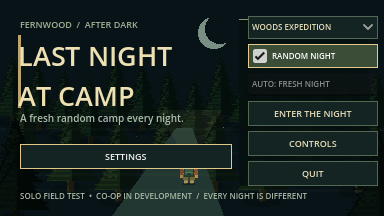

## The surrounding forest update

Fernwood camp now sits at the exact centre of a **9,600×9,408** world, with a
massive forest on every side—about **35 times the previous woods area**.
**2,410 connected forest clearings**, loops and six remote ruins surround the
ten furnished camp buildings. Four exits lead north, east, south and west.
Trails are **128 pixels wide**, and the village, bog and graveyard have larger
clearings and clear approach aprons. Roofs cut away inside buildings.

In Woods Expedition, **24 cryptids—four of each species—plus the stalker** patrol
the inner forest and deeper woods. A true sight mask hides occluded terrain and
creatures; nearby footsteps and calls provide audible warnings without revealing
the whole maze. The local field map follows you, records explored trails and
points back toward camp. The village lies northwest, bog east and graveyard south.

Both modes default to fresh randomized camp layouts. Loot, required extra parts,
weather, creature homes and trails use the run seed. Music plays on the menu;
**Settings** holds the saved mixer before Play. Foreground canopies fade when
they cover the camper, and view-local scenery rendering keeps distant forest
active for gameplay without drawing thousands of tree sprites at once.

## Play from source

Use **Godot 4.7.2 stable**, standard/GDScript edition. Python 3 is optional for
the helper commands. No plugins, Python packages, or export templates are needed.

1. Clone this repository and enter its folder:

   ```sh
   git clone https://github.com/ChrisTech44/darkwoods.git
   cd darkwoods
   ```

2. Open `project.godot` in Godot and press **F5**, or launch with:

   ```sh
   python3 tools/run_game.py
   ```

3. Choose **Woods Expedition** or **Quick Camp**, and select **Enter the Night**.
   **Random Night is on by default** in both modes. To repeat a particular night,
   uncheck it and enter a positive seed. Open **Settings** to adjust volume before playing.
   **Controls** opens the survivor field guide.

The launcher finds `godot` or `godot4` on PATH, or the macOS app executable.
Set `GODOT_BIN` to another executable if needed. Use
`python3 tools/run_game.py --editor` to open the editor. On Windows,
`py -3` can replace `python3`. See [setup and testing](docs/testing.md).

## Choose your night

| Mode | Repair objective | Threats and exploration |
| --- | --- | --- |
| **Quick Camp** | Battery in the Fern bunk cabin, fuel in Maintenance, key in the Ranger Lodge. | The camp stalker and a shorter three-part objective with randomized camp buildings. Flashlight charge does not drain. |
| **Woods Expedition** | Battery and key in camp location pools; fuel and two extra parts in themed-area caches. | The stalker plus 24 cryptids, a seeded trail maze, survival supplies, weather, and a draining flashlight. |

Expedition extra parts are drawn from **belt, fuse, tire, and spark plug**.
The pack lists the current requirements and location clues. The woods contains
three larger areas with a required cache in each: **Abandoned Village (northwest)**,
**Witch's Bog (east)**, and **Old Graveyard (south)**. Six smaller ruined landmarks remain along
the trails for exploration.

## How to escape

1. **Prepare in camp.** Check **Tab** for component clues. In Woods Expedition,
   find the reusable **boltcutters in Maintenance** before opening locked caches.
   Building doors face south.
2. **Search and collect.** Stand close to an item and press **E**. Walls block
   interaction. In the woods, explore to reveal trails on your field map; it does
   not show the entire maze or undiscovered cache positions.
3. **Repair the van.** Return to its rear and press **E** to install carried
   components. You can make several trips; all required parts must be installed.
4. **Hold E for two seconds** at the rear to start the repaired van. Letting go
   or moving out of range resets the start hold.
5. **Stay aboard.** Starting automatically seats the driver. The van departs
   after **eight seconds**, and passengers are safe inside.

Only boarded survivors extract. The implemented teammate boarding rule is
**E beside the running van**; standing nearby does not count, and downed survivors
cannot board. Teammate boarding and revive currently use local test fixtures,
since connected co-op is still in development.

A round is won when at least one living passenger escapes. The results report
your own outcome too; survivors left outside are left behind.

## Controls

| Key | Action |
| --- | --- |
| **WASD / arrow keys** | Walk and face a direction |
| **Shift** | Sprint while stamina lasts; sprinting makes noise |
| **E** | Take items, open caches with cutters, install parts, enter a running van |
| **Hold E** | Start the repaired van or revive a nearby downed teammate |
| **F** | Toggle the flashlight |
| **Q** | Throw a flare |
| **R** | Use a spare flashlight battery |
| **C** | Eat rations to restore stamina |
| **Tab** | Toggle pack, objective clues, and field map |
| **Esc** | Pause or resume; close the menu's field guide |

## Survive the woods

Walking recovers stamina. Sprint to create distance, then go quiet: enemies
investigate noises and search where they last sensed you. Walls block their
sight; losing line of sight helps break pursuit.

| Supply or condition | Rule |
| --- | --- |
| **Flashlight** | Starts with 90 seconds of charge. In an expedition it drains while lit in the woods, then switches off when empty. Turning it off saves charge. Camp use does not drain it. |
| **Spare battery — R** | Restores up to 70 seconds, capped at 90, and switches the light on. |
| **Flare — Q** | Burns for nine seconds. Repels the stalker and all cryptids except the lantern moth nearby when they can see it; attracts moths. |
| **Rations — C** | Restore full stamina and clear exhaustion. |
| **Medkit** | Automatically consumed on a completed teammate revive, shortening the hold from three seconds to 1.2 seconds. It does not provide a solo self-revive. |
| **Fog** | Shortens enemy sight and the woods flashlight beam. |
| **Rain** | Reduces enemy hearing. |

Expeditions start with two flares, one spare battery, and one ration pack.
Search for additional supplies in camp, woods clearings, and themed sites.
Tools and supplies cannot be used while paused or downed.

The first hit **downs** a survivor. A second hit or **16 seconds of bleeding out**
eliminates them. A living teammate can hold E nearby to revive, with a short grace
period after revival. In the current solo mode, nobody can revive you, so avoid
being downed.

### Know what is following you

| Threat | Behavior | Useful response |
| --- | --- | --- |
| **Camp stalker** | Patrols camp, investigates noise, chases on clear sight, and searches its last known target location. | Break sight around buildings; use sprint carefully and flares when cornered. |
| **Werewolf** | Alternates a fast charge with a slower recovery. | Save stamina for the burst and use the recovery window to reposition. |
| **Sasquatch / Bigfoot** | A long-armed forest ape that hears farther than the stalker, with a slower chase. | Walk quietly and avoid broadcasting your route with repeated sprinting. |
| **Lantern moth** | Tracks lit survivors and visible flares; ignores dark survivors beyond close range. | Switch off your light to reduce detection, and remember that flares attract it. |
| **Vampire** | Fast outside the flashlight beam; slows and tries to flank a lit approach. | Face it with your light and use flares to pass a tight trail. |
| **Witch** | Keeps casting distance, shows a wind-up, then fires a fixed-trajectory hex bolt. | Sidestep the bolt or put a wall between you. A hit briefly slows movement and drains stamina. |
| **Briar revenant** | Senses movement, with close-range detection even if you stand still. | Freeze at a distance or break sight; do not wait for it to get close. |

Each expedition spawns **24 cryptids across all six species alongside the stalker**.
The stalker starts nearer the camp routes; cryptids roam 16-point trail circuits around all sides of camp and
visit the objective areas. Enemies lead visible moving targets briefly and sweep
reachable points around their last sensed location after losing sight.
Creature calls and footsteps complement the visual threat cues. A heartbeat fades
in when the stalker or a cryptid sees you, then fades away after pursuit.

## Sound and volume

The supplied MP3s now provide forest/bog ambience, a positional campfire,
restrained music, surface-specific walking/running sounds, six creature voices,
and pursuit heartbeat. Creature calls start only nearby (within 160 pixels), fade with distance and
follow the moving source; enemy footsteps use a shorter 110-pixel range. Calls have cooldowns; visual cues remain usable
with sound muted. **Esc** opens Master, Effects, Ambience and Music sliders;
the same controls are behind **Settings** on the main menu, with music and subdued forest
ambience playing. Settings persist and zero mutes. Pause suspends round sound, results stop it, and
replaying creates fresh emitters. Muting does not change monster hearing.

No microphone capture, permission prompt or voice chat exists in this offline
build. See the [cue manifest and provenance notes](assets/audio/README.md).
Final listening/balance and Windows/Linux/exported audio remain unverified.

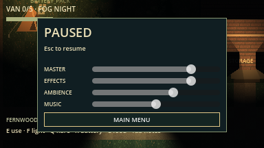

## Use the forest sites

Stand close and press **E**, with a clear path to the interaction point.

| Area | Interactions and trade-offs |
| --- | --- |
| **Abandoned Village** | Enter two furnished huts and search the required cache. Ring the square's bell to draw nearby enemies toward it, then slip away; the bell has a cooldown. The well stash awards two flares, a battery, and food once. |
| **Witch's Bog** | Search the ritual stash. The cauldron restores full flashlight charge once, but hexes your movement briefly and makes noise. |
| **Old Graveyard** | Search the repair cache among the graves. The crypt yields two flares once, with a loud stone-moving noise. |

Searching expedition items makes noise. Treat the stashes as preparation for the
next encounter, and plan a return route rather than spending every flare at once.

## Replay the expedition

Random Night is enabled whenever the menu opens. Uncheck it and enter a seed
to reproduce the camp, trails, item recipe, weather, and
encounter roster. The seed is also displayed in field notes and results.
After a round:

- **Try Another Night** selects a fresh seed and camp in either mode.
- **Retry This Seed** starts over with the same layout and fresh items/supplies.
- **Main Menu** returns to mode selection.

Both modes vary building positions and surrounding trees within reserved camp
lots. Bunk cabins can trade places, as can the bathhouse and first aid building. Door paths, loot and field-map markers move together. Roof footprints
and main trails stay separate. Retrying a seed reproduces the camp too.

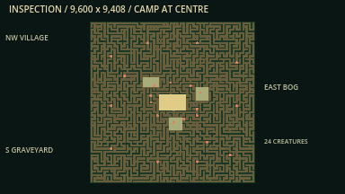

## Screenshots

Actual Godot viewport captures. The camp images show Quick Camp; the woods images
include current region/woods captures. Region overviews deliberately raise ambient
light and disable the sight mask to inspect entrances; normal play keeps both
night lighting and sight restrictions. Close creature shots are inspection fixtures with
AI disabled and the camera offset for composition. The escape result comes from
a complete automated expedition with all enemies active.

| Campsite and local lighting | Furnished Ranger Lodge |
| --- | --- |
|  |  |

| Dark woods and flashlight | Field notes and explored trails |
| --- | --- |
| 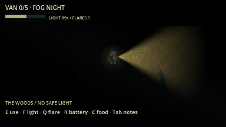 | 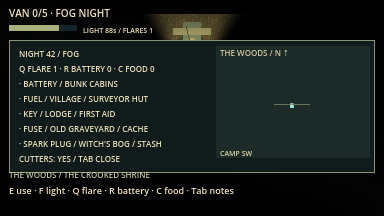 |

| Werewolf | Sasquatch (Bigfoot) | Lantern moth |
| --- | --- | --- |
| 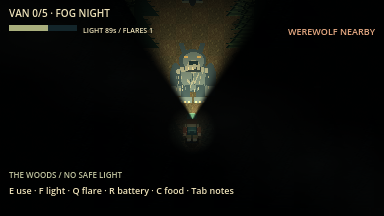 | 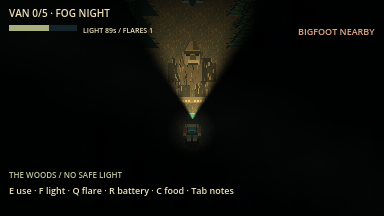 | 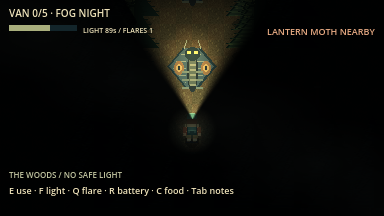 |

| Vampire | Witch | Briar revenant |
| --- | --- | --- |
| 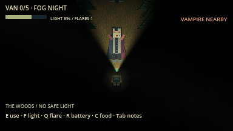 | 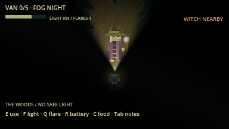 | 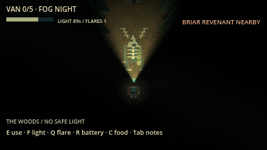 |

| Abandoned village | Witch's bog | Old graveyard |
| --- | --- | --- |
| 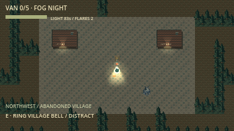 | 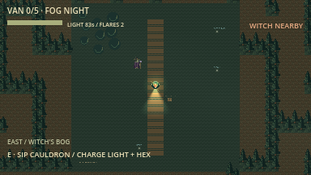 | 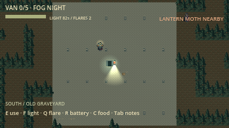 |

| Loading the next night | Successful extraction |
| --- | --- |
|  | 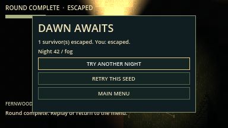 |

## Development and verification

The current implementation is **M1 plus the requested surrounding forest, sight,
audio and replayability expansions**. Latest full graphical verification passed
**77 steps** with zero engine errors/warnings, including import/startup, every
GDScript parse, complete active camp/woods rounds, native audio, twelve-seed
navigation stress and region/visibility checks. See the
[current report](docs/evidence/surround_forest/summary.json) and
[evidence notes](docs/evidence/surround_forest/README.md).

```sh
python3 tools/verify.py             # Import, parse, and headless gameplay checks
python3 tools/verify.py --graphical # Also render, play, and capture screenshots
```

Verified on **macOS arm64 / Godot 4.7.2**. Human real-time balance testing,
connected multiplayer, exported packages, and execution on Windows/Linux remain
unverified. The automated woods player uses navigation paths as a route guide;
the tests do not establish balance for every seed.

Latest layout/audio checks and limits are recorded in the development log.
Upcoming milestones cover ENet host/join and synchronized co-op/audio (**M2/M2-A**),
four-player reliability and proximity voice (**M3/M3-V**), and desktop distribution (**M4**).

- [Authoritative project brief](AGENT_BRIEF.md) — requirements and acceptance gates.
- [Milestones](docs/milestones.md) — implementation plan and remaining work.
- [Architecture](docs/architecture.md) — world, AI, and authority boundaries.
- [Testing](docs/testing.md) — commands, coverage, and platform limits.
- [Development log](docs/development_log.md) — changes, failures, fixes, and evidence.
- [Original art and asset provenance](assets/README.md) — reproducible pixel-art sources.

Project rules in [AGENTS.md](AGENTS.md) require verified incremental commits and
ongoing pushes to GitHub, with a development log update for each increment.
The original supplied Word brief is retained alongside the Markdown specification.
