# Last Night at Camp

**Find the parts. Keep your light alive. Get in the van before it leaves.**

An original top-down pixel-art survival horror game built in Godot 4. Explore
Fernwood's cabins, follow twisting trails into the woods, and repair your escape
van while a stalker and roaming cryptids hunt by sight, sound, and light.

**Playable now:** an offline solo prototype with two modes and complete
escape/defeat/replay loops. The intended game is 1–4 player online co-op;
the latest update adds survivor selection, an item belt, six optional biomes and seven new monster types. Networking and voice
are **not implemented yet**. Run this
prototype from source; standalone desktop packages are a later milestone.


## Survivors, biomes and the item belt

Choose one of **six survivors** before starting, with exact bonuses, an animated
preview, saved choice, Random Survivor and Settings. The Jock has 5s stamina;
Grease Monkey starts the engine in 1.5s; Scout saves light; First-Aid Kid rescues
faster; Quiet Kid reduces sprint hearing; Overprepared starts with extra supplies.

| Survivor | Advantage | Survival tip |
| --- | --- | --- |
| **The Jock** | 5s sprint stamina instead of 4s; unchanged speed/recovery | Save the longer burst for reaching cover. |
| **Grease Monkey** | 1.5s engine ignition instead of 2s; +1 spare battery | Bring all parts home before starting; departure still takes 8s. |
| **The Scout** | Woods light drain 0.8 charge/s instead of 1; +1 ration | Stretch batteries on long trips; beam range stays unchanged. |
| **First-Aid Kid** | Ordinary teammate revive 2.25s instead of 3s; +1 medkit and +1 flare | Extra flare helps solo; the revive bonus needs a teammate. No self-revive. |
| **The Quiet Kid** | Sprint AI hearing reach ×0.75 after weather | Walk after breaking sight. Interactions and flare noise keep their normal reach. |
| **Overprepared** | +1 flare, +1 spare battery and +1 ration | Use the extra margin to explore, then keep room for rare tools. |

Your choice is remembered. **Random Survivor** reveals a role before confirmation;
it is independent of **Random Night**. All roles can collect every part and escape.

**1–6 or keypad 1–6** selects one of six belt slots. **V** uses the held supply;
**G** drops its whole stack; **E** picks it back up. Each supply type takes one
slot, with same-type items stacking. Vehicle components and cutters are carried
separately. Q/R/C still use flares, batteries and food. Medkits help while holding
E to revive a teammate; they cannot self-revive.

Find **noise tins** (three delayed distracting rattles), **salt wards** (4s of
physical-hit protection), and **glow moss** (+35 light charge and hex removal).
Six optional landmarks join the village, bog and graveyard: **Flooded Mill,
Bramble Orchard, Starless Observatory, Last-Car Rail Yard, White Stone Quarry,
and Drowned Chapel**. Each has multiple approaches, a one-time rare tool and a
territorial guardian. Required components still come from the original regions.

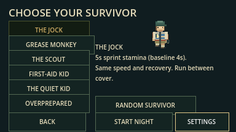

[Full content guide and inspection screenshots](docs/content_update.md) covers
hunter/guardian counterplay and the current prototype limits.

## The surrounding forest update

Fernwood camp now sits at the exact centre of a **9,600×9,408** world, with a
massive forest on every side—about **35 times the previous woods area**.
**2,410 connected forest clearings**, loops and six remote ruins surround the
ten furnished camp buildings. Four exits lead north, east, south and west.
Trails are **128 pixels wide**, and the village, bog and graveyard have larger
clearings and clear approach aprons. Roofs cut away inside buildings.

In Woods Expedition, **24 cryptids across 13 species, plus the stalker** patrol
the inner forest and deeper woods. A true sight mask hides occluded terrain and
creatures; nearby footsteps and calls provide audible warnings without revealing
the whole maze. The local field map follows you, records explored trails and
points back toward camp. The village lies northwest, bog east and graveyard south.

Both modes default to fresh randomized camp layouts. Loot, required extra parts,
weather, creature homes and trails use the run seed. Music plays on the menu;
**Settings** holds the saved mixer before Play. Foreground canopies fade when
they cover the camper, and view-local scenery rendering keeps distant forest
active for gameplay without drawing thousands of tree sprites at once.

## Play from source

Use **Godot 4.7.2 stable**, standard/GDScript edition. Python 3 is optional for
the helper commands. No plugins, Python packages, or export templates are needed.

1. Clone this repository and enter its folder:

   ```sh
   git clone https://github.com/ChrisTech44/darkwoods.git
   cd darkwoods
   ```

2. Open `project.godot` in Godot and press **F5**, or launch with:

   ```sh
   python3 tools/run_game.py
   ```

3. Choose **Woods Expedition** or **Quick Camp**, select **Enter the Night**, choose a survivor, then **Start Night**.
   **Random Night is on by default** in both modes. To repeat a particular night,
   uncheck it and enter a positive seed. Open **Settings** to adjust volume before playing.
   **Controls** opens the survivor field guide.

The launcher finds `godot` or `godot4` on PATH, or the macOS app executable.
Set `GODOT_BIN` to another executable if needed. Use
`python3 tools/run_game.py --editor` to open the editor. On Windows,
`py -3` can replace `python3`. See [setup and testing](docs/testing.md).

## Choose your night

| Mode | Repair objective | Threats and exploration |
| --- | --- | --- |
| **Quick Camp** | Battery in the Fern bunk cabin, fuel in Maintenance, key in the Ranger Lodge. | The camp stalker and a shorter three-part objective with randomized camp buildings. Flashlight charge does not drain. |
| **Woods Expedition** | Battery and key in camp location pools; fuel and two extra parts in themed-area caches. | The stalker plus 24 cryptids, a seeded trail maze, survival supplies, weather, and a draining flashlight. |

Expedition extra parts are drawn from **belt, fuse, tire, and spark plug**.
The pack lists the current requirements and location clues. The woods contains nine major regions. Three hold the required caches: **Abandoned Village (northwest)**,
**Witch's Bog (east)**, and **Old Graveyard (south)**. The mill, orchard, observatory, rail yard, quarry
and chapel are optional; six smaller ruined landmarks also remain along the trails.

## How to escape

1. **Prepare in camp.** Check **Tab** for component clues. In Woods Expedition,
   find the reusable **boltcutters in Maintenance** before opening locked caches.
   Building doors face south.
2. **Search and collect.** Stand close to an item and press **E**. Walls block
   interaction. In the woods, explore to reveal trails on your field map; it does
   not show the entire maze or undiscovered cache positions.
3. **Repair the van.** Return to its rear and press **E** to install carried
   components. You can make several trips; all required parts must be installed.
4. **Hold E for two seconds (1.5s as Grease Monkey)** at the rear to start the repaired van. Letting go
   or moving out of range resets the start hold.
5. **Stay aboard.** Starting automatically seats the driver. The van departs
   after **eight seconds**, and passengers are safe inside.

Only boarded survivors extract. The implemented teammate boarding rule is
**E beside the running van**; standing nearby does not count, and downed survivors
cannot board. Teammate boarding and revive currently use local test fixtures,
since connected co-op is still in development.

A round is won when at least one living passenger escapes. The results report
your own outcome too; survivors left outside are left behind.

## Controls

| Key | Action |
| --- | --- |
| **WASD / arrow keys** | Walk and face a direction |
| **Shift** | Sprint while stamina lasts; sprinting makes noise |
| **E** | Take items, open caches with cutters, install parts, enter a running van |
| **Hold E** | Start the repaired van or revive a nearby downed teammate |
| **F** | Toggle the flashlight |
| **1–6 / keypad 1–6** | Select a belt slot |
| **V / G** | Use held supply / drop its stack |
| **Q** | Throw a flare |
| **R** | Use a spare flashlight battery |
| **C** | Eat rations to restore stamina |
| **Tab** | Toggle pack, objective clues, and field map |
| **Esc** | Pause or resume; close the menu's field guide |

## Survive the woods

Walking recovers stamina. Sprint to create distance, then go quiet: enemies
investigate noises and search where they last sensed you. Walls block their
sight; losing line of sight helps break pursuit.

| Supply or condition | Rule |
| --- | --- |
| **Flashlight** | Starts with 90 seconds of charge. In an expedition it drains while lit in the woods, then switches off when empty. Turning it off saves charge. Camp use does not drain it. |
| **Spare battery — R** | Restores up to 70 seconds, capped at 90, and switches the light on. |
| **Flare — Q** | Burns for nine seconds. Repels nearby stalker/cryptids with sight to it except moths and candle grazers; moths follow it and grazers consume it. |
| **Rations — C** | Restore full stamina and clear exhaustion. |
| **Medkit** | Automatically consumed on a completed teammate revive, shortening the hold from three seconds to 1.2 seconds. It does not provide a solo self-revive. |
| **Noise tin — select, V** | Drops a lure ahead of you. Rattles after 1.5s, 3.5s and 5.5s with 480px hearing reach. Leave before investigators arrive. |
| **Salt ward — select, V** | Protects from physical hits for 4s. Does not heal or remove hexes. |
| **Glow moss — select, V** | Restores 35 light charge, capped at 90, and removes your current hex. |
| **Fog** | Shortens enemy sight and the woods flashlight beam. |
| **Rain** | Reduces enemy hearing. |

Baseline supplies are two flares, one spare battery, and one ration pack; survivor bonuses add to these.
Search for additional supplies in camp, woods clearings, and themed sites.
Tools and supplies cannot be used while paused or downed.

The first hit **downs** a survivor. A second hit or **16 seconds of bleeding out**
eliminates them. A living teammate can hold E nearby to revive, with a short grace
period after revival. In the current solo mode, nobody can revive you, so avoid
being downed.

### Know what is following you

| Threat | Behavior | Useful response |
| --- | --- | --- |
| **Camp stalker** | Patrols camp, investigates noise, chases on clear sight, and searches its last known target location. | Break sight around buildings; use sprint carefully and flares when cornered. |
| **Werewolf** | Alternates a fast charge with a slower recovery. | Save stamina for the burst and use the recovery window to reposition. |
| **Sasquatch / Bigfoot** | A long-armed forest ape that hears farther than the stalker, with a slower chase. | Walk quietly and avoid broadcasting your route with repeated sprinting. |
| **Lantern moth** | Tracks lit survivors and visible flares; ignores dark survivors beyond close range. | Switch off your light to reduce detection, and remember that flares attract it. |
| **Vampire** | Fast outside the flashlight beam; slows and tries to flank a lit approach. | Face it with your light and use flares to pass a tight trail. |
| **Witch** | Keeps casting distance, shows a wind-up, then fires a fixed-trajectory hex bolt. | Sidestep the bolt or put a wall between you. A hit briefly slows movement and drains stamina. |
| **Briar revenant** | Senses movement, with close-range detection even if you stand still. | Freeze at a distance or break sight; do not wait for it to get close. |

Each expedition spawns **24 cryptids across 13 species, plus the stalker**.
The stalker starts on camp routes. Roaming cryptids follow trail circuits and
investigate sensed activity; six landmark guardians stay within their home zones.
The new threats below are playable first versions of the larger design catalog.

| New threat | Where and how it hunts | Tell and useful response |
| --- | --- | --- |
| **Switchback Hound** | Roams forest trails; hears up to 320px before rain/Quiet Kid modifiers and searches last sensed areas for 12s. | A **CHARGE** cue, line and target ring warn for 1.2s before a 0.55s straight dash. Sidestep after it commits, break sight and walk away. |
| **Boiler Saint** | Territorial guardian of the **Flooded Mill**. Places a steam patch at your observed position. | A **DANGER** ring warns for 1.2s. Leave the 23px disk; the patch lasts 2.2s and briefly hexes/slows rather than dealing direct damage. |
| **Bramble Seamstress** | Territorial guardian of the **Bramble Orchard**. Marks a temporary thorn patch after seeing you. | Step out of the warning ring or **walk** through the active thorns. Sprinting through applies a brief hex/slow; the patch expires after 2.2s. |
| **Shutter Wraith** | Territorial guardian of the **Starless Observatory**. Moves faster when not held in your visible flashlight beam. | Aim directly at it within 145px to stop its chase movement, then back away. It can still hit at contact range; do not approach while holding the beam. |
| **Last-Car Conductor** | Territorial guardian of the **Rail Yard**. Marks an inspection patch at your observed position. | Leave its **DANGER** ring during the 1.2s warning. The temporary patch slows/hexes; use the other track lane or retreat out of the yard. |
| **Stoneback Ram** | Territorial guardian of the **White Stone Quarry**. Commits to a straight charge toward the warned position. | Sidestep the **CHARGE** line during its 1.2s tell. The 0.55s dash collides with walls; reposition during the cooldown. |
| **Candle Grazer** | Territorial guardian of the **Drowned Chapel**. Sees lit survivors, detects dark survivors at close range, and follows visible flares. | Switch off your beam at a distance or leave a flare and move away. It **consumes flares on contact** and is not repelled by them. |

**Hunters versus zones:** Hounds can follow sensed activity along ordinary trails;
landmark guardians reject survivor targets and noises outside their home bounds.
Leave the landmark, break sight and stop sprinting to reduce pursuit. Required
woods caches remain in the village/bog/graveyard; the six new zones are optional.
Every guardian can still attack on contact. Steam, thorns and inspection patches
expire, affect each survivor once per patch and never block an exit or change
collision. Each patch hit applies a 1.2s hex (movement at 60% speed) and drains
1.5 stamina; walking avoids the Seamstress's thorns. New monsters currently reuse an existing nearby revenant call; their
appearance and visible cues identify them more reliably than their sound.

Enemies lead visible moving targets briefly and sweep
reachable points around their last sensed location after losing sight.
Creature calls and footsteps complement the visual threat cues. A heartbeat fades
in when the stalker or a cryptid sees you, then fades away after pursuit.

## Sound and volume

The supplied MP3s now provide forest/bog ambience, a positional campfire,
restrained music, surface-specific walking/running sounds, six creature voices,
and pursuit heartbeat. Creature calls start only nearby (within 160 pixels), fade with distance and
follow the moving source; enemy footsteps use a shorter 110-pixel range. Calls have cooldowns; visual cues remain usable
with sound muted. **Esc** opens Master, Effects, Ambience and Music sliders;
the same controls are behind **Settings** on the main menu, with music and subdued forest
ambience playing. Settings persist and zero mutes. Pause suspends round sound, results stop it, and
replaying creates fresh emitters. Muting does not change monster hearing.

No microphone capture, permission prompt or voice chat exists in this offline
build. See the [cue manifest and provenance notes](assets/audio/README.md).
Final listening/balance and Windows/Linux/exported audio remain unverified.


## Use the forest sites

Stand close and press **E**, with a clear path to the interaction point.

| Area | Interactions and trade-offs |
| --- | --- |
| **Abandoned Village** | Enter two furnished huts and search the required cache. Ring the square's bell to draw nearby enemies toward it, then slip away; the bell has a cooldown. The well stash awards two flares, a battery, and food once. |
| **Witch's Bog** | Search the ritual stash. The cauldron restores full flashlight charge once, but hexes your movement briefly and makes noise. |
| **Old Graveyard** | Search the repair cache among the graves. The crypt yields two flares once, with a loud stone-moving noise. |
| **Flooded Mill (west)** | Follow shallow channels and plank crossings around the waterwheel and gauge boiler. Its rare-tool altar is optional; watch the Boiler Saint's marked steam disk. |
| **Bramble Orchard (southwest)** | Fruit rows, trellises and vines mark the clearing. Search the rare-tool altar, then walk around the Seamstress's thorn patches or leave by another approach. |
| **Starless Observatory (northeast)** | A slit dome, telescope and radial tiled court identify the site. Hold the Wraith in your beam while retreating from the optional altar. |
| **Last-Car Rail Yard (southeast)** | Paired tracks, sleepers, switches, signal and scrap carts provide orientation. Cross away from the Conductor's inspection marker; the altar is optional. |
| **White Stone Quarry (far northwest)** | Stepped stone outlines, ladder markings, boulder clusters and survey rings surround the altar. Keep sideways space to dodge the Ram's locked charge. |
| **Drowned Chapel (deep south)** | Broken column bases, candle pews and a cross mosaic mark the court. Search the altar cautiously; flares attract its Candle Grazer instead of driving it away. |

The six new regions each offer **one rare tool per round**. Searching an altar
makes a 650px noise stimulus, so plan your exit first. If the belt is full and
the reward needs a new supply-type slot, nothing is consumed: drop a stack with
**G** and try again. These pockets have multiple entrances and open internal
routes. Their channels, floor markings and decorative props are walkable; they
do not introduce swimming, climbing, impassable machinery or new required parts.

Searching expedition items makes noise. Treat the stashes as preparation for the
next encounter, and plan a return route rather than spending every flare at once.

## Replay the expedition

Random Night is enabled whenever the menu opens. Uncheck it and enter a seed
to reproduce the camp, trails, item recipe, weather, and
encounter roster. The seed is also displayed in field notes and results.
After a round:

- **Try Another Night** returns to the menu. Choose/confirm a survivor and start a fresh random night in either mode.
- **Retry This Seed** keeps your survivor and seed, with the same layout and fresh items/supplies.
- **Main Menu** returns to mode selection.

Both modes vary building positions and surrounding trees within reserved camp
lots. Bunk cabins can trade places, as can the bathhouse and first aid building. Door paths, loot and field-map markers move together. Roof footprints
and main trails stay separate. Retrying a seed reproduces the camp too.


## Screenshots

Actual Godot viewport captures. The original camp/forest screenshots below are
from the earlier verified baseline; the new-monster and optional-biome galleries
show the content update. The camp images use Quick Camp. Region overviews deliberately raise ambient
light and disable the sight mask to inspect entrances; normal play keeps both
night lighting and sight restrictions. Close creature shots are inspection fixtures with
AI disabled and the camera offset for composition. The escape result comes from
a complete automated expedition with all enemies active.

| Campsite and local lighting | Furnished Ranger Lodge |
| --- | --- |
|  |  |

| Dark woods and flashlight | Field notes and explored trails |
| --- | --- |
|  |  |

| Werewolf | Sasquatch (Bigfoot) | Lantern moth |
| --- | --- | --- |
|  |  |  |

| Vampire | Witch | Briar revenant |
| --- | --- | --- |
|  |  |  |

| Abandoned village | Witch's bog | Old graveyard |
| --- | --- | --- |
|  |  |  |

### New monster close-ups

These are dedicated engine captures of the seven new species, with AI disabled
and brightened lighting for inspection. They show the implemented sprites rather
than concept art; the monster table above explains their current powers.

| Switchback Hound | Boiler Saint | Bramble Seamstress |
| --- | --- | --- |
| 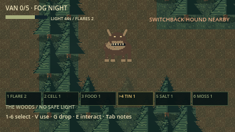 | 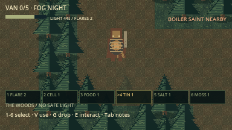 | 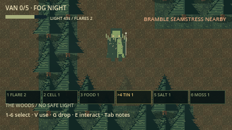 |

| Shutter Wraith | Last-Car Conductor | Stoneback Ram |
| --- | --- | --- |
| 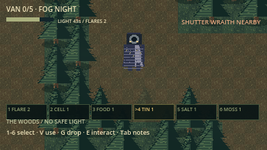 | 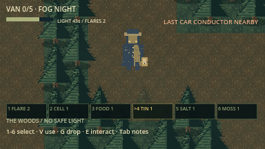 | 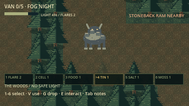 |

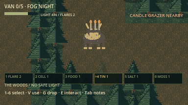

### New optional biomes

The following captures show each new region and its local guardian. Lighting is
brightened and sight masking disabled for the inspection tour; normal play keeps
night lighting and occlusion. The forest-site table above covers rewards, risks
and how to navigate each site.

| Flooded Mill — waterwheel, boiler and plank crossings | Bramble Orchard — fruit rows and trellises |
| --- | --- |
| 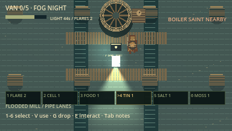 | 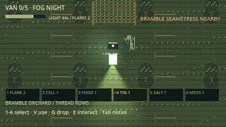 |

| Starless Observatory — dome and telescope | Last-Car Rail Yard — tracks and switches |
| --- | --- |
| 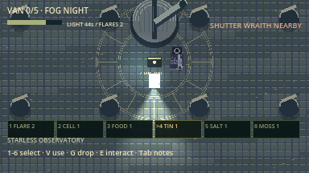 | 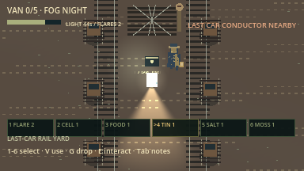 |

| White Stone Quarry — terraces and survey rings | Drowned Chapel — columns and cross mosaic |
| --- | --- |
| 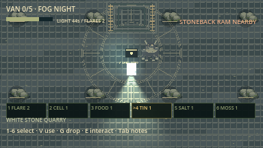 | 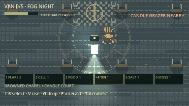 |

### Supply belt

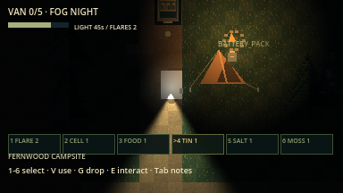

The selected slot is highlighted and its supply appears in the survivor's hand.
Use **1–6/keypad** to select, **V** to use, **G** to drop the stack and **E** to
recover units. Vehicle components and cutters remain separate from this limit.

| Loading the next night | Successful extraction |
| --- | --- |
|  |  |

## Development and verification

The current implementation includes offline survivor selection, six roles,
the supply belt, nine major forest regions and 13 cryptid species. The latest
full headless verification passed **69 steps** with zero errors/warnings;
focused final content checks passed **301 assertions**. The expanded graphical
guide tour passed **316 assertions**, including 15 image captures. Graphical content captures
and checks are recorded in the [content report](docs/evidence/content_expansion/summary.json)
and [evidence notes](docs/evidence/content_expansion/README.md). The earlier full
graphical forest baseline remains preserved in the
[surrounding-forest report](docs/evidence/surround_forest/summary.json).

```sh
python3 tools/verify.py             # Import, parse, and headless gameplay checks
python3 tools/verify.py --graphical # Also render, play, and capture screenshots
```

Verified on **macOS arm64 / Godot 4.7.2**. Human real-time balance testing,
connected multiplayer, exported packages, and execution on Windows/Linux remain
unverified. The automated woods player uses navigation paths as a route guide;
the tests do not establish balance for every seed.

Latest [offline content rules and captures](docs/content_update.md) include the
six playable survivor roles, item belt and six new landmark/monster pairs.
Human balance and full all-role input-only rounds remain pending. Next come
authoritative ENet co-op/audio (M2/M2-A), reliability, optional proximity voice
(M3/M3-V), and tested desktop packages (M4).

The larger backlog includes 48 monster concepts and 18 biome designs. Seven
new monster types and six new regions now have first offline versions; deeper
powers, interiors and the remaining catalog are still planned.

- [Authoritative project brief](AGENT_BRIEF.md) — requirements and acceptance gates.
- [Milestones](docs/milestones.md) — implementation plan and remaining work.
- [Survivor selection and co-op](docs/survivor_multiplayer_plan.md) — six archetypes, selection screens and the transition into voice.
- [Monster catalog](docs/monster_catalog.md) — 48 additional designs, their abilities and counterplay.
- [Biome design](docs/biome_design.md) — 18 detailed regions, randomized layouts, encounters and staged delivery.
- [Architecture](docs/architecture.md) — world, AI, and authority boundaries.
- [Testing](docs/testing.md) — commands, coverage, and platform limits.
- [Development log](docs/development_log.md) — changes, failures, fixes, and evidence.
- [Original art and asset provenance](assets/README.md) — reproducible pixel-art sources.

Project rules in [AGENTS.md](AGENTS.md) require verified incremental commits and
ongoing pushes to GitHub, with a development log update for each increment.
The brief and design documents are maintained in Markdown only.
