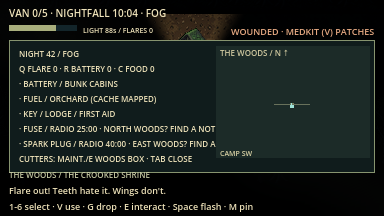
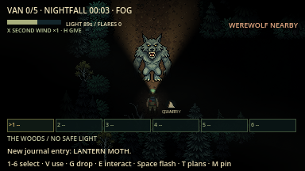
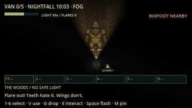
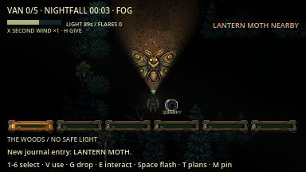
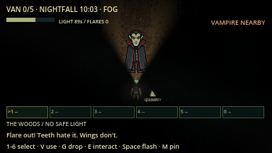
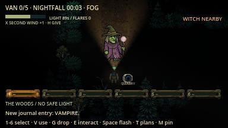
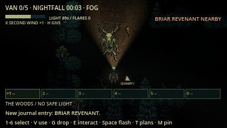

# Last Night at Camp

**Find the parts. Keep your light alive. Escape by van, radio, boat, or the ranger road.**

An original top-down pixel-art survival horror game built in Godot 4. Explore
Fernwood's cabins, follow twisting trails into the woods, and repair your escape
van while a stalker and roaming cryptids hunt by sight, sound, and light.

**Playable now:** offline solo and **1–4 player ENet host/join co-op**, with
Quick Camp and Woods Expedition. Host on LAN/Wi-Fi or a reachable Internet /
virtual-LAN address. Independent local-process and graphical network tests pass;
real cross-machine/Internet and other-platform acceptance remains pending.
The [gameplay overhaul](docs/fun_overhaul.md) is under way (F1–F5 implemented),
and opt-in **proximity voice chat** is in. Run from source; standalone packages
are a later milestone.

See the [item reference](#items) for every item, its location and how to use it.


## Survivors, biomes and the item belt

Choose one of **six survivors** before starting, with exact bonuses, an animated
preview, saved choice, Random Survivor and Settings. The Jock has 5s stamina;
Grease Monkey starts the engine in 1.5s; Scout saves light; First-Aid Kid rescues
faster; Quiet Kid reduces sprint hearing; Overprepared starts with extra supplies.

Every survivor also has one **active ability on X** and a **team bonus**.

| Survivor | Advantage | Ability (X) | Team bonus |
| --- | --- | --- | --- |
| **The Jock** | 5s sprint stamina instead of 4s | **Second Wind**: full stamina and +10% sprint for 2s; once per night phase | Hauls the heavy boat motor alone at full walking pace. |
| **Grease Monkey** | 1.5s engine ignition; +1 spare battery | **Jury-Rig** (2 per night): shut and barricade the nearest cabin door for 8s (nothing can push through), or restart the dead generator silently | |
| **The Scout** | Light drain 0.8/s; +1 ration | **Mark** (30s cooldown): tag the creature, locked cache or site you are facing and can see, for the whole team, for 6s | Starts the night knowing one extra part's region. |
| **First-Aid Kid** | Medkit revive 2.25s; +1 medkit, +1 flare | **Patch** (2 per night): heal your own or an adjacent teammate's wound without a medkit | |
| **The Quiet Kid** | Sprint hearing reach ×0.75 | **Hold Breath** (45s cooldown): 6s of silent sprinting; breath lasts twice as long while hidden | Leaves no blood trail while wounded. |
| **Overprepared** | +1 flare, +1 battery, +1 ration | **Unpack** (once per night): drop a stash of flare, battery, rations and medkit for anyone | |

**H** hands one of your held supply to a teammate standing right beside you.
Two survivors at the dead generator restart it quietly; alone it roars.
At the end of a night the results screen hands out **awards** such as *Never
Left Behind*, *Most Flares Wasted*, *Bait*, *Pack Mule* and *Show-Off*.

Your choice is remembered. **Random Survivor** reveals a role before confirmation;
it is independent of **Random Night**. All roles can collect every part and escape.

**1–6 or keypad 1–6** selects one of six belt slots. **V** uses the held supply;
**G** drops its whole stack; **E** picks it back up. Each supply type takes one
slot, with same-type items stacking. Slots show the key and name without trailing quantity numbers; Tab lists the main supply counts. Vehicle components and cutters are carried
separately. Q/R/C still use flares, batteries and food. Medkits help while holding
E to revive a teammate faster, and V patches your own wound.

Find **noise tins** (three delayed distracting rattles), **salt wards** (4s of
physical-hit protection), and **glow moss** (+35 light charge and hex removal).
Six optional landmarks join the village, bog and graveyard: **Flooded Mill,
Bramble Orchard, Starless Observatory, Last-Car Rail Yard, White Stone Quarry,
and Drowned Chapel**. Each has multiple approaches, a one-time rare tool and a
territorial guardian. Required components still come from the original regions.


[Full content guide and inspection screenshots](docs/content_update.md) covers
hunter/guardian counterplay and the current prototype limits.

## The surrounding forest update

Fernwood camp now sits at the exact centre of a **9,600×9,408** world, with a
massive forest on every side—about **35 times the previous woods area**.
**2,410 connected forest clearings**, loops and six remote ruins surround the
ten furnished camp buildings. Four exits lead north, east, south and west.
Trails are **128 pixels wide**, and the village, bog and graveyard have larger
clearings and clear approach aprons. Roofs cut away inside buildings.

In Woods Expedition, **48 cryptids across 16 species, plus the stalker** patrol
the inner forest and deeper woods. A true sight mask hides occluded terrain and
creatures; nearby footsteps and calls provide audible warnings without revealing
the whole maze. The local field map follows you, records explored trails and
points back toward camp. The village lies northwest, bog east and graveyard south.

### Find your way

- **The ring road and spokes.** A wide dirt **ring road** circles camp about
  1,500 px out and runs straight through the Abandoned Village, Witch's Bog and
  Old Graveyard. Four straight **spoke roads** leave the camp exits (north,
  east, south, west) and run to the edges of the map. Lamp posts light the
  ring and the inner spokes as long as camp has power; in a blackout the roads
  go dark too. The outer spokes are dark **logging roads**. Everything between
  the roads is the old maze ("the thickets"): shorter as the crow flies, but
  darker and unmarked. From camp, the graveyard is about 18 s on foot, the bog
  28 s and the village 30 s.

- **Signposts** stand at about 120 trail junctions per night. Each board points
  along the real shortest trail to **camp** and the two nearest regions. Stand
  beside one to read its full directions on the HUD
  (for example `SIGNPOST · CAMP E · ABANDONED VILLAGE W · OLD GRAVEYARD S`).
- **Skyline markers.** Tall landmarks show over the treetops: the camp fire always,
  plus up to four regions within about 2,400 px (bell tower, bog glow, dome,
  rail signal and others). They sit at the screen edge in that direction and
  never reveal trails, caches or creatures.
- **Region names and roads from the start.** The field map (Tab) prints the ring
  road, spokes and every nearby region outline from the Ranger Lodge wall map;
  regions brighten once you have walked them.
  Trails still appear only where you have explored.
- **Team pins.** Press **M** to drop a pin where you stand. Everyone sees it on
  their field map and as an edge marker, with a shared "pinned WITCH'S BOG"
  notice. Each player keeps their newest three pins.


Both modes default to fresh randomized camp layouts. Loot, required extra parts,
weather, creature homes and trails use the run seed. Music plays on the menu;
**Settings** holds the saved mixer before Play. Foreground canopies fade when
they cover the camper, and view-local scenery rendering keeps distant forest
active for gameplay without drawing thousands of tree sprites at once. Every
trail is lined with dense trees and undergrowth; your sight reaches just into
that tree line and fades to darkness, so you see the forest rising around the
path but never the next trail through it.

Trees use staggered trunk positions, varied crown heights and a dense bracken
fringe rather than a straight hedge. Visible foliage catches nearby flashlights
and flares even along the north-facing border. Crowns fade locally around your
survivor, and a small, smooth woods-camera lookahead gives north-side trees more
room above you. The terrain and creatures behind the tree wall remain hidden.

| Facing north at normal night exposure | Facing south at normal night exposure |
| --- | --- |
|  |  |

[Before/after captures and verification](docs/evidence/forest_treeline/README.md).

## Play from source

Use **Godot 4.7.2 stable**, standard/GDScript edition. Python 3 is optional for
the helper commands. No plugins, Python packages, or export templates are needed.

1. Clone this repository and enter its folder:

   ```sh
   git clone https://github.com/ChrisTech44/darkwoods.git
   cd darkwoods
   ```

2. Open `project.godot` in Godot and press **F5**, or launch with:

   ```sh
   python3 tools/run_game.py
   ```

3. Choose **Woods Expedition** or **Quick Camp**, select **Enter the Night**, choose a survivor, then **Start Night**.
   **Random Night is on by default** in both modes. To repeat a particular night,
   uncheck it and enter a positive seed. Open **Settings** to adjust volume before playing.
   **Controls** opens the survivor field guide.

The launcher finds `godot` or `godot4` on PATH, or the macOS app executable.
Set `GODOT_BIN` to another executable if needed. Use
`python3 tools/run_game.py --editor` to open the editor. On Windows,
`py -3` can replace `python3`. See [setup and testing](docs/testing.md).

## Play with friends

Open **Host / Join Co-op**, choose your name/survivor, and **Host** or enter the
host address and **Join**. Default port: **UDP 27840**. Everyone marks **Ready**;
the host chooses mode/seed and starts. LAN/Wi-Fi uses the host's local IP;
Internet needs a reachable public UDP port or an existing virtual LAN/VPN.

**[Connection setup, co-op rules and screenshots](docs/multiplayer_guide.md)**
explains routing, joining, revives, shared escape and replay. New joins are
lobby-only. **Esc opens a local menu without pausing the shared world.**

**Proximity voice** (optional, off by default): in **Settings** or the Esc menu,
set **MIC** to *Push to talk (B)* or *Open mic*, then **restart the game once**.
The microphone (and macOS's one-time permission prompt) is only started for
players who turn voice on. In the lobby everyone hears everyone. In a round you
hear teammates near you (up to about 420 px), from their direction, muffled
behind walls and silent beyond range. Escaped, dead and left-behind players
talk on a ghost channel the living cannot hear. Monsters never hear voice. The
HUD shows who is talking. **VOICE** and **MIC GAIN** sliders set loudness.


## Choose your night

| Mode | Repair objective | Threats and exploration |
| --- | --- | --- |
| **Quick Camp** | Battery in the Fern bunk cabin, fuel in Maintenance, key in the Ranger Lodge. | The camp stalker and a shorter three-part objective with randomized camp buildings. Flashlight charge does not drain. |
| **Woods Expedition** (a long night at your own pace) | Battery and key in camp location pools; fuel and two extra parts in themed-area caches, revealed by ranger radio as the night deepens. | A night that deepens as you make progress: the stalker plus 48 cryptids, a seeded trail maze, survival supplies, weather, storms, blackouts and a draining flashlight. |

Expedition extra parts are drawn from **belt, fuse, tire, and spark plug**.
The pack lists the current requirements and location clues. The woods contains nine major regions.
Each night three of them (one each in three different directions) hold the
locked caches; the White Stone Quarry never does. Six smaller ruined landmarks
also remain along the trails.

## The night (Woods Expedition)

An expedition has **no fixed clock to beat and no deadline**. The night moves
through four phases as **your team makes progress**: installing van parts, or
completing steps of the radio, boat or gate escapes. A team that stalls still
slides from Dusk to Nightfall to Deep Night after about 12 quiet minutes per
phase, but only real progress brings the Witching Hour. The heading shows the
phase and how long you have been out.

| Phase | Arrives when | What happens |
| --- | --- | --- |
| **Dusk** | Start | Battery and key are in camp. Grab tools and supplies, plan routes. The woods are at their calmest. |
| **Nightfall** | One step secured (e.g. first van part), or 12 quiet minutes | Ranger radio reveals the **fuel** cache. First storm of the night. |
| **Deep Night** | Half an escape ready (e.g. third van part), or 12 more quiet minutes | Radio reveals the **first extra part**. The stalker hears farther. A blackout hits camp. |
| **Witching Hour** | An escape nearly or fully ready (e.g. fourth van part) | Radio reveals the **last extra part**. The stalker chases faster, and pressure keeps climbing until you leave. |

- **Where the parts are changes every night.** The three locked caches (fuel and
  the two extra parts) go to three different regions in three different
  directions from camp, drawn from eight regions: village, observatory (north),
  bog, rail yard (east), graveyard, chapel (south), mill, orchard (west).
- **Follow the clues.**
  - The camp corkboard names the fuel's region (shown in the Dusk message and
    on Tab).
  - For the other parts you start with only a direction, e.g. `FUSE / NORTH
    WOODS? FIND A NOTE`.
  - **Ranger notes** lie on the roads heading toward each part's region (two per
    part). Pick one up with E to name the region for the whole team.
  - Walking into a part's region also names it. Once its cache has been revealed
    by radio, it's marked on your map `(CACHE MAPPED)`.
  - Skyline markers show which part waits in a region you know about, e.g.
    `DOME · FUSE`.
- **Parts arrive by radio.** Tab lists every required part; unrevealed ones show
  which phase the radio will announce them in, e.g. `FUEL / RADIO AT NIGHTFALL ·
  ORCHARD`. Each installed part deepens the night and unlocks the next one, so the
  whole chain unfolds at your pace.
- **Supply drops.** Each new phase leaves 2 flashlight batteries, a flare and a
  ration at the Maintenance stash.
- **The woods get hungrier.** Pressure ("dread") rises the longer you linger in a phase, with loud noises
  and every installed part. Higher dread sends roaming creatures toward your
  general area more often, never to your exact spot and never into camp. After
  a chase you get at least 45 seconds of calm. Music swells with dread, and a
  distant howl marks each new phase.
- **Storms** (90s): thunder masks noise (creatures hear 40% less far) and
  lightning briefly lights the trees. Walls still block what you can see.
- **Blackouts:** camp lamps die until someone restarts the generator by the
  Maintenance door (**E**, loud). The campfire keeps burning.
- **No dawn rescue.** The only way out is an escape you build yourselves; the
  Witching Hour never ends on its own.
- **Story events** (two per night, in seeded phases):
  - **The Hunt Begins:** a horn sounds; for a minute every roaming creature
    converges on the last loud noise made near camp. Go quiet.
  - **The Stalker's Gift:** a crate tied with a bow appears in a named region
    (pinned GIFT). It holds two flares, a battery and a medkit, but the bell on
    the lid calls the killer from anywhere.
  - **Lost Camper:** a counselor calls from a region (pinned CAMPER). The first
    survivor to reach them is followed home; they freeze in panic if something
    chases nearby. Getting them into camp earns a medkit and +250 score.
- **Build-ups:** before the woods send something your way you hear a distant
  call from its direction and your flashlight stutters for a moment.

Quick Camp stays a short mode with no night clock.

## Score, Daily Night and the Camp Journal

Every Woods Expedition night ends with a **score and grade** (S ≥ 1800, A ≥ 1400,
B ≥ 1000, C ≥ 600, otherwise D): escape +1000, using the rumoured escape +200,
landmark relics +150 each, ranger notes +25, rescues and patches +100, creatures
sighted +10 each, then ×1.15 per night modifier. Your best score per seed is kept.

Pick **DAILY NIGHT** in the mode list to play the same seeded expedition as
everyone else today (the seed is the date, e.g. Night 20261017).

**CAMP JOURNAL** on the main menu shows your nights and escapes, a **bestiary**
(each creature's survival tip unlocks the first time you see it) and **merit
badges** such as First Light, Route Master, Pyromaniac, Lake Legend, Snare
Dancer, Red Sky, Daily Dose, Field Guide, Top Marks and Team Player. New badges
appear on the results screen. Progress is saved locally on each player's machine.

## Tonight's killer and night modifiers

Each Woods Expedition night has a **headline killer** and **0–2 modifiers**, both
chosen by the seed and announced in the Dusk message and the Tab pack heading.

- **The Stalker** escalates with the night. At Dusk he keeps to camp and the inner
  ring (he gives up chases beyond it). From Nightfall he hunts anywhere. In Deep
  Night his search memory lasts 50% longer, and **once** he may sabotage the van:
  if nobody stands within 300 px of it, he walks over, rips out the last installed
  part and leaves it in that part's region, **pinned on your map** (VAN ALARM).
  In the Witching Hour he runs faster, breaks doors 50% quicker and **once** cuts
  the generator if nobody is guarding it.
- **The Groundskeeper** escalates the same way, and also sets **snares** on trails
  you have already walked (up to four armed). A snare glints in your flashlight
  within 90 px. Step on one and you are held for 4 seconds while it rattles loudly
  and calls him. A teammate frees you instantly with **E**, and anyone can
  **disarm** an armed snare quietly with **E**.

| Modifier | Effect |
| --- | --- |
| **Blood Moon** | More hounds and jackals roam; the killer runs 8% faster. |
| **Dead Batteries** | Spare batteries restore 40 charge instead of 70. |
| **Fog Bank** | The night is foggy: shorter sight for everyone. |
| **Silent Night** | No music; creatures hear 15% farther. |
| **Generous Woods** | 48 extra supply caches in the woods. |
| **Lone Wolf** | Every survivor starts at a different camp building door. |

## How to escape

**Each Woods Expedition night offers two ways out: the camp van, plus one
rumoured escape** (Radio Rescue, the Boat, the Ranger Gate or the Signal Fire),
chosen by the night's seed. The Dusk message names the rumour, and **T** cycles
through tonight's plans only; parts for other escapes do not appear. Whichever
escape finishes first ends the round.

1. **Prepare in camp.** Check **Tab** for component clues. In Woods Expedition,
   find reusable **boltcutters** (Maintenance, or a second pair in a woods
   toolbox) or the noisy **crowbar** (a bunk cabin) before opening locked caches.
   Building doors face south.
2. **Search and collect.** Stand close to an item and press **E**. Walls block
   interaction. In the woods, explore to reveal trails on your field map; it does
   not show the entire maze or undiscovered cache positions.
3. **Repair the van.** Return to its rear and press **E** to install carried
   components. You can make several trips; all required parts must be installed.
4. **Hold E for two seconds (1.5s as Grease Monkey)** at the rear to start the repaired van. Letting go
   or moving out of range resets the start hold.
5. **Stay aboard.** Starting automatically seats the driver. In Quick Camp the
   van departs after **eight seconds**. On an expedition the engine roar is a
   finale: departure takes **20 seconds**, the engine revs every 5 seconds, and
   every creature in earshot (and the stalker, from anywhere) comes for the van.
   Passengers are safe inside; everyone else must get aboard in time.

Living survivors board with **E beside the running van**; standing nearby does
not count. Downed survivors are rescued automatically when at least one passenger
escapes, even if they have not been revived. The automated network tests
use host-only placements for isolated authority checks; human co-op balance is
still unrecorded.

A round is won when at least one living passenger escapes, a standing survivor
is rescued from the radio landing circle, boat dock, ranger bridge or signal
fire ring. The results report your own outcome too; living
survivors left outside are left behind.

### Radio Rescue (Woods Expedition)

An alternate escape now crosses the **Flooded Mill → north Power Substation →
east Radio Relay Station → landing zone south of the Drowned Chapel**. The van
remains available; the first extraction to finish ends the round.

1. Collect the **emergency fuse** beside the mill's central reward area. It uses
   no belt slot and drops with your gear if you are downed or disconnect.
2. Press **E** at the substation cabinet to restore its dedicated rescue circuit.
   Camp blackouts do not undo this repair.
3. At the east relay's ladder, **hold E for six seconds** to climb and transmit.
   The channel opens as soon as the relay has power.
   Moving away, releasing E, getting downed or changing operators resets the hold.
4. Load one **flare** into each of the three marked holders by pressing **E**.
   Three additional flares are stashed beside the chapel landing circle. Signals
   stay lit; throwing an ordinary flare with Q does **not** count as a signal.
   You can prepare the signals before transmitting.
5. Gather the team, then press **E at the circle's centre** to start the
   **40-second holdout**. The countdown does not wait for stragglers. Signal
   noise draws nearby monsters through their normal hearing; resident guardians
   keep their existing territory limits.
6. Be **standing inside the 96 px landing circle** when rescue arrives. A successful
   rescue also recovers connected downed teammates anywhere. Standing survivors
   outside the circle, hidden survivors and van passengers are left behind by
   radio rescue. If nobody standing reaches the circle, the round is lost.

Press **T** to cycle **Van → Radio → Boat → Ranger Gate** plans; **Tab** closes
field notes. Quick Camp keeps its van-only escape.

| North Power Substation | East Radio Relay Station |
| --- | --- |
|  |  |


### Signal Fire (Woods Expedition)

On Signal Fire nights, **T** names three regions (one each to the north, east and
south) holding **two kerosene cans and a flare gun**. They use no belt slot. Carry
them to the **signal pyre on the White Stone Quarry rim** and press **E** to fit
them, then **E** again to light it. The blaze starts a **45-second hold-out**: it
lights up the quarry and beacons every creature in the woods toward the fire,
pulsing every 6 seconds. Standing survivors inside the **fire ring (110 px)** when
the rescue plane passes are recovered, along with any downed teammates.

### Boat and Ranger Gate (Woods Expedition)

**Boat:** carry the **outboard motor** from the west Logging Camp, **marine fuel**
from the east Rail Yard, and the **drain plug** from the north Observatory to the
southeast Lakeshore Boathouse. E fits them. The motor uses no belt slot, slows its
carrier to **75% walking speed**, and prevents sprinting/vaulting. **G** sets it
down immediately. A standing teammate can **hold E within 48 px** to help: both
walk at normal speed without sprinting while assisting.

Once all three parts are fitted, E at the boat starts a **25-second launch**. Stay on the
wooden dock within **80 px** of the boat point. The **Lake Thing** marks three
fixed dock positions with glowing ripple circles, each warning for **2 seconds**
before striking. Step outside a circle or throw a flare within 100 px with clear
sight to interrupt that attack. Signals at the chapel do not repel the Lake Thing.

**Ranger Gate:** the T plan names three regions holding tonight's distinct
**gate-code fragments**. Carry them to the gate on the north road and E to fit
them. Restore the same north substation circuit used by Radio Rescue, then E at
**the gate's left breaker** to turn on the road floodlights. The alarm draws the
stalker toward the gate through normal travel; nearby roamers can hear it too.
Once the gate is powered and coded, **hold E for four seconds** at the gate, then run north along the
lit road to the bridge. The first standing survivor at the bridge starts an
**eight-second team evacuation window**. Everyone standing must reach the bridge's
**64 px circle** before it closes.

Both routes recover connected downed teammates when at least one standing,
unhidden survivor escapes. Standing players outside the extraction area and van
passengers are left behind by these routes. The first escape to finish ends the
round. Quick Camp keeps its original van-only rules.

| Lakeshore boat launch | Ranger checkpoint |
| --- | --- |
|  |  |

[Full Boat/Gate walkthrough, graphics and verification limits](docs/boat_gate.md).

## Controls

| Key | Action |
| --- | --- |
| **WASD / arrow keys** | Walk and face a direction |
| **Shift** | Sprint while stamina lasts; sprinting makes noise |
| **E** | Take items, open caches with cutters or a crowbar, install parts, enter a running van, hide/leave a hiding spot, slam/open doors, knock over woodpiles and deadfall |
| **Hold E** | Climb/transmit at the relay (6s), start the repaired van, revive a nearby downed teammate, or (solo, downed) get back up once |
| **Space** | Flash-stun creatures close in your beam (costs light, 8 s cooldown) |
| **F** | Toggle the flashlight |
| **1–6 / keypad 1–6** | Select a belt slot |
| **V / G** | Use held supply / drop its stack |
| **Q** | Throw a flare |
| **R** | Use a spare flashlight battery |
| **C** | Eat rations to restore stamina |
| **M** | Drop a team map pin where you stand (newest three kept) |
| **B** (hold) | Push to talk, when voice is set to push-to-talk in co-op |
| **X** | Use your survivor's ability |
| **H** | Hand the held supply to an adjacent teammate |
| **Tab** | Toggle pack, objective clues, and field map |
| **Esc** | Solo: pause/resume. Co-op: local menu; the shared world continues. |

**T** cycles expedition Van / Radio / Boat / Ranger Gate objective plans.

## Items

Press **E** near an item to collect it. Walls block collection. **Tab** shows the
current night's required parts and their location clues; exact building and
woods positions vary with the seed. In co-op, pickups and searchable stashes
are shared: taking one removes it for everyone.

### Vehicle parts and reusable tools

These go in your pack and **do not use belt slots**. Press **E at the van's rear**
to install carried required parts. Quick Camp needs battery, fuel and key.
Woods Expedition needs those three plus **two** parts chosen from drive belt,
fuse, tire and spark plug; check Tab to see which two your night requires.

| Item | Where to find it | What it does |
| --- | --- | --- |
| **Van battery** | Quick Camp: Fern Bunk Cabin. Woods: one of the Fern/Pine bunk cabins or Cedar Bunkhouse. | Required van component in both modes. This is different from a spare flashlight battery. |
| **Fuel** | Quick Camp: Maintenance. Woods: one of the three locked objective caches listed below. | Required van component in both modes. |
| **Key** | Quick Camp: Ranger Lodge. Woods: Ranger Lodge or First Aid. | Required van component in both modes. |
| **Drive belt** | Woods only, when selected as a required part: a locked objective cache. | One of four possible extra repair parts; install it at the van. |
| **Outboard motor** | Woods: west Logging Camp. | Heavy boat objective; no belt slot. Carry at 75% walk, no sprint/vault. G drops it; an adjacent teammate holding E restores full walking speed. E fits it at the boathouse. |
| **Marine fuel** | Woods: east Rail Yard. | Dedicated boat fuel, separate from van fuel. No belt slot; E fits it at the boathouse. |
| **Drain plug** | Woods: north Observatory. | Third boat component. No belt slot; E fits it at the boathouse. |
| **Gate-code fragments 1–3** | Woods: three seeded regions across east, south and west; T names them. | Separate objective inventory; drop on down/disconnect. E fits each once at the north Ranger Gate. |
| **Emergency fuse** | Woods only: Flooded Mill, beside its central reward area. | Repairs the north Power Substation for Radio Rescue. Separate objective inventory; no belt slot. Different from the van fuse. |
| **Fuse** | Woods only, when selected as a required part: a locked objective cache. | One of four possible extra repair parts; install it at the van. |
| **Tire** | Woods only, when selected as a required part: a locked objective cache. | One of four possible extra repair parts; install it at the van. |
| **Spark plug** | Woods only, when selected as a required part: a locked objective cache. | One of four possible extra repair parts; install it at the van. |
| **Boltcutters** | Woods only: Maintenance, plus a second pair in a woods toolbox 1,000–1,600 px from camp (Tab shows its compass bearing). | Reusable tool that opens locked caches quietly when you press E. Kept after use; it is not installed in the van. Each survivor can carry one pair, so the second is left for a teammate. |
| **Crowbar** | Woods only: the bunk cabin that does not hold the van battery. | Pries a locked cache open when you have no cutters, with a loud 500 px noise. Reusable; carried in the pack like cutters. |

The Woods objective caches are in **Village / Surveyor Hut**, **Witch's Bog /
Stash**, and **Old Graveyard / Cache**. Fuel and the two selected extra parts are
shuffled among these three caches. Optional landmark biomes are not required to
complete the van. Building lots move with the seed, so follow the named clues
rather than memorizing screen coordinates.

### Flashlight and survival supplies

Every survivor has a built-in **flashlight**; it is not a pickup or belt item.
Toggle it with **F**. It starts with **90 charge**, drains at 1 charge/second
while lit in expedition woods (Scout: 0.8/second), and switches off at zero.
Camp use does not drain charge. Teammates see its light too.

**Woods loot** below means seeded supply pickups scattered through forest
clearings; the 96 scattered pickups include all seven supply types. **Landmark
reward** means a one-time search in Flooded Mill, Bramble Orchard, Broken
Observatory, Rail Yard, White Stone Quarry or Candle Chapel. Each landmark gives
one of noise tin, salt ward or glow moss; the reward depends on its seeded site.

| Supply | Where to find it | What it does / how to use it |
| --- | --- | --- |
| **Flare** | Start with 2; Woods loot; 3-flare Maintenance stash; 3-flare chapel rescue stash; Village well; Graveyard crypt. Medic and Overprepared start with +1. | **Q**, or select + **V**, throws it ahead. Lights the area for up to **9s** and repels enemies with clear sight nearby. **E at a rescue signal holder** instead spends one flare on a persistent signal light (no permanent repulsion). Lantern Moths follow it; Candle Grazers can consume it. |
| **Spare flashlight battery** | Start with 1; Woods loot; extra campsite battery; Village well. Grease Monkey and Overprepared start with +1. | **R**, or select + **V**, restores **70 charge**, capped at 90, and switches the light on. Not consumed if already full. |
| **Rations** | Start with 1; Woods loot; Village well. Scout and Overprepared start with +1. | **C**, or select + **V**, restores full stamina and clears exhaustion. Not consumed at full stamina. Eating can attract nearby Ration Moths. |
| **Medkit** | First-Aid Kid starts with 1; Woods loot. | Select + **V** patches your own wound. Carried while you **hold E beside a downed teammate**, it speeds the revive to 3s (2.25s as First-Aid Kid) instead of 6s bare-handed, and is consumed on completion. Interrupted attempts keep it. |
| **Noise tin** | Woods loot; landmark reward. | Select + **V** places a lure ahead. It rattles at **1.5s, 3.5s and 5.5s**, drawing noise-sensitive enemies within 480 world pixels. Move away before they investigate. |
| **Salt ward** | Woods loot; landmark reward. | Select + **V** grants **4s of protection from physical hits**. Does not heal or remove hexes. |
| **Glow moss** | Woods loot; landmark reward. | Select + **V** restores **35 light charge**, capped at 90, and removes the current hex. Use F if your flashlight was switched off. |

The extra campsite battery, Maintenance flare stash, forest supply pickups and
searchable biome rewards are **Woods Expedition sources**. Quick Camp has its
three objective pickups and survivors' starting supplies; no ground medkits or
extra supply stashes spawn there. A First-Aid Kid can bring a medkit into Quick
Camp, and downed/disconnected teammates drop their carried gear in either mode.

The **Village well** gives two flares, one spare battery and one ration; the
**Graveyard crypt** gives two flares. Both are one-time shared rewards and make
noise. The Bog cauldron is an environmental interaction, not a carried item:
press E once to refill your light, at the cost of a 2s hex and a loud noise.

### Carrying, selecting and sharing items

The belt holds **six different supply types**; matching units stack in the same
slot. Select with **1–6 or keypad 1–6**, use with **V** (a medkit patches a wound), and
press **G** to drop the selected supply's **whole stack**. The belt labels show
slot keys and names; Tab shows flare, battery and ration counts. Parts and
boltcutters stay outside this limit.

On down or disconnect, every carried part, tool and supply unit drops beside
the survivor for teammates to recover with E. E collects gear near a downed
teammate while holding E revives them. Players cannot use supplies while downed.

## Survive the woods

Walking recovers stamina. Sprint to create distance, then go quiet: enemies
investigate noises and search where they last sensed you. Walls block their
sight; losing line of sight helps break pursuit. **Fog** shortens enemy sight and
the woods flashlight beam; **rain** reduces enemy hearing.

Tools and supplies cannot be used while paused or downed. Every survivor’s
flashlight, nearby glow and deployed flares illuminate the shared world on each
connected screen; walls and the viewer’s woods line of sight still block visibility.
Interaction and supply messages appear only on the acting player’s HUD; down,
revive and departure announcements remain shared.

**Wounded, then downed.** The first hit **wounds** you. You get 1.2 seconds of
grace to run, sprint 10% slower and leave a short blood trail that nearby
patrolling creatures can follow. Select a **medkit and press V** to patch the
wound. A second hit while wounded **downs** you indefinitely; further hits and
time never kill. All carried parts, tools and supplies drop beside the body,
where teammates can recover them with E.

- **Downed:** crawl slowly with WASD (20 px/s) and press **E** to call for help.
  That gives every teammate a flashing HELP marker for 8 s and makes a small noise
  (10 s cooldown).
- **Reviving:** any living teammate can **hold E** beside you. Bare-handed takes
  **6 s** (4.5 s for the First-Aid Kid); with a medkit it takes 3 s (2.25 s) and
  uses the kit. Revived survivors come back wounded.
- **Solo:** if you're the only survivor, you get **20 seconds** after going down to
  **hold E for 8 s** and drag yourself up, once per night, loudly.
- **Flash-stun:** press **Space** to flare your flashlight. Creatures in the beam
  within 90 px freeze for 1.5 s. It costs 15 light charge (expedition), has an 8 s
  cooldown, and the same creature can't be stunned again for 6 s.

**Hide, slam, topple.**

- **Hiding spots:** under bunks and cots, in lockers, behind crates, under
  canoes and tables in camp buildings, and in thick brush along woods trails.
  Press **E** beside one to slip in; you can't move or be hit, and creatures
  can't see you. Your **breath** (the stamina bar while hidden) drains while
  anything is within 120 px and refills when it's clear. Run out and you gasp
  loudly and tumble out. If a creature *saw* you hide, it comes to that spot and
  drags you out, so break line of sight first. E leaves; your flashlight comes
  back on.
- **Doors:** every building door can be slammed shut with **E** (a small noise),
  even while you're still running through the doorway: you finish the step in
  the direction you're heading and the door shuts behind you.
  Closed doors block movement, sight and light. A creature pressing on one breaks
  through in about **2.5 s** with a loud crash, and a smashed door can't be closed
  again for 20 s.
- **Fences:** low wooden fences cross some woods trails (about 40 per night),
  always where going around is a long way (9+ clearings). Press **E** beside one to
  **vault** it in half a second: quiet at a walk, loud if you were sprinting.
  Creatures can't vault, so a fence between you and a pursuer forces it the
  long way round. Fences don't block sight or light.
- **Shortcut gates:** short new trails link some optional regions (usually the
  Observatory, Rail Yard and Chapel) straight to the nearest road, closed by a
  ranger gate with a latch box. The latch is on the region side: reach the
  region the long way, press **E** at the gate, and the shortcut stays open for
  the whole team, and for anything hunting you.
- **Knock-overs:** woodpiles on the straight trail stretches just outside camp,
  and deadfall logs on straight stretches deeper in the woods. Press **E** to
  topple one: it falls **across the whole trail, wall to wall**, closing it for
  **6 s**. You land on the far side from whatever is chasing you, and anything it
  lands on is stunned for 2 s. Loud, and each works once.

If everyone is down (and no solo last chance remains), the round ends in defeat.
Successful revivals do not accumulate toward defeat; the round continues while
anyone is standing or aboard.

### Know what is following you

| Threat | Behavior | Useful response |
| --- | --- | --- |
| **Camp stalker** | Sweeps central camp early, patrols the roads, investigates noise and chases standing survivors on clear sight. Leaves downed bodies to search or pursue others. | Break sight around buildings; use sprint carefully and flares when cornered. |
| **Werewolf** | Alternates a fast charge with a slower recovery. | Save stamina for the burst and use the recovery window to reposition. |
| **Sasquatch / Bigfoot** | A long-armed forest ape that hears farther than the stalker, with a slower chase. | Walk quietly and avoid broadcasting your route with repeated sprinting. |
| **Lantern moth** | Tracks lit survivors and visible flares; ignores dark survivors beyond close range. | Switch off your light to reduce detection, and remember that flares attract it. |
| **Vampire** | Fast outside the flashlight beam; slows and tries to flank a lit approach. | Face it with your light and use flares to pass a tight trail. |
| **Witch** | Keeps casting distance, shows a wind-up, then fires a fixed-trajectory hex bolt. | Sidestep the bolt or put a wall between you. A hit briefly slows movement and drains stamina. |
| **Briar revenant** | Senses movement, with close-range detection even if you stand still. | Freeze at a distance or break sight; do not wait for it to get close. |

Each expedition spawns **48 cryptids across 16 species, plus the stalker**.
The stalker starts on camp routes. Roaming cryptids follow trail circuits and
investigate sensed activity; six landmark guardians stay within their home zones.
The denser expedition places additional roaming encounters around camp approaches,
with a three-flare preparation stash in Maintenance. The new threats below are playable first versions of the larger design catalog.

| New threat | Where and how it hunts | Tell and useful response |
| --- | --- | --- |
| **Switchback Hound** | Roams forest trails; hears up to 320px before rain/Quiet Kid modifiers and searches last sensed areas for 12s. | A **CHARGE** cue, line and target ring warn for 1.2s before a 0.55s straight dash. Sidestep after it commits, break sight and walk away. |
| **Boiler Saint** | Territorial guardian of the **Flooded Mill**. Places a steam patch at your observed position. | A **DANGER** ring warns for 1.2s. Leave the 23px disk; the patch lasts 2.2s and briefly hexes/slows rather than dealing direct damage. |
| **Bramble Seamstress** | Territorial guardian of the **Bramble Orchard**. Marks a temporary thorn patch after seeing you. | Step out of the warning ring or **walk** through the active thorns. Sprinting through applies a brief hex/slow; the patch expires after 2.2s. |
| **Shutter Wraith** | Territorial guardian of the **Starless Observatory**. Moves faster when not held in your visible flashlight beam. | Aim directly at it within 145px to stop its chase movement, then back away. It can still hit at contact range; do not approach while holding the beam. |
| **Last-Car Conductor** | Territorial guardian of the **Rail Yard**. Marks an inspection patch at your observed position. | Leave its **DANGER** ring during the 1.2s warning. The temporary patch slows/hexes; use the other track lane or retreat out of the yard. |
| **Stoneback Ram** | Territorial guardian of the **White Stone Quarry**. Commits to a straight charge toward the warned position. | Sidestep the **CHARGE** line during its 1.2s tell. The 0.55s dash collides with walls; reposition during the cooldown. |
| **Candle Grazer** | Territorial guardian of the **Drowned Chapel**. Sees lit survivors, detects dark survivors at close range, and follows visible flares. | Switch off your beam at a distance or leave a flare and move away. It **consumes flares on contact** and is not repelled by them. |
| **Relay Jackal** | Roams ordinary forest trails and angles toward a flank only while it can see you; searches last sensed areas for 12s. | Break sight, change direction and avoid sprinting back through its investigation route. Flares repel it. |
| **Ration Moth** | Roams the woods with short 70px sight; ration use attracts it to that sound location from up to 600px away. | Eat before moving, then leave quietly. It investigates the meal location rather than tracking hidden inventory. Flares repel it. |
| **Lake Thing** | A bounded **Boat launch encounter**, separate from the 48 roaming cryptids. Marks fixed dock positions, then strikes after 2 seconds. | Leave each glowing ripple circle or throw a nearby flare with clear sight to cancel that strike. It does not chase through the forest or target unseen survivor positions. |
| **Lens Eater** | A roaming lens-faced creature that warns before draining up to 8 light charge if you keep aiming directly at it nearby. | Turn your beam away or put a tree/wall between you during its 1.2s **DANGER** warning. The cast has a 6.5s cooldown; it cannot consume spare batteries. |

**Hunters versus zones:** Hounds can follow sensed activity along ordinary trails;
landmark guardians reject survivor targets and noises outside their home bounds.
Leave the landmark, break sight and stop sprinting to reduce pursuit. Required
woods caches rotate across eight regions. Guardian regions remain optional for a
van run unless tonight's clue sends you there.
Every guardian can still attack on contact. Steam, thorns and inspection patches
expire, affect each survivor once per patch and never block an exit or change
collision. Each patch hit applies a 1.2s hex (movement at 60% speed) and drains
1.5 stamina; walking avoids the Seamstress's thorns. Each newer monster now has
its own call (five screeches, shared in pitch-shifted pairs); appearance and
visible tells still identify them best.

Enemies lead visible moving targets briefly and sweep
reachable points around their last sensed location after losing sight.
Creature calls and footsteps complement the visual threat cues. A heartbeat fades
in when the stalker or a cryptid sees you, then fades away after pursuit.

## Sound and volume

**Creatures are loud now.** Calls carry about 560 px (well off-screen) with a
gentler fall-off, chasing creatures scream every few seconds, wandering ones
call every 6–12 s, monster footsteps are heavier (pitched by size) and carry
240 px, the headline killer screams when it hunts and growls while
investigating, and a faint chorus of far-off calls drifts in every 18–35 s.
None of this changes what monsters hear.

The supplied MP3s now provide forest/bog ambience, a positional campfire,
restrained music, surface-specific walking/running sounds, a call for every
creature species, pursuit heartbeat, a ranger-radio broadcast (static, then
chatter) at each night phase, door slams and break-ins, gate and vault thuds,
and crashing woodpiles. Calls follow their moving source and have cooldowns; visual cues remain usable
with sound muted. **Esc** opens Master, Effects, Ambience and Music sliders;
the same controls are behind **Settings** on the main menu, with music and subdued forest
ambience playing. Settings persist and zero mutes. Pause suspends round sound, results stop it, and
replaying creates fresh emitters. Muting does not change monster hearing.

Voice chat is optional (see [Play with friends](#play-with-friends)); voice
audio is never recorded or saved. Local sound follows replicated world movement; synchronized
audio event/listening acceptance remains pending. See the [cue manifest and provenance notes](assets/audio/README.md).
Final listening/balance and Windows/Linux/exported audio remain unverified.


## Use the forest sites

Stand close and press **E**, with a clear path to the interaction point.

| Area | Interactions and trade-offs |
| --- | --- |
| **Abandoned Village** | Enter two furnished huts and search the required cache. Ring the square's bell to draw nearby enemies toward it, then slip away; the bell has a cooldown. The well stash awards two flares, a battery, and food once. |
| **Witch's Bog** | Search the ritual stash. The cauldron restores full flashlight charge once, but hexes your movement briefly and makes noise. |
| **Old Graveyard** | Search the repair cache among the graves. The crypt yields two flares once, with a loud stone-moving noise. |
| **Flooded Mill (west)** | Follow shallow channels and plank crossings around the waterwheel and gauge boiler. Its rare-tool altar is optional; watch the Boiler Saint's marked steam disk. |
| **Bramble Orchard (southwest)** | Fruit rows, trellises and vines mark the clearing. Search the rare-tool altar, then walk around the Seamstress's thorn patches or leave by another approach. |
| **Starless Observatory (northeast)** | A slit dome, telescope and radial tiled court identify the site. Hold the Wraith in your beam while retreating from the optional altar. |
| **Last-Car Rail Yard (southeast)** | Paired tracks, sleepers, switches, signal and scrap carts provide orientation. Cross away from the Conductor's inspection marker; the altar is optional. |
| **White Stone Quarry (far northwest)** | Stepped stone outlines, ladder markings, boulder clusters and survey rings surround the altar. Keep sideways space to dodge the Ram's locked charge. |
| **Drowned Chapel (deep south)** | Broken column bases, candle pews and a cross mosaic mark the court. Search the altar cautiously; flares attract its Candle Grazer instead of driving it away. |

The six new regions each offer **one rare tool per round**. Searching an altar
makes a 650px noise stimulus, so plan your exit first. If the belt is full and
the reward needs a new supply-type slot, nothing is consumed: drop a stack with
**G** and try again. These pockets have multiple entrances and open internal
routes. Their channels, floor markings and decorative props are walkable; they
do not introduce swimming, climbing, impassable machinery or new required parts.

Searching expedition items makes noise. Treat the stashes as preparation for the
next encounter, and plan a return route rather than spending every flare at once.

## Replay the expedition

Random Night is enabled whenever the menu opens. Uncheck it and enter a seed
to reproduce the camp, trails, item recipe, weather, and
encounter roster. The seed is also displayed in field notes and results.
After a round:

- **Try Another Night** returns to the menu. Choose/confirm a survivor and start a fresh random night in either mode.
- **Retry This Seed** keeps your survivor and seed, with the same layout and fresh items/supplies.
- **Main Menu** returns to mode selection.

In co-op, only the host chooses replay: everyone returns to the lobby with
readiness cleared; Retry Seed retains the world recipe. Guests wait for the host
or leave. A host disconnect ends the session.

Both modes vary building positions and surrounding trees within reserved camp
lots. Bunk cabins can trade places, as can the bathhouse and first aid building. Door paths, loot and field-map markers move together. Roof footprints
and main trails stay separate. Retrying a seed reproduces the camp too.


**Full-map example — Night 42.** Numbers match the region names around the map;
**C** marks Fernwood camp and coral dots mark the 48 cryptid starting positions.
The atlas includes Power Substation, Radio Relay Station, Logging Camp, Lakeshore
Boathouse, the Ranger Road/bridge and the chapel rescue area. Van caches rotate across eight
regions; labels identify possible cache regions rather than fixed objectives. North is up. This is an inspection
atlas; the in-game field map still reveals only explored trails.

## Art

The F5 escape props use one **16-piece SpriteCook sheet**, matched to the existing
camp art: transformer, breaker, mast, flare beacon, outboard, skiff, boathouse,
ranger booth/barrier, logs, workshop, pier, Lake Thing, bridge, marine fuel and
code notes. The batch cost **12 credits** (716 → 704). No paid animation or repeat
generation was needed. Source and derived IDs/hashes are in
[spritecook-assets.json](spritecook-assets.json); the reproducible slicer is
[tools/slice_escape_props.gd](tools/slice_escape_props.gd).

The game's art was redrawn with SpriteCook in October 2026:
- trees and bushes, all six survivors, the stalker and all 16 creatures;
- every item and belt icon, the van, tent, campfire and camp props;
- building interiors and furniture, the landmark props;
- seamless ground, floor, roof and water textures;
- the title screen.

See [art evidence](docs/evidence/spritecook/README.md). The stalker is now
noticeably bigger than the campers.


## Screenshots

Actual Godot viewport captures with the current SpriteCook art, retaken on
17 October 2026 (see [screenshot sources](docs/screenshots/README.md)). The camp
images use Quick Camp. Region and landmark shots deliberately raise ambient
light and disable the sight mask so the art is visible; normal play keeps both
night lighting and sight restrictions. Close creature shots are inspection fixtures with
AI disabled and the camera offset for composition. The escape result comes from
a complete automated expedition with all enemies active.

| Campsite, tent and escape van | Furnished mess hall |
| --- | --- |
|  |  |

| Dark woods and flashlight | Field notes and explored trails |
| --- | --- |
|  |  |

| Werewolf | Sasquatch (Bigfoot) | Lantern moth |
| --- | --- | --- |
|  |  |  |

| Vampire | Witch | Briar revenant |
| --- | --- | --- |
|  |  |  |

| Abandoned village | Witch's bog | Old graveyard |
| --- | --- | --- |
|  |  |  |

### New monster close-ups

These are dedicated engine captures of the seven new species, with AI disabled
and brightened lighting for inspection. They show the implemented sprites rather
than concept art; the monster table above explains their current powers.

| Switchback Hound | Boiler Saint | Bramble Seamstress |
| --- | --- | --- |
|  |  |  |

| Shutter Wraith | Last-Car Conductor | Stoneback Ram |
| --- | --- | --- |
|  |  |  |


### More roaming encounters

| Relay Jackal | Ration Moth | Lens Eater |
| --- | --- | --- |
|  |  |  |

These three species roam ordinary trails; they do not require a biome encounter.

### New optional biomes

The following captures show each new region's centrepiece at gameplay zoom,
with the HUD hidden. Lighting is brightened and sight masking disabled for the
inspection tour; normal play keeps
night lighting and occlusion. The forest-site table above covers rewards, risks
and how to navigate each site.

| Flooded Mill — waterwheel and plank crossings | Bramble Orchard — fruit rows and trellises |
| --- | --- |
|  |  |

| Starless Observatory — dome and survey rings | Last-Car Rail Yard — tracks and signals |
| --- | --- |
|  |  |

| White Stone Quarry — terraces and stone piles | Drowned Chapel — columns and shrine |
| --- | --- |
|  |  |

### Supply belt


The selected slot is highlighted and its supply appears in the survivor's hand.
Use **1–6/keypad** to select, **V** to use, **G** to drop the stack and **E** to
recover units. Vehicle components and cutters remain separate from this limit.

| Loading the next night | Successful extraction |
| --- | --- |
|  |  |

## Development and verification

The current implementation includes solo and 1–4 player ENet co-op in both
modes, six survivor roles, the supply belt, nine major regions and 16 cryptid
species. Full baseline verification passed **104 steps** with no errors/warnings,
including the [navigation](docs/evidence/navigation/README.md),
[night phase](docs/evidence/night_phases/README.md) and
[chase toolkit](docs/evidence/chase_toolkit/README.md) and
[hiding/doors](docs/evidence/chase_props/README.md) and
[road network](docs/evidence/road_network/README.md) and
[rotation/clue](docs/evidence/rotation_clues/README.md) and
[gates/fences/audio](docs/evidence/barriers_audio/README.md) suites;
final content checks passed **350 assertions**. Current graphical ENet tests passed **654
assertions across 14 process runs**, including two/four peers and graphical
host/client windows in both modes. See the
[current network report](docs/evidence/active_ai/summary.json),
[evidence notes](docs/evidence/active_ai/README.md), and
[rendering/denser-forest evidence](docs/evidence/denser_forest/README.md).
The latest [forest-rendering pass](docs/evidence/forest_treeline/README.md)
adds 20 graphical cardinal/walking assertions, 7 sight and 12 shadow checks,
plus 273 assertions across two graphical peers in both modes. Earlier graphical
baselines remain preserved separately.

```sh
python3 tools/verify.py             # Import, parse, and headless gameplay checks
python3 tools/verify.py --graphical # Also render, play, and capture screenshots
python3 tools/verify_network.py --mode all --players 2
python3 tools/verify_network.py --mode all --players 4
```

Verified on **macOS arm64 / Godot 4.7.2**. Human real-time balance testing,
real cross-machine Internet co-op, exported packages, and execution on
Windows/Linux remain unverified. The automated woods player uses navigation paths as a route guide;
the tests do not establish balance for every seed.

Latest [offline content rules and captures](docs/content_update.md) include the
six playable survivor roles, item belt and six new landmark/monster pairs.
ENet co-op is now implemented in both modes. Two/four-peer local execution and
scripted graphical two-window checks are recorded in the
[multiplayer guide](docs/multiplayer_guide.md). Human balance, real cross-machine
Internet, synchronized-audio listening, jitter/other-platform acceptance and
exports remain pending. Proximity voice uses TwoVoIP (Opus); see the
[multiplayer guide](docs/multiplayer_guide.md#proximity-voice).

The larger backlog includes 48 monster concepts and 18 biome designs. Ten
new monster types and six new regions now have first offline versions; deeper
powers, interiors and the remaining catalog are still planned.

- [Authoritative project brief](AGENT_BRIEF.md) — requirements and acceptance gates.
- [Milestones](docs/milestones.md) — implementation plan and remaining work.
- [Gameplay overhaul](docs/fun_overhaul.md) — planned night phases, chases, hiding, map redesign, new escapes and replayability.
- [Survivor selection and co-op](docs/survivor_multiplayer_plan.md) — six archetypes, selection screens and the transition into voice.
- [Monster catalog](docs/monster_catalog.md) — 48 additional designs, their abilities and counterplay.
- [Biome design](docs/biome_design.md) — 18 detailed regions, randomized layouts, encounters and staged delivery.
- [Play together](docs/multiplayer_guide.md) — LAN/Wi-Fi/Internet setup, co-op controls and execution limits.
- [Architecture](docs/architecture.md) — world, AI, and authority boundaries.
- [Testing](docs/testing.md) — commands, coverage, and platform limits.
- [Development log](docs/development_log.md) — changes, failures, fixes, and evidence.
- [Original art and asset provenance](assets/README.md) — reproducible pixel-art sources.

Project rules in [AGENTS.md](AGENTS.md) require verified incremental commits and
ongoing pushes to GitHub, with a development log update for each increment.
The brief and design documents are maintained in Markdown only.
