# Last Night at Camp

**Dedicated server:** run a camp without a host survivor. See the
[server setup and connection guide](docs/dedicated_server.md). Updated `main`
clients (`lnac-net-30`) can join; the server code is available in this checkout.

**Find the parts. Keep your light alive. Get out before the woods get you.**

A top-down pixel-art survival horror game for **1 to 4 players**, made in Godot.
It is the last night of summer camp at Fernwood, the counselors are gone, and
something is hunting you. Search the cabins and the forest for the parts your
escape needs, keep your flashlight charged, hide and run when you are found,
and get your friends out together.

| The title screen | The camp at night |
| --- | --- |
| 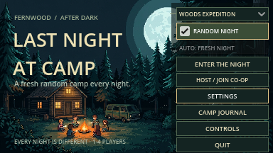 | 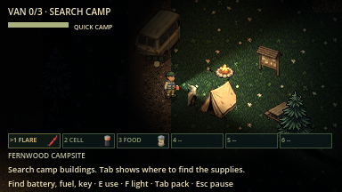 |

| Something in the woods | The Signal Fire finale |
| --- | --- |
| 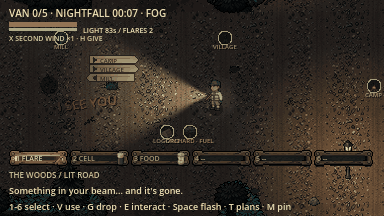 | 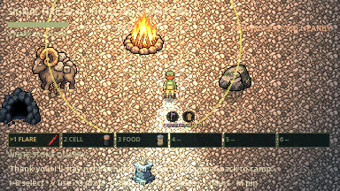 |

## Contents

- [What kind of game is this?](#what-kind-of-game-is-this)
- [See it in action (clips)](#see-it-in-action)
- [Quick start: install and play](#quick-start-install-and-play)
- [Your first night, step by step](#your-first-night-step-by-step)
- [Controls](#controls)
- [How to win (and lose)](#how-to-win-and-lose)
- [Tips for your first nights](#tips-for-your-first-nights)
- [Play with friends and proximity voice](#play-with-friends)
- Detailed guide: [modes](#choose-your-night) · [the night](#the-night-woods-expedition) ·
  [score and journal](#score-daily-night-and-the-camp-journal) · [killers and modifiers](#tonights-killer-and-night-modifiers) ·
  [escapes](#how-to-escape) · [survivors](#survivors-and-their-abilities) · [items](#items) ·
  [creatures](#survive-the-woods) · [the world](#the-world-and-finding-your-way) · [sound](#sound-and-volume) ·
  [forest sites](#use-the-forest-sites) · [replay](#replay-the-expedition)
- [Screenshots](#screenshots) · [Art](#art) · [Development and testing](#development-and-verification)

## What kind of game is this?

- **Co-op survival horror.** Play alone or with up to three friends over your
  home network or the internet. Everyone sees the same world; downed friends can
  be revived; one team escape saves everyone still alive.
- **Two modes.** *Quick Camp* is a short round inside the camp: find a battery,
  fuel and key, fix the van, leave. *Woods Expedition* is the main game: a long
  night across a huge forest around the camp.
- **A night that builds.** The night starts calm and gets more dangerous as you
  make progress (Dusk → Nightfall → Deep Night → Witching Hour). There is no
  timer to beat; the danger keeps rising until you escape.
- **Something different every night.** Each night is generated from a seed: the
  camp layout, where the parts are, which escape is rumoured to work, which
  creatures roam the woods, weather, events and modifiers such as Blood Moon.
  **The Stalker** hunts you every night.
- **Fear you can fight.** You cannot kill anything. You can run, hide in lockers
  and bushes, slam doors, throw flares, flash creatures with your light, set
  traps of noise, and use your survivor's special ability.

## See it in action

Short clips recorded from the real game in real time (`tools/capture_clips.gd`,
built into GIFs by `tools/build_clips.py`). The night is brightened a little so
you can follow the action; real nights are darker.

| He's right behind you | The stalker carries you off |
| --- | --- |
| 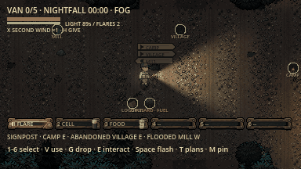 | 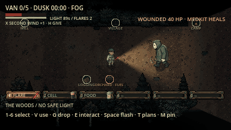 |
| From Nightfall he **shadows** one survivor just outside their light and scrawls on the ground behind them. The writing only shows up when your light finds it; turn around and he melts into the dark. | Wounded, he doesn't hit you: he **throws you over his shoulder** and heads for his hook. Mash **E** (the bar drains if you stop, and he jolts you); tear free and you hit the ground, dropping what you held. |

### New creatures (18 October)

| The Groundskeeper's mower | The Cuckoo |
| --- | --- |
| 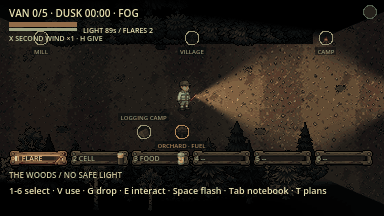 | 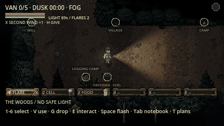 |
| You always hear the engine, and his headlight is all he sees. On open trail he's faster than your sprint and **runs you over**; he turns wide, so sidestep late or cut through trees. Lose him and he parks to search on foot with a rake. That's your chance to pull the spark plug. | It calls **CUCKOO** three times while you're in its sight. Still there on the third and time lurches back: you're where you were **8 seconds ago**. Break line of sight, or flash it. |

| The Banshee | The Slug |
| --- | --- |
| 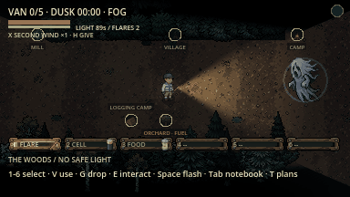 | 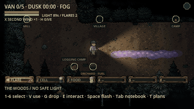 |
| A ring swells while she draws breath. Still inside when she screams and you're **deafened for 25 s**: the whole game goes muffled, so no whistle and no heartbeat warning. | Its slime trail makes you **skate**: slow to get going, impossible to stop or turn sharply. A salt ward makes it shrivel and dissolves the slime. |

| The Surveyor | The Hitchhiker |
| --- | --- |
| 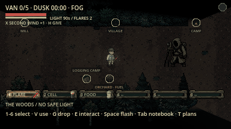 | 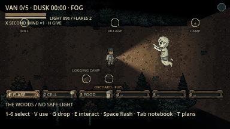 |
| One touch and you're **LOST**: the map is scribble, signposts and skyline mean nothing, your location reads "???". Stand beside a teammate for 3 s, or find a ranger note. | It climbs on your back: slower, no sprint, and it keeps **switching your flashlight off**. Walk into a teammate to pass it on (**TAG!**). |

| The Tollkeeper | The Echo |
| --- | --- |
| 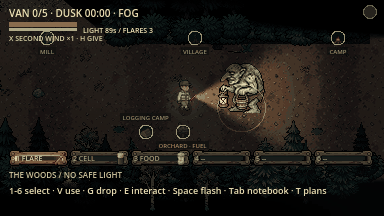 | 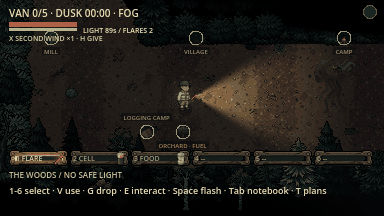 |
| He blocks the trail. Walk past unpaid and he **shoves you back**; **E** drops one supply in his bucket and he waves you through for a minute. | It whistles **the stalker's camp song** from the wrong place, so you hear "him" where he isn't (notes rise from it while it does). Get your light on it up close and it bursts. |

| The Fortune Teller |
| --- |
| 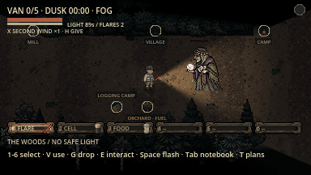 |
| She reaches you and **turns a tarot card**: The Sun, The Star and Strength help; The Tower, The Moon, The Fool and Death hurt. Here it's **The Fool**: the belt spills. Walk away to decline. |

### The rest of the woods

| The Mimic | The Toadstool Imps |
| --- | --- |
|  | 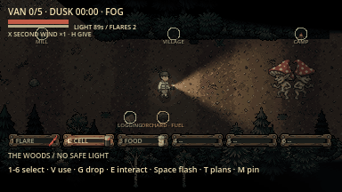 |
| "Sam" waves and calls you over. Real teammates carry a flashlight and show on the map. With voice chat on, it even speaks with your teammate's voice. | They tie your laces, you trip, and they run off with whatever you were holding, then tell you (roughly) where they hid it. A flash poofs them. |

| The Night Owl | The Witch's frog curse |
| --- | --- |
| 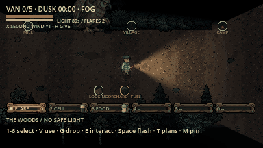 | 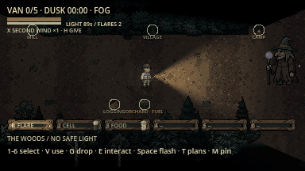 |
| Wander alone and its shadow grows under you: it snatches you and drops you far away. Stay within 150 px of a teammate, or throw a flare. | Her bolt curses you: frog (no carrying parts, no items), backwards controls, swapping places with a teammate, or floating. A salt ward bounces it back. |

| Sneaking up on Bigfoot | Bear Hug |
| --- | --- |
| 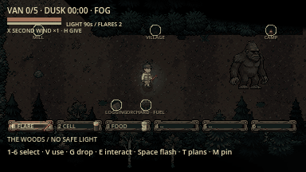 | 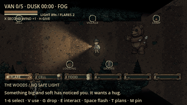 |
| Bigfoot is shy. Startle it in the dark and it throws you; light it up from far away and it bolts, dropping fur worth score. | Once it has seen you it never stops following. Caught, you're squeezed until you mash **E** free or a teammate flashes it. |

| The moon comes out | A moth on your face |
| --- | --- |
|  | 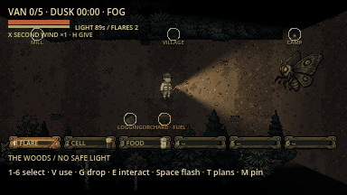 |
| The lost hiker is harmless... until the moon breaks through (watch the moon dial, top right). Then hide, throw wolfsbane, or a flare. | It flies to your light and settles over your eyes, drinking your battery. **Space** swats it off. |

| A storm rolls in | Slam the door... until it breaks |
| --- | --- |
| 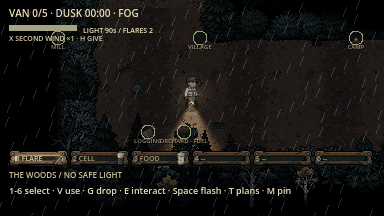 | 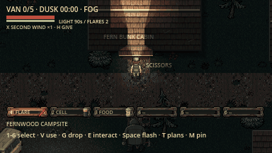 |
| Lightning lights up the trees and thunder masks your footsteps: creatures hear you 40% less far. | **E** slams a cabin door behind you. It buys a few seconds, then he breaks through (from Deep Night on, when camp is open). |

| Starting the van |
| --- |
| 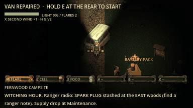 |
| Hold **E** at the rear. The engine roars, the headlights come on, and everyone has 20 seconds to climb aboard. |

## Quick start: install and play

You need two things: the free **Godot 4.7.2** engine and this project's files.

1. **Install Godot 4.7.2 (standard version, not .NET).** Download it from
   [godotengine.org/download](https://godotengine.org/download/archive/4.7.2-stable/).
   - **Mac:** open the downloaded `.zip`, drag **Godot.app** into Applications.
     The first time, right-click it and choose **Open** if macOS warns you.
   - **Windows:** unzip it anywhere and run the `Godot_v4.7.2...exe` file.
   - **Linux:** unzip it and run the executable.
2. **Get the game files.** Either click the green **Code** button on GitHub and
   choose **Download ZIP** (then unzip it), or use git:

   ```sh
   git clone https://github.com/ChrisTech44/darkwoods.git
   ```

3. **Open it in Godot.** Start Godot. In the Project Manager click **Import**,
   pick the `project.godot` file inside the game folder, and confirm. **Let the
   editor finish importing** (a progress bar, about a minute) before playing.
   This first import is required: it builds Godot's hidden `.godot` folder,
   which is not included in the download.
4. **Play.** Press **F5** (or the ▶ button at the top right of the editor).
   The title screen opens in its own window.

**Even easier on Windows:** double-click **`Play (Windows).bat`** in the game
folder. It finds Godot (put the Godot `.exe` in the game folder, your Downloads
or your Desktop, or set `GODOT_BIN`), imports the project on the first run, and
starts the game. On any system, `python3 tools/run_game.py` does the same
(on Windows: `py -3 tools\run_game.py`). Both check and repair the import on
every launch.

### Troubleshooting

- **A wall of errors like `Identifier "CampProfile" not declared`,
  `Could not find type "CampPlayer"`, or `Unable to open file:
  res://.godot/imported/....ctex` / `....mp3str`:** the project was run before
  Godot finished importing it (for example, the editor was closed mid-import).
  Use `Play (Windows).bat` or `python3 tools/run_game.py`: they run Godot's
  import before every launch (about 2 seconds once up to date) and fill in
  anything missing. Or open it in the Godot editor and wait for the import to finish.
  From a terminal: `godot --headless --path <game folder> --import`, then run.
- **The import crashes (`Program crashed with signal 8`, `FATAL: Index p_index
  = 1 is out of bounds`) and hundreds of assets stay missing:** fixed on
  17 October 2026. The voice library crashed Godot's editor (which runs the import)
  on Linux and Windows. `git pull`, then use the launcher: it removes the
  crashing entry from `.godot/extension_list.cfg`, which an older copy may still
  list. If you open the editor yourself after updating, delete that file first.
- **Still broken after updating with git pull?** Run the launcher with
  `--reimport` (or delete the `.godot` folder) to rebuild Godot's cache.
- **Voice chat silent:** see [Play with friends](#play-with-friends); turn MIC on,
  restart once, allow the microphone, and wear headphones.

Prefer the terminal? `python3 tools/run_game.py` launches the game directly
(it finds Godot on your PATH, including the Ubuntu Snap `godot-4`, or in
Applications; set `GODOT_BIN` to point at it otherwise; `--editor` opens the
editor). Python is optional. More detail:
[setup and testing](docs/testing.md).

## Your first night, step by step

1. **Pick a night.** On the title screen choose **WOODS EXPEDITION** (the full
   game) or **QUICK CAMP** (a 5–10 minute taste), then **ENTER THE NIGHT**.
   *Daily Night* gives everyone the same night today.
2. **Pick a survivor.** Choose Christian, John, Max or Alex; each has a
   different passive, X ability and drawback. John rewards objective preparation. Then **START NIGHT**.

   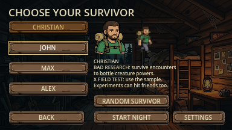

3. **Read the opening message.** It names where the fuel is, which second
   escape is rumoured to work tonight, tonight's killer and any modifiers.
4. **Search the camp.** Walk into the cabins (roofs fade away inside). Stand on
   an item and press **E** to take it. The **battery** and **key** are in camp;
   grab the **boltcutters** from Maintenance (they open locked caches) and any
   flares, batteries and food you see.

   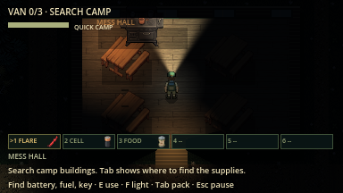

5. **Open your notebook (Tab).** The **map** shows where you are, your next
   step, teammates and every part you know about, where it actually lies now;
   **Z** switches between the area around you and the whole woods. Press Tab
   again for the **escape plan** (**T** flips between tonight's routes), the
   **field guide** and a **log** of everything announced so far. **Esc** closes it.

   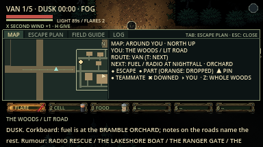

6. **Head into the woods.** Leave camp by one of its four exits. Your
   **flashlight (F)** drains in the woods; **R** swaps in a spare battery.
   Follow the lit ring road and the **signposts** at junctions, which always
   point toward camp and nearby regions.

   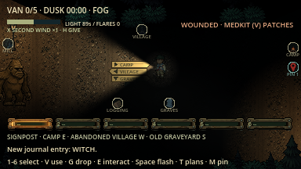

7. **Find the locked caches.** The fuel and two extra parts sit in locked
   caches in three different regions. Ranger notes on the roads and walking into
   a region tell you which one. Open a cache with **E** while carrying
   boltcutters (a crowbar works, but loudly).
8. **When something finds you:** sprint (**Shift**), throw a **flare (Q)**,
   **flash (Space)** it with your light, slam a cabin door, or hide (**E** at a
   locker, bed or bush) and hold still. Each hit takes **health** (the red bar
   under the title); at zero you're downed. If the stalker catches you
   **wounded**, he carries you off to his hook: mash **E**! A **medkit (V)** heals 50. Until Deep
   Night the camp is a refuge: nothing follows you past the lanterns at the
   trail mouths.
9. **Fix your escape.** Bring each part back and press **E** at the rear of the
   van. Installing parts deepens the night, so the radio reveals the next part
   and the woods get angrier.
10. **Get out.** Hold **E** at the van's rear to start it. The engine roars and
    everything comes for you: everyone has **20 seconds** to press **E** beside
    the van and climb in. (Or use tonight's rumoured escape: radio, boat, gate
    or signal fire.)

    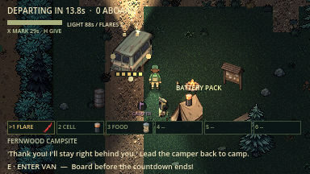

11. **See your score.** The results show your grade, awards and any new badges.
    New creatures you met are added to the **Camp Journal** on the title screen.

    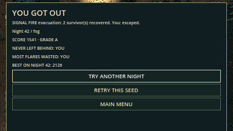

## Controls

| Key | Action |
| --- | --- |
| **WASD / arrow keys** | Walk and face a direction |
| **Shift** | Sprint while stamina lasts; sprinting makes noise |
| **E** | Take items, open caches with cutters or a crowbar, install parts, enter a running van, hide/leave a hiding spot, slam/open doors, knock over woodpiles and deadfall |
| **Hold E** | Climb/transmit at the relay (6s), start the repaired van, revive a nearby downed teammate, or (solo, downed) get back up once |
| **Mash E** | Wriggle free when something holds you; beside a held teammate, pull them loose |
| **Space** | Flash-stun creatures close in your beam (costs light, 8 s cooldown); swats a moth off your face |
| **F** | Toggle the flashlight |
| **1–6 / keypad 1–6** | Select a belt slot |
| **V / G** | Use held supply / drop its stack |
| **Q** | Throw a flare |
| **R** | Use a spare flashlight battery |
| **C** | Eat rations to restore stamina |
| **M** | Drop a team map pin where you stand (newest three kept) |
| **B** (hold) | Push to talk, when voice is set to push-to-talk in co-op |
| **X** | Use your survivor's ability |
| **H** | Hand the held supply to an adjacent teammate |
| **Tab** | Notebook: Map → Escape Plan → Field Guide → Log → close (**Shift+Tab** goes back, **Esc** closes, the mouse can click tabs) |
| **Z** | In the notebook: map around you / whole woods; next field-guide topic |
| **Esc** | Solo: pause/resume. Co-op: local menu; the shared world continues. |

**T** opens the escape plan, and with the notebook open cycles tonight's escape
plans (the van and the rumoured escape). The map then marks that route's goal.
The world keeps running while the notebook is open (offline too; use Esc to pause).

### Finding your way

Walk up to a camp building and its name appears on the plaque beside the door
(when you can see the door); step inside and a short title names the place.
Entering a woods region or leaving camp does the same. Signposts, the map and
the skyline use the same short names, each taken from the place's full name
(e.g. OBSERVATORY for the Starless Observatory). The camp's own boathouse is
the **Camp Boathouse**; the one in the woods is the **Lakeshore** boathouse.

### Moon dial and ranger radio

The **moon dial** (top right) is dark until Nightfall, then waxes toward full
as the clouds thin: a fuller moon means the moon is about to break through. When
it is out the dial glows, with a ring that runs down until the clouds return;
werewolves change while it is out. On a **Blood Moon** night the dial is red.

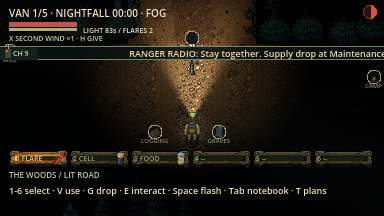

At each new phase a short title (NIGHTFALL, DEEP NIGHT...) appears, and the
**ranger radio**'s message crawls across a strip under the top bar while the
static and chatter play, so you can read what was said. It is also kept in
the notebook's Log.

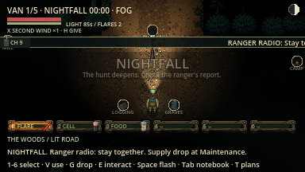

## How to win (and lose)

- **Win:** any escape that finishes with a living survivor aboard or in its
  rescue circle. Downed teammates are carried out with you; anyone else still
  standing outside is left behind.
- **Lose:** everyone is downed with no one left to revive them (solo players get
  one 20-second chance to drag themselves back up).
- There is **no time limit**. Waiting is not safe, though: pressure keeps
  rising until it reaches a fixed ceiling, including in the Witching Hour.

## Tips for your first nights

- **Keep your light alive.** Pick up every battery. Turn the flashlight off
  (F) when a lantern moth or lens eater is near; they hunt light.
- **Sound gives you away.** Sprinting, crowbars, dropped items and the
  generator are loud. Walk once you have broken line of sight.
- **Listen to your heart.** A slow heartbeat means something is close; a fast one
  means it has seen you. Creature calls carry well off-screen, footsteps get
  heavier as big things get close, and a flicker of your flashlight means
  something is being sent your way.
- **Flares scare teeth, not wings.** Hounds, wolves and the stalker hate flares;
  moths are drawn to light.
- **Hide early, not late.** Something that *sees* you hide will drag you out.
- **Use the roads.** The lit ring road is faster and safer than the maze,
  until a blackout turns its lamps off.
- **Mark things.** Press M to pin a spot for your team. Pins are shared;
  Christian's experiments can affect teammates too.

## Play with friends

Open **Host / Join Co-op**, choose your name/survivor, and **Host** or enter the
host address and **Join**. Your name, the address and the port are remembered
for the next night and the next launch. Default port: **UDP 27840**. Everyone marks **Ready**;
the host chooses mode/seed and starts. LAN/Wi-Fi uses the host's local IP;
Internet needs a reachable public UDP port or an existing virtual LAN/VPN.

Update clients and server together to **lnac-net-30**. Your survivor now responds
locally, with server corrections smoothed; other survivors use a short movement
buffer. A long connection interruption can still pause movement. See
[measured smoothness improvements](docs/evidence/smoothness/README.md).

**[Connection setup, co-op rules and screenshots](docs/multiplayer_guide.md)**
explains routing, joining, revives, shared escape and replay. New joins are
lobby-only; disconnected players can recover their existing survivor for five
minutes. All carried gear drops immediately and never duplicates on return.
**Esc opens a local menu without pausing the shared world.**

**Proximity voice** (optional, off by default): in **Settings** or the Esc menu,
set **MIC** to *Push to talk (B)* or *Open mic*, then **restart the game once**.
The microphone (and macOS's one-time permission prompt) is only started for
players who turn voice on. In the lobby everyone hears everyone: a mic meter
beside the title shows your own level (and the open-mic threshold), and a
speaker meter lights beside each player in the roster while they talk. In a
round you hear teammates near you (up to about 560 px, fading gently), slightly
from their direction, softened (not smothered) by walls and tree lines, and
silent beyond range. Every voice is levelled, so a quiet microphone is lifted to
match a loud one, and music and ambience dip while a teammate is talking.
Escaped, dead and left-behind players talk on a ghost channel the living cannot
hear. Monsters never hear voice. The HUD shows who is talking. **VOICE** and
**MIC GAIN** sliders set loudness; if friends say you're quiet, raise MIC GAIN.

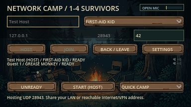

## Choose your night

| Mode | Repair objective | Threats and exploration |
| --- | --- | --- |
| **Quick Camp** | Battery in the Fern bunk cabin, fuel in Maintenance, key in the Ranger Lodge. | The camp stalker and a shorter three-part objective with randomized camp buildings. Flashlight charge does not drain. |
| **Woods Expedition** (a long night at your own pace) | Battery and key in camp location pools; fuel and two extra parts in themed-area caches, revealed by ranger radio as the night deepens. | A night that deepens as you make progress: the stalker plus 27 creatures of 21 kinds, each with its own trick (camp is safe until Deep Night), a seeded trail maze, survival supplies, weather, storms, blackouts and a draining flashlight. |

Expedition extra parts are drawn from **belt, fuse, tire, and spark plug**.
The pack lists the current requirements and location clues. The woods contains nine major regions.
Each night three of them (one each in three different directions) hold the
locked caches; the White Stone Quarry never does. Six smaller ruined landmarks
also remain along the trails.

## The night (Woods Expedition)

An expedition has **no fixed clock to beat and no deadline**. The night moves
through four phases as **your team makes progress**: installing van parts, or
completing steps of the radio, boat or gate escapes. A team that stalls still
slides from Dusk to Nightfall to Deep Night after about 12 quiet minutes per
phase, but only real progress brings the Witching Hour. The heading shows the
phase and how long you have been out.

| Phase | Arrives when | What happens |
| --- | --- | --- |
| **Dusk** | Start | Battery and key are in camp. Grab tools and supplies, plan routes. The woods are at their calmest. |
| **Nightfall** | One step secured (e.g. first van part), or 12 quiet minutes | Ranger radio reveals the **fuel** cache. First storm of the night. |
| **Deep Night** | Half an escape ready (e.g. third van part), or 12 more quiet minutes | Radio reveals the **first extra part**. The stalker hears farther. A blackout hits camp. |
| **Witching Hour** | An escape nearly or fully ready (e.g. fourth van part) | Radio reveals the **last extra part**. The stalker chases faster, and pressure reaches a fixed ceiling even if you delay leaving. |

- **Where the parts are changes every night.** The three locked caches (fuel and
  the two extra parts) go to three different regions in three different
  directions from camp, drawn from eight regions: village, observatory (north),
  bog, rail yard (east), graveyard, chapel (south), mill, orchard (west).
- **Follow the clues.**
  - The camp corkboard names the fuel's region (shown in the Dusk message and
    on Tab).
  - For the other parts you start with only a direction, e.g. `FUSE / NORTH
    WOODS? FIND A NOTE`.
  - **Ranger notes** lie on the roads heading toward each part's region (two per
    part). Pick one up with E to name the region for the whole team.
  - Walking into a part's region also names it. Once its cache has been revealed
    by radio, it's marked on your map `(CACHE MAPPED)`.
  - Skyline markers show which part waits in a region you know about, e.g.
    `OBSERVATORY · FUSE`.
- **Parts arrive by radio.** Tab lists every required part; unrevealed ones show
  which phase the radio will announce them in, e.g. `FUEL / RADIO AT NIGHTFALL ·
  ORCHARD`. Each installed part deepens the night and unlocks the next one, so the
  whole chain unfolds at your pace.
- **Supply drops.** Each new phase leaves 2 flashlight batteries, a flare and a
  ration at the Maintenance stash.
- **The woods get hungrier.** Pressure ("dread") rises the longer you linger in a phase, with loud noises
  and every installed part. Higher dread sends roaming creatures toward your
  general area more often, never to your exact spot and never into camp. After
  a chase you get at least 45 seconds of calm. Music swells with dread, and a
  distant howl marks each new phase.
- **Storms** (90s): thunder masks noise (creatures hear 40% less far) and
  lightning briefly lights the trees. Walls still block what you can see.
- **Blackouts:** camp lamps die until someone restarts the generator by the
  Maintenance door (**E**, loud). The campfire keeps burning.
- **No dawn rescue.** The only way out is an escape you build yourselves; the
  Witching Hour never ends on its own.
- **Story events** (two per night, in seeded phases):
  - **The Hunt Begins:** a horn sounds; for a minute every roaming creature
    converges on the last loud noise made near camp. Go quiet.
  - **The Stalker's Gift:** a crate tied with a bow appears in a named region
    (pinned GIFT). It holds two flares, a battery and a medkit, but the bell on
    the lid calls the killer from anywhere.
  - **Lost Camper:** a counselor calls from a region (pinned CAMPER). The first
    survivor to reach them is followed home; they freeze in panic if something
    chases nearby. Getting them into camp earns a medkit and +250 score.
- **Build-ups:** before the woods send something your way you hear a distant
  call from its direction and your flashlight stutters for a moment.

Quick Camp stays a short mode with no night clock.

## Score, Daily Night and the Camp Journal

Every Woods Expedition night ends with a **score and grade** (S ≥ 1800, A ≥ 1400,
B ≥ 1000, C ≥ 600, otherwise D): escape +1000, using the rumoured escape +200,
landmark relics +150 each, ranger notes +25, rescues and patches +100, creatures
sighted +10 each, then ×1.15 per night modifier. Your best score per seed is kept.

Pick **DAILY NIGHT** in the mode list to play the same seeded expedition as
everyone else today (the seed is the date, e.g. Night 20261017).

**CAMP JOURNAL** on the main menu shows your nights and escapes, a **bestiary**
(each creature's survival tip unlocks the first time you see it) and **merit
badges** such as First Light, Route Master, Pyromaniac, Lake Legend, Mower
Mechanic (pull the Groundskeeper's spark plug, then escape), Red Sky, Daily Dose, Field Guide, Top Marks and Team Player. New badges
appear on the results screen. Progress is saved locally on each player's machine.

## Tonight's killer and night modifiers

Every night **the Stalker** is the killer, joined by **0–2 modifiers** chosen by
the seed and announced in the Dusk message and the notebook.

- **The Stalker** is the reason this game exists: the camp's old counselor in a
  canvas mask, and nothing else in the woods behaves like him.
  - **The camp song.** He whistles *Row, Row, Row Your Boat*. The direction and
    volume tell you where he is; it comes faster when he's hunting.
  - **Shadowing.** From Nightfall he picks a **favourite** survivor and follows
    them through the woods. He closes distant gaps at 88 px/s, faster than normal
    walking but slower than sprinting. His lunge timer only advances within
    **260 px with clear sight**; distance and intervening walls pause it. Nearby,
    he follows about **130 px behind** at 78 px/s. Catch him in your beam and he
    melts into the dark, only to turn up behind you later. After **90–130 s**
    of nearby shadowing, he lunges. Ordinary distant sightings during a search
    return him to stalking; deliberate noise investigations and point-blank
    encounters can start a chase. A chase lasts at most **12 s** before a
    three-second recovery and another stalking interval. Quick Camp has no shadowing.
  - **The grab and the hook.** He doesn't hit a wounded survivor (50 health or
    less): he **throws them over his shoulder** and walks them to **his hook**,
    a post in his lair in the woods. His grip is hard to break: your struggle
    drains when you stop mashing, every few seconds he **hitches you up on his
    shoulder** (the view jolts and you lose a chunk of progress), and each time
    he grabs you it takes more presses, capped at **18**. Tear free and you **hit the ground and
    drop what you were holding**. A teammate's flash, a flare or the **air horn**
    makes him drop you cleanly. Reach the hook and you're downed there,
    **pinned on everyone's map**: a rescue run.
  - **He remembers.** Use a hiding spot twice and he checks it, and drags you out.
  - **Bear traps** on the trails you walk most: a loud snap, 15 damage and 4 s
    stuck. They glint in your light; **E** disarms one; a teammate frees you.
  - **Calling cards.** When he creeps up close behind you, he scrawls your name,
    "I SEE YOU" or "RUN" on the ground. The writing only shows up when your
    light falls on it.
  - **Rage.** Every escape from him (a broken grab, a stun, a hiding spot in
    mid-chase) builds rage; at three he **frenzies** for **12 s**: faster, glowing
    red, bursting doors instantly, screaming instead of whistling. He then needs
    **40 s** before building rage again. His final speed is capped at **90 px/s**,
    including Blood Moon and phase bonuses (normal sprint is 110; wounded is 99).
  - **Escalation.** In Deep Night his search memory lasts 50% longer and
    **once** he may sabotage the van (VAN ALARM, the part pinned on your map); in
    the Witching Hour he runs faster and **once** cuts the generator.
- **The Groundskeeper** is no longer an alternative killer: he now roams the
  woods on his ride-on mower (see [the creature table](#know-what-is-following-you)).

| Modifier | Effect |
| --- | --- |
| **Blood Moon** | The moon comes out twice as often; the killer runs 8% faster. All creature types remain present. |
| **Dead Batteries** | Spare batteries restore 40 charge instead of 70. |
| **Fog Bank** | The night is foggy: shorter sight for everyone. |
| **Silent Night** | No music; creatures hear 15% farther. |
| **Generous Woods** | 48 extra supply caches in the woods. |
| **Lone Wolf** | Every survivor starts at a different camp building door. |

## How to escape

**Each Woods Expedition night offers two ways out: the camp van, plus one
rumoured escape** (Radio Rescue, the Boat, the Ranger Gate or the Signal Fire),
chosen by the night's seed. The Dusk message names the rumour, and **T** cycles
through tonight's plans only; parts for other escapes do not appear. Permanent
machinery, buildings, the boat hull and the unlit pyre remain scenery on other
nights; their escape actions are unavailable. The ranger barrier stays raised
when that route is inactive. Whichever escape finishes first ends the round.

1. **Prepare in camp.** Check **Tab** for component clues. In Woods Expedition,
   find reusable **boltcutters** (Maintenance, or a second pair in a woods
   toolbox) or the noisy **crowbar** (a bunk cabin) before opening locked caches.
   Building doors face south.
2. **Search and collect.** Stand close to an item and press **E**. Walls block
   interaction. In the woods, explore to reveal trails on your field map; it does
   not show the entire maze or undiscovered cache positions.
3. **Repair the van.** Return to its rear and press **E** to install carried
   components. You can make several trips; all required parts must be installed.
4. **Hold E for two seconds** at the rear to start the repaired van. Letting go
   or moving out of range resets the start hold.
5. **Stay aboard.** Starting automatically seats the driver. In Quick Camp the
   van departs after **eight seconds**. On an expedition the engine roar is a
   finale: departure takes **20 seconds**, the engine revs every 5 seconds, and
   every creature in earshot (and the stalker, from anywhere) comes for the van.
   Passengers are safe inside; everyone else must get aboard in time.

Living survivors board with **E beside the running van**; standing nearby does
not count. Downed survivors are rescued automatically when at least one passenger
escapes, even if they have not been revived. The automated network tests
use host-only placements for isolated authority checks; human co-op balance is
still unrecorded.

A round is won when at least one living passenger escapes, a standing survivor
is rescued from the radio landing circle, boat dock, ranger bridge or signal
fire ring. The results report your own outcome too; living
survivors left outside are left behind.

### Radio Rescue (Woods Expedition)

An alternate escape now crosses the **Flooded Mill → north Power Substation →
east Radio Relay Station → landing zone south of the Drowned Chapel**. The van
remains available; the first extraction to finish ends the round.

1. Collect the **emergency fuse** beside the mill's central reward area. It uses
   no belt slot and drops with your gear if you are downed or disconnect.
2. Press **E** at the substation cabinet to restore its dedicated rescue circuit.
   Camp blackouts do not undo this repair.
3. At the east relay's ladder, **hold E for six seconds** to climb and transmit.
   The channel opens as soon as the relay has power.
   Moving away, releasing E, getting downed or changing operators resets the hold.
4. Load one **flare** into each of the three marked holders by pressing **E**.
   Three additional flares are stashed beside the chapel landing circle. Signals
   stay lit; throwing an ordinary flare with Q does **not** count as a signal.
   You can prepare the signals before transmitting.
5. Gather the team, then press **E at the circle's centre** to start the
   **40-second holdout**. The countdown does not wait for stragglers. Signal
   noise draws nearby monsters through their normal hearing; resident guardians
   keep their existing territory limits.
6. Be **standing inside the 96 px landing circle** when rescue arrives. A successful
   rescue also recovers connected downed teammates anywhere. Standing survivors
   outside the circle, hidden survivors and van passengers are left behind by
   radio rescue. If nobody standing reaches the circle, the round is lost.

Press **T** to cycle tonight's plans (the van and that night's rumoured
escape) in the notebook; **Esc** closes it. Quick Camp keeps its van-only escape.

| North Power Substation | East Radio Relay Station |
| --- | --- |
| 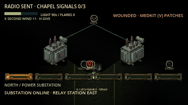 | 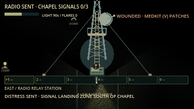 |

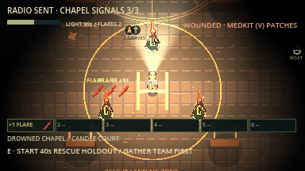

### Signal Fire (Woods Expedition)

On Signal Fire nights, **T** names three regions (one each to the north, east and
south) holding **two kerosene cans and a flare gun**. They use no belt slot. Carry
them to the **signal pyre on the White Stone Quarry rim** and press **E** to fit
them, then **E** again to light it. The blaze starts a **45-second hold-out**: it
lights up the quarry and beacons every creature in the woods toward the fire,
pulsing every 6 seconds. Standing survivors inside the **fire ring (110 px)** when
the rescue plane passes are recovered, along with any downed teammates.

### Boat and Ranger Gate (Woods Expedition)

**Boat:** carry the **outboard motor** from the west Logging Camp, **marine fuel**
from the east Rail Yard, and the **drain plug** from the north Observatory to the
southeast Lakeshore Boathouse. E fits them. The motor uses no belt slot, slows its
carrier to **75% walking speed**, and prevents sprinting/vaulting. **G** sets it
down immediately. A standing teammate can **hold E within 48 px** to help: both
walk at normal speed without sprinting while assisting.

Bring all three parts to the **BOAT REPAIR pad on the Lakeshore dock**,
southeast of camp. This is separate from the Camp Boathouse. Stand on the pad
and press E to fit the parts you carry; MOTOR / FUEL / PLUG each show OK when
fitted. The notebook names the carrier and directs them to the dock.

Once all three parts are fitted, E again at the pad starts a **25-second launch**. Stay on the
wooden dock within **80 px** of the boat point. The **Lake Thing** marks three
fixed dock positions with glowing ripple circles, each warning for **2 seconds**
before striking. Step outside a circle or throw a flare within 100 px with clear
sight to interrupt that attack. Signals at the chapel do not repel the Lake Thing.

**Ranger Gate:** the T plan names three regions holding tonight's distinct
**gate-code fragments**. Carry them to the gate on the north road and E to fit
them. Restore the same north substation circuit used by Radio Rescue, then E at
**the gate's left breaker** to turn on the road floodlights. The alarm draws the
stalker toward the gate through normal travel; nearby roamers can hear it too.
Once the gate is powered and coded, **hold E for four seconds** at the gate, then run north along the
lit road to the bridge. The first standing survivor at the bridge starts an
**eight-second team evacuation window**. Everyone standing must reach the bridge's
**64 px circle** before it closes.

Both routes recover connected downed teammates when at least one standing,
unhidden survivor escapes. Standing players outside the extraction area and van
passengers are left behind by these routes. The first escape to finish ends the
round. Quick Camp keeps its original van-only rules.

| Lakeshore boat launch | Ranger checkpoint |
| --- | --- |
| 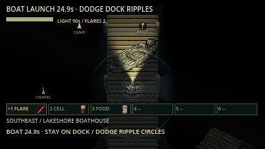 | 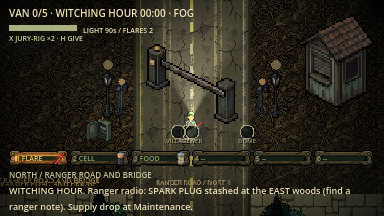 |

[Full Boat/Gate walkthrough, graphics and verification limits](docs/boat_gate.md).

## Survivors and their abilities

Choose **Christian, John, Max or Alex** before starting. The four friends replace
the old six archetypes. Selection and lobby remember the choice; Random Survivor
chooses among these four. Dedicated camper sprites and portraits follow the
requested hair, facial hair, glasses and clothing, with backpacks, rolled mats
and hiking boots. These are stylized designs from descriptions.
[Artwork and credit record](docs/evidence/camper_art/README.md).

| Survivor | Passive | X ability | Drawback |
| --- | --- | --- | --- |
| **Christian** | Survive a real creature signature to collect one sample | **Field Test:** reproduce its signature; some samples transform you. X again performs a form's secondary action | Friends can be affected. Full slots keep their sample; Werewolf needs the actual full moon |
| **John** | Completing a new preparation step on any escape refills stamina | **Push Through:** halve accepted damage and defer the reduced bill for 6s, 45s cooldown | Reduced debt lands afterward. Grabs end the burst; healing waits. Lethal debt cannot be escaped by boarding |
| **Max** | Trust your luck | **What Could Go Wrong?** X spins a wheel every 60s | Discover the named results yourself |
| **Alex** | After 4s isolated from living teammates, light uses 25% less charge and stamina recovers 35% faster | **My Own Way Back:** X places a 75s marker; X again while alone channels a 2s return, then 40s cooldown | Hits interrupt; holds/downing prevent return. Blocked landing or expiry can ruin the plan |

Everyone has the same basic stats and starting supplies. Objective parts, tools,
revives and all five escape routes stay available to every character. John earns
preparation credit once per real step, not by collecting or reinstalling items.
Max's wheel replaces his money and purchase system. Alex's return moves his
current body and gear; it never rewinds injuries or spent resources.

Christian has variants for all 30 creature-brain species. For example, a Werewolf
sample produces a moon-dependent wolf form/pounce, and a Paparazzo sample winds
up a flashbang: turn away or take cover. Exposed friends can be blinded and
photographed for the Stalker; Christian suffers his own brief whiteout. Other
samples include curses, spores, thread, disguises, slime and sensory effects.
No creature-selection menu is needed: the sample beside X determines the next
experiment. The Stalker and Lake Thing special samples remain separate design
proposals, outside the normal pool. Quick Camp starts Christian with one
Paparazzo sample; Max's wheel works in both modes.

Isolation enters beyond 190px, exits within 150px, and ignores downed/escaped
teammates as proximity anchors. Multiple copies of a character remain allowed.
Old role saves return to the four-character selection; camper artwork follows
the requested descriptions. See the [overhaul and detailed rules](docs/four_survivor_overhaul.md).

Max's wheel appears briefly beside him, with a pointer and weighted slices.
Results show names only. He can move while it spins; interruption does not
refund the cooldown. The old permanent help paragraph and cash economy are gone.

Christian's five ranged copy families launch distinct travelling shots; faint
paths/cones/area guides show how his equipped sample applies. Transformations
show a timer and special-action status. Mimic copies the appearance and overhead
name of a living player actually present; solo use keeps the sample. Copied
Cuckoo calls/rewind bells, Lullaby singing and mower engines use existing audio.
[All 30 interaction details and evidence](docs/ability_feedback_review.md).

**Disable camper powers:** main-menu Settings for offline play, or the listen-host
lobby switch. The host controls both passive and active powers for the whole
round; guests see the locked rule. Dedicated servers use
`python3 tools/run_server.py --no-camper-abilities`. Ordinary supplies, flashlight,
revives and objectives remain available.

**H** hands one of your held supply to a teammate standing right beside you.
Two survivors at the dead generator restart it quietly; alone it roars.
At the end of a night the results screen hands out **awards** such as *Never
Left Behind*, *Most Flares Wasted*, *Bait*, *Pack Mule* and *Show-Off*.

Your choice is remembered. **Random Survivor** reveals a role before confirmation;
it is independent of **Random Night**. All roles can collect every part and escape.

**1–6 or keypad 1–6** selects one of six belt slots. **V** uses the held supply;
**G** drops its whole stack; **E** picks it back up. Each supply type takes one
slot, with same-type items stacking. Slots show the key and name without trailing quantity numbers; Tab lists the main supply counts. Vehicle components and cutters are carried
separately. Q/R/C still use flares, batteries and food. Medkits help while holding
E to revive a teammate faster, and V heals 50 of your own health.

Find **noise tins** (three delayed distracting rattles), **salt wards** (4s of
physical-hit protection), and **glow moss** (+35 light charge and hex removal).
Six optional landmarks join the village, bog and graveyard: **Flooded Mill,
Bramble Orchard, Starless Observatory, Last-Car Rail Yard, White Stone Quarry,
and Drowned Chapel**. Each has multiple approaches, a one-time rare tool and a
territorial guardian. Required components still come from the original regions.

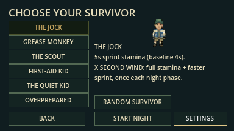

[Full content guide and inspection screenshots](docs/content_update.md) covers
hunter/guardian counterplay and the current prototype limits.

## Items

Press **E** near an item to collect it. Walls block collection. **Tab** shows the
current night's required parts and their location clues; exact building and
woods positions vary with the seed. In co-op, pickups and searchable stashes
are shared: taking one removes it for everyone.

### Vehicle parts and reusable tools

These go in your pack and **do not use belt slots**. Press **E at the van's rear**
to install carried required parts. Quick Camp needs battery, fuel and key.
Woods Expedition needs those three plus **two** parts chosen from drive belt,
fuse, tire and spark plug; check Tab to see which two your night requires.

| Item | Where to find it | What it does |
| --- | --- | --- |
| **Van battery** | Quick Camp: Fern Bunk Cabin. Woods: one of the Fern/Pine bunk cabins or Cedar Bunkhouse. | Required van component in both modes. This is different from a spare flashlight battery. |
| **Fuel** | Quick Camp: Maintenance. Woods: one of the three locked objective caches listed below. | Required van component in both modes. |
| **Key** | Quick Camp: Ranger Lodge. Woods: Ranger Lodge or First Aid. | Required van component in both modes. |
| **Drive belt** | Woods only, when selected as a required part: a locked objective cache. | One of four possible extra repair parts; install it at the van. |
| **Outboard motor** | Woods: west Logging Camp. | Heavy boat objective; no belt slot. Carry at 75% walk, no sprint/vault. G drops it; an adjacent teammate holding E restores full walking speed. E fits it at the boathouse. |
| **Marine fuel** | Woods: east Rail Yard. | Dedicated boat fuel, separate from van fuel. No belt slot; E fits it at the boathouse. |
| **Drain plug** | Woods: north Observatory. | Third boat component. No belt slot; E fits it at the boathouse. |
| **Gate-code fragments 1–3** | Woods: three seeded regions across east, south and west; T names them. | Separate objective inventory; drop on down/disconnect. E fits each once at the north Ranger Gate. |
| **Emergency fuse** | Woods only: Flooded Mill, beside its central reward area. | Repairs the north Power Substation for Radio Rescue. Separate objective inventory; no belt slot. Different from the van fuse. |
| **Fuse** | Woods only, when selected as a required part: a locked objective cache. | One of four possible extra repair parts; install it at the van. |
| **Tire** | Woods only, when selected as a required part: a locked objective cache. | One of four possible extra repair parts; install it at the van. |
| **Spark plug** | Woods only, when selected as a required part: a locked objective cache. | One of four possible extra repair parts; install it at the van. |
| **Boltcutters** | Woods only: Maintenance, plus a second pair in a woods toolbox 1,000–1,600 px from camp (Tab shows its compass bearing). | Reusable tool that opens locked caches quietly when you press E. Kept after use; it is not installed in the van. Each survivor can carry one pair, so the second is left for a teammate. |
| **Crowbar** | Woods only: the bunk cabin that does not hold the van battery. | Pries a locked cache open when you have no cutters, with a loud 500 px noise. Reusable; carried in the pack like cutters. |

The Woods objective caches are in **Village / Surveyor Hut**, **Witch's Bog /
Stash**, and **Old Graveyard / Cache**. Fuel and the two selected extra parts are
shuffled among these three caches. Optional landmark biomes are not required to
complete the van. Building lots move with the seed, so follow the named clues
rather than memorizing screen coordinates.

### Flashlight and survival supplies

Every survivor has a built-in **flashlight**; it is not a pickup or belt item.
A full charge lasts **7 minutes of ordinary woods use** (9m20s while Alex’s isolation bonus is active).
The HUD shows remaining beam time; flash bursts and light-eating creatures can
use charge sooner. Spare batteries still restore 70 charge out of 90.
Toggle it with **F**. It starts with **90 charge**, drains at one third charge/second
while lit in expedition woods (Alex alone: one quarter/second), and switches off at zero.
Camp use does not drain charge. Teammates see its light too.

**Woods loot** below means seeded supply pickups scattered through forest
clearings; the 96 scattered pickups include all seven supply types. **Landmark
reward** means a one-time search in Flooded Mill, Bramble Orchard, Broken
Observatory, Rail Yard, White Stone Quarry or Candle Chapel. Each landmark gives
one of noise tin, salt ward or glow moss; the reward depends on its seeded site.

| Supply | Where to find it | What it does / how to use it |
| --- | --- | --- |
| **Flare** | Start with 2; Woods loot; 3-flare Maintenance stash; 3-flare chapel rescue stash; Village well; Graveyard crypt. | **Q**, or select + **V**, throws it ahead. Lights the area for up to **9s** and repels enemies with clear sight nearby. **E at a rescue signal holder** instead spends one flare on a persistent signal light (no permanent repulsion). Lantern Moths follow it; Candle Grazers can consume it. |
| **Spare flashlight battery** | Start with 1; Woods loot; extra campsite battery; Village well. | **R**, or select + **V**, restores **70 charge**, capped at 90, and switches the light on. Not consumed if already full. |
| **Rations** | Start with 1; Woods loot; Village well. | **C**, or select + **V**, restores full stamina and clears exhaustion. Not consumed at full stamina. Eating can attract nearby Ration Moths. |
| **Medkit** | Woods loot; Max may duplicate an owned one. | Select + **V** heals 50 health (refused at full health). Carried while you **hold E beside a downed teammate**, it speeds the revive to 3s instead of 6s bare-handed, and is consumed on completion. Interrupted attempts keep it. |
| **Noise tin** | Woods loot; landmark reward. | Select + **V** places a lure ahead. It rattles at **1.5s, 3.5s and 5.5s**, drawing noise-sensitive enemies within 480 world pixels. Move away before they investigate. |
| **Salt ward** | Woods loot; landmark reward. | Select + **V** grants **4s of protection from physical hits**. Does not heal or remove hexes. |
| **Glow moss** | Woods loot; landmark reward. | Select + **V** restores **35 light charge**, capped at 90, and removes the current hex. Use F if your flashlight was switched off. |

The extra campsite battery, Maintenance flare stash, forest supply pickups and
searchable biome rewards are **Woods Expedition sources**. Quick Camp has its
three objective pickups and survivors' starting supplies; no ground medkits or
extra supply stashes spawn there. Max may duplicate an owned medkit with his wheel. Downed/disconnected
teammates drop their carried gear in either mode.

The **Village well** gives two flares, one spare battery and one ration; the
**Graveyard crypt** gives two flares. Both are one-time shared rewards and make
noise. The Bog cauldron is an environmental interaction, not a carried item:
press E once to refill your light, at the cost of a 2s hex and a loud noise.

### Carrying, selecting and sharing items

The belt holds **six different supply types**; matching units stack in the same
slot. Select with **1–6 or keypad 1–6**, use with **V** (a medkit heals 50 health), and
press **G** to drop the selected supply's **whole stack**. The belt labels show
slot keys and names; Tab shows flare, battery and ration counts. Parts and
boltcutters stay outside this limit.

On down or disconnect, every carried part, tool and supply unit drops beside
the survivor for teammates to recover with E. E collects gear near a downed
teammate while holding E revives them. Players cannot use supplies while downed.

## Survive the woods

Walking recovers stamina. Sprint to create distance, then go quiet: enemies
investigate noises and search where they last sensed you. Walls block their
sight; losing line of sight helps break pursuit. **Fog** shortens enemy sight and
the woods flashlight beam; **rain** reduces enemy hearing.

Tools and supplies cannot be used while paused or downed. Every survivor’s
flashlight, nearby glow and deployed flares illuminate the shared world on each
connected screen; walls and the viewer’s woods line of sight still block visibility.
Interaction and supply messages appear only on the acting player’s HUD; down,
revive and departure announcements remain shared.

**Health, then downed.** You have **100 health** (the red bar under the title;
the edges of the screen flash red when you're hit). Every creature hits for its
own damage (see the table below); after any hit you get **1.5 seconds** in
which nothing can hit you again, and the creature that hit you stops to recover
before it can strike again. At **50 or less** you're **wounded**: you sprint 10%
slower and leave a short blood trail that nearby creatures can follow. Select a
**medkit and press V** to heal **50** (rations heal 10 and refill stamina). At
**0** you're **downed** indefinitely; further hits and time never kill. All
carried parts, tools and supplies drop beside the body, where teammates can
recover them with E.

- **Downed:** crawl slowly with WASD (20 px/s) and press **E** to call for help.
  That gives every teammate a flashing HELP marker for 8 s and makes a small noise
  (10 s cooldown).
- **Reviving:** any living teammate can **hold E** beside you. Bare-handed takes
  **6 s**; with a medkit it takes 3 s and
  uses the kit. Revived survivors come back with 35 health.
- **Solo:** if you're the only survivor, you get **20 seconds** after going down to
  **hold E for 8 s** and drag yourself up, once per night, loudly.
- **Flash-stun:** press **Space** to flare your flashlight. Creatures in the beam
  within 90 px freeze for 1.5 s. It costs 15 light charge (expedition), has an 8 s
  cooldown, and the same creature can't be stunned again for 6 s.

**Hide, slam, topple.**

- **Hiding spots:** under bunks and cots, in lockers, behind crates, under
  canoes and tables in camp buildings, and in thick brush along woods trails.
  Press **E** beside one to slip in; you can't move or be hit, and creatures
  can't see you. Your **breath** (the stamina bar while hidden) drains while
  anything is within 120 px and refills when it's clear. Run out and you gasp
  loudly and tumble out. If a creature *saw* you hide, it comes to that spot and
  drags you out, so break line of sight first. E leaves; your flashlight comes
  back on.
- **Doors:** every building door can be slammed shut with **E** (a small noise),
  even while you're still running through the doorway: you finish the step in
  the direction you're heading and the door shuts behind you.
  Closed doors block movement, sight and light. A creature pressing on one breaks
  through in about **2.5 s** with a loud crash, and a smashed door can't be closed
  again for 20 s.
- **Fences:** low wooden fences cross some woods trails (about 40 per night),
  always where going around is a long way (9+ clearings). Press **E** beside one to
  **vault** it in half a second: quiet at a walk, loud if you were sprinting.
  Creatures can't vault, so a fence between you and a pursuer forces it the
  long way round. Fences don't block sight or light.
- **Shortcut gates:** short new trails link some optional regions (usually the
  Observatory, Rail Yard and Chapel) straight to the nearest road, closed by a
  ranger gate with a latch box. The latch is on the region side: reach the
  region the long way, press **E** at the gate, and the shortcut stays open for
  the whole team, and for anything hunting you.
- **Knock-overs:** woodpiles on the straight trail stretches just outside camp,
  and deadfall logs on straight stretches deeper in the woods. Press **E** to
  topple one: it falls **across the whole trail, wall to wall**, closing it for
  **6 s**. You land on the far side from whatever is chasing you, and anything it
  lands on is stunned for 2 s. Loud, and each works once.

If everyone is down (and no solo last chance remains), the round ends in defeat.
Successful revivals do not accumulate toward defeat; the round continues while
anyone is standing or aboard.

### Know what is following you

Every creature does **one thing nothing else does**, warns you before it does
it, and can be beaten, often with an item or a teammate. Not all of them want
to kill you: some steal, some carry you off, some make you squeak. The full
design is in [docs/monster_revamp.md](docs/monster_revamp.md).

| Creature | What it does | Tell | How to beat it |
| --- | --- | --- | --- |
| **The Vampire** | **Hypnotises**: if it can see you (and your beam isn't on it) you're drawn toward it. Up close it **latches on** and drains health. | Red eyes; the screen edges pulse red. | **Garlic** keeps it away; hold your beam on it (it slows and the pull breaks); sprint away; mash **E** if bitten. Breaking its pull or escaping a bite gives **6 s without another pull or bite**. |
| **The Werewolf** | A harmless **lost hiker** until the **moon** comes out (moon icon, about every three minutes from Nightfall). Then it rampages: pounces **knock you flying** (35) and doors burst. | A howl. | Hide until the clouds return, throw **wolfsbane**, or use a flare. |
| **Bigfoot** | **Shy.** Never hunts. Sneak up on it in the dark and it **throws you** across the clearing (10, and you may drop what you hold). | Grunting. | Light it up from a distance: it bolts and drops **Bigfoot fur** (+300 score). |
| **The Witch** | Her hex bolt **curses**: **Frog** (12 s: can't carry parts or use items), **Backwards** controls (10 s), **Swap** places with a teammate, or **Float** like a balloon (8 s). | Cackle, casting ring and the curse name. Four curses are shuffled; no consecutive repeats. | Sidestep the bolt's line; a **salt ward** bounces it back and turns *her* into a frog. |
| **The Lantern Moth** | Flies to your light and **lands on your face**: a moth fills your screen and drinks your battery. | Fluttering. | **Space** swats it (or a teammate's flash); **bug spray**; light off. |
| **The Puffball** | Swells and bursts: spores give you a **helium voice** (60 s, on voice chat too) and loud **sneezes** (30 s). | A pale cloud growing. | Walk around it, or **stand still** as it bursts to hold your breath. |
| **The Scarecrow** | **Only moves when nobody is looking.** Unwatched it's very fast and its touch hurts (60). A flash can't stop it. | Rustling straw. | Keep a light on it and back away; take turns as a team. |
| **Buster, the stalker's hound** | Tracks blood, and when it sees you it **barks**, bringing the stalker straight to you. Drags the downed toward the hook. | Sniffing, then "WOOF!". | Throw him **rations**: he's your friend for 60 s and growls at nearby creatures. |
| **The Peeper** | **Staring contest**: put your beam on it or face it up close and you're **locked** in place, slowly hurt. | An unblinking eye in the trees. | Don't look; a teammate stepping between you breaks it; it blinks after 7 s. |
| **The Conductor** | **"Tickets, please"**: no ticket and you're whisked away to the **Rail Yard**. | Lantern bell. | Carry a **train ticket** and he gives you a free ride to camp instead. |
| **The Mimic** | **Pretends to be a teammate**: their look, their name, and with voice chat on, **their voice**, replayed from where it stands. Up close it shows its teeth (25). | No flashlight, and it isn't on the map. | Check the map and voice: real teammates carry lights. |
| **The Night Owl** | **Carries off** anyone who wanders alone: you're snatched and dropped about 700 px away (10). | A hoot, then its shadow growing under you. | Stay within 150 px of a teammate; a flare makes it let go. |
| **The Bog Hands** | Hide in **mud puddles** on trails. Step in and they hold you; after 6 s you're **dragged under** (downed). | A bubbling puddle. | Walk around puddles; mash **E** or have a teammate pull you; a flare scares them off. |
| **The Toadstool Imps** | Tie your laces: you **trip** and drop what you hold, then they **steal it and hide it** nearby (and tell you which way). | Giggling. | A flash poofs them; **bug spray** keeps them off. |
| **Bear Hug** | A giant camp teddy that **never stops following** you once it has seen you, slowly. If it catches you it **hugs**: held and squeezed. | Squeaky footsteps. | Keep moving; mash **E**, or a teammate flashes it. |
| **The Groundskeeper** | Drives a **ride-on mower**: faster than a sprint on open trail, **runs you over** (35 and a launch), but turns wide and only sees what his **headlight** shows. Lose him in trees, a cabin or a hiding spot and he parks and walks with his **rake**, dragging people out of hiding spots near him. | The engine, always; a headlight beam. | Sidestep late, cut through trees, duck indoors. While he's away from it, **hold E at the mower 3 s to pull the spark plug**: he's on foot for 90 s. |
| **The Cuckoo** | A clock-headed thing on spider legs. When it sees you it calls **CUCKOO** three times; still in its sight on the third and **time snaps you back 8 s** to where you stood. | The calls, and the bird popping out. | Break line of sight before the third call, or flash it. |
| **The Banshee** | Drifts toward you, **draws a long breath** (a ring swells around her) and **screams**: everyone inside with a clear line is **deafened for 25 s**: the world goes muffled, so no whistle, calls or heartbeat warning. | A gasp and the swelling ring. | Get out of the ring or behind something solid before she lets go. |
| **The Slug** | Leaves a **slime trail** across the paths; step in it and you **skate** (slow to start, can't stop or turn sharply). Its touch coats you for 8 s. | A glistening shine on the trail. | Walk around the shine. A **salt ward** makes it shrivel and flee and dissolves the slime near you. |
| **The Surveyor** | Touch and you're **LOST** for 40 s: your map is scribble, the skyline and signposts mean nothing, your location reads "???". | A faceless figure with a tripod. | Stand beside a teammate for 3 s, or pick up a ranger note. Hold your light on it and it backs off. |
| **The Hitchhiker** | A ghost child that **rides on your back**: two-thirds speed, no sprint, and it keeps **switching your flashlight off**. | Giggling. | **Walk into a teammate** to pass it on (TAG!), or wait 45 s. |
| **The Tollkeeper** | A troll who **blocks a trail**. Walk past unpaid and he **shoves you back** (10). | His lantern ring on the path. | **E** pays one supply from your belt and he lets you by for a minute (no supplies: 15 health). Or go round. |
| **The Echo** | Whistles **the stalker's camp song** from the wrong place, so you hear "him" where he isn't. Never attacks. | The whistle itself. | Put your light on it up close and it bursts into smoke. |
| **The Fortune Teller** | Reaches you, holds you a moment and turns a **tarot card**: The Sun (full light), The Star (a part's region), Strength (+30) help; The Tower (the stalker finds you), The Moon (no light 20 s), The Fool (your belt spills) and Death (30) hurt. Then she vanishes. | A soft chime and a glowing crystal ball. | She drifts slowly: walk away to decline. |

**Region guardians** stay in their regions:

| Region | Guardian | What it does | How to beat it |
| --- | --- | --- | --- |
| Flooded Mill | **The Lullaby Saint** | Its hymn makes you **drowsy**; stand still for 2 s and you **fall asleep** (and snore loudly). | Keep moving; **coffee** (90 s awake). |
| Bramble Orchard | **The Seamstress** | **Stitches** you to the nearest teammate (or the ground) for 25 s: you can't get more than 80 px apart. | **Scissors** cut the thread. |
| Starless Observatory | **The Paparazzo** | **Camera flash**: blinds anyone facing it for 3 s and **sends your photo to the stalker**. | Turn away; break line of sight. |
| Rail Yard | **Trash Jackals** (a pair) | **Steal** from your belt (sometimes a part) and run it to their **den** (pinned on the map). | Flash one to make it drop the loot; rations distract them. |
| White Stone Quarry | **The Ram** | A telegraphed **CHARGE** that bowls over everyone in its path (30) and bursts doors. | Step out of the line. |
| Drowned Chapel | **The Snuffer** | Walks in a bubble of **darkness**: flashlights cut out and flares die near it. | **Glow moss** can't be snuffed; walk away. |

**The Snuffer — Drowned Chapel:** a slow, harmless light-eater that follows
nearby survivors. Within **140 px** it switches off flashlights and destroys
flares, leaving you exposed to other creatures. **Glow moss** protects your own
light from its snuffing. Walk out of its bubble and toggle F to restore your
beam; throwing more flares into the bubble wastes them.

**Held?** When something holds you (bite, hug, mud, stare, talons, the stalker's
shoulder) the screen says **HELD BY … · MASH E** with a bar: every press of **E**
wriggles you closer to free, but the bar **drains** whenever you stop, so only
fast, steady mashing works. **Repeat grabs add two presses, capped at four above the first grab**
(the Stalker: 14, 16, then at most 18; Vampire: 8, 10, then at most 12).
Those are base counts; progress still drains between presses. Escaping the
Stalker gives a three-second head start. A teammate
pressing **E** beside you pulls twice as hard, and a teammate's **flash** (or a
flare near the stalker, or the air horn) frees you at once: teamwork is the
reliable way out.

**Creature items** (V to use, from your belt):

| Item | Where | Use |
| --- | --- | --- |
| **Garlic** | Woods; a braid in the Vampire's region | 60 s: the Vampire won't come near or hypnotise you. |
| **Wolfsbane** | Woods | Throw at a transformed werewolf (aim at it): it turns back and flees for 90 s. |
| **Bug spray** | Woods; Cedar Bunkhouse porch | 45 s: moths and imps keep off. |
| **Scissors** | First Aid and Fern Bunk Cabin porches | Cut a Seamstress thread (yours or a teammate's beside you). |
| **Train ticket** | Woods | Carry it: the Conductor gives you a free ride to camp. |
| **Air horn** | Maintenance porch | Stuns the stalker for 5 s and makes him drop anyone he carries. Everything hears it. |
| **Coffee** | Ranger Lodge and Mess Hall porches | 90 s awake (no lullaby) and full stamina. |
| **Bigfoot fur** | Dropped by a fleeing Bigfoot | +300 score. |

Rations double as **bait** (Buster, jackals), the **salt ward** reflects witch
curses, and **glow moss** also makes you glow for 60 s (nothing can snuff it).

Each expedition includes every woods creature type: **38 creatures plus the
Stalker (39 enemies)**. The Vampire and Witch live in their regions; the six
regional guardians include a pair of jackals. **All 29 roaming types** are spread
across the forest, starting at least 1,100 px from camp. No type sits out; the seed
varies their placement and order. Blood Moon keeps the complete roster too.
Roamers follow trail circuits and investigate sensed activity. There's a
three-flare stash in Maintenance for when they come.

The new arrivals are the Lifeguard, Night-Light Kid, Vulture, Huntmaster,
Shell Game Magician, Nobody and Shade. Learn their counters through encounters
and the field guide. The Shade stays in dark ground, opens its eyes for two
seconds before a 50-health strike, and disperses under a steady beam or flare.
Your faint body glow only helps you see your character; it does not repel it.

**Camp is a refuge until Deep Night.** For the first half of the night no
creature (the stalker included) enters camp, sees into it or hears noise from
it; the lanterns at the four trail mouths burn while that holds. They go out when
**Deep Night** begins (or when the van's engine roars): from then on the camp is
open to everything. The director that steers creatures toward survivors waits
until Nightfall.

**How hard things hit.** Most creatures above don't simply hit you. The ones
that do: the stalker 50 (4 s cooldown), the Groundskeeper's mower 35 (his rake 25), the
Scarecrow 60, the werewolf's pounce 35, the Ram's charge 30, the Mimic 25,
Bigfoot's throw and the Night Owl's drop 10. Holds drain over time: the Vampire
6/s, Bear Hug 5/s, the Peeper 4/s. After a hit the creature pauses for half its
cooldown (at most 2 s), and you get 1.5 s in which nothing can hit you. The lake
thing's telegraphed strike at the boat dock hits for 50.

**Listen, don't read.** Nothing on screen names a nearby monster or says whether it
is hunting you. Instead your **heartbeat** tells you: a slow, quiet beat means
something is close (within about 300 px, even behind the trees), quickening as it
nears; a **fast, loud** beat means it can see you and is coming. Pair that with
creature calls and footsteps to work out what and where it is.

## The world and finding your way

Tall structures (the radio mast, boathouse, logging shed, ranger booth, pyre,
bell frame, ruins, trees by the trail and more) are depth-sorted with you: walk
north of one and you pass behind it, south and you pass in front. When one
hides you, it turns see-through so you never lose your survivor.

Fernwood camp now sits at the exact centre of a **9,600×9,408** world, with a
massive forest on every side—about **35 times the previous woods area**.
**2,410 connected forest clearings**, loops and six remote ruins surround the
ten furnished camp buildings. Four exits lead north, east, south and west.
Trails are **128 pixels wide**, and the village, bog and graveyard have larger
clearings and clear approach aprons. Roofs cut away inside buildings.

In Woods Expedition, **27 creatures of 21 kinds, plus the stalker** are
spread through the forest, and none comes into camp before Deep Night. A true sight mask hides occluded terrain and
creatures; nearby footsteps and calls provide audible warnings without revealing
the whole maze. The local field map follows you, records explored trails and
points back toward camp. The village lies northwest, bog east and graveyard south.

### Find your way

- **The ring road and spokes.** A wide dirt **ring road** circles camp about
  1,500 px out and runs straight through the Abandoned Village, Witch's Bog and
  Old Graveyard. Four straight **spoke roads** leave the camp exits (north,
  east, south, west) and run to the edges of the map. Lamp posts light the
  ring and the inner spokes as long as camp has power; in a blackout the roads
  go dark too. The outer spokes are dark **logging roads**. Everything between
  the roads is the old maze ("the thickets"): shorter as the crow flies, but
  darker and unmarked. From camp, the graveyard is about 18 s on foot, the bog
  28 s and the village 30 s.

- **Signposts** stand at about 120 trail junctions per night. Each board points
  along the real shortest trail to **camp** and the two nearest regions. Stand
  beside one to read its full directions on the HUD
  (for example `SIGNPOST · CAMP E · ABANDONED VILLAGE W · OLD GRAVEYARD S`).
- **Skyline markers.** Tall landmarks show over the treetops: the camp fire always,
  plus up to four regions within about 2,400 px (bell tower, bog glow, dome,
  rail signal and others). They sit at the screen edge in that direction and
  never reveal trails, caches or creatures.
- **Region names and roads from the start.** The field map (Tab) prints the ring
  road, spokes and every nearby region outline from the Ranger Lodge wall map;
  regions brighten once you have walked them.
  Trails still appear only where you have explored.
- **Team pins.** Press **M** to drop a pin where you stand. Everyone sees it on
  their field map and as an edge marker, with a shared "pinned WITCH'S BOG"
  notice. Each player keeps their newest three pins.


Both modes default to fresh randomized camp layouts. Loot, required extra parts,
weather, creature homes and trails use the run seed. Music plays on the menu;
**Settings** holds the saved mixer before Play. Foreground canopies fade when
they cover the camper, and view-local scenery rendering keeps distant forest
active for gameplay without drawing thousands of tree sprites at once. Every
trail is lined with dense trees and undergrowth; your sight reaches just into
that tree line and fades to darkness, so you see the forest rising around the
path but never the next trail through it.

Trees use staggered trunk positions, varied crown heights and a dense bracken
fringe rather than a straight hedge. Visible foliage catches nearby flashlights
and flares even along the north-facing border. Crowns fade locally around your
survivor, and a small, smooth woods-camera lookahead gives north-side trees more
room above you. The terrain and creatures behind the tree wall remain hidden.

| Facing north at normal night exposure | Facing south at normal night exposure |
| --- | --- |
| 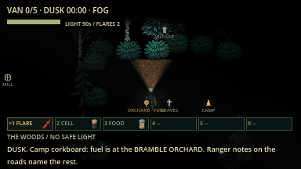 | 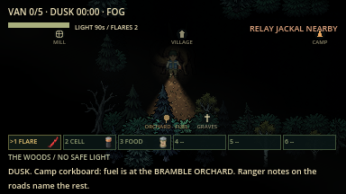 |

[Before/after captures and verification](docs/evidence/forest_treeline/README.md).

## Sound and volume

**Creatures are loud now.** Calls carry about 560 px (well off-screen) with a
gentler fall-off, chasing creatures scream every few seconds, wandering ones
call every 6–12 s, monster footsteps are heavier (pitched by size) and carry
240 px, the headline killer screams when it hunts and growls while
investigating, and a faint chorus of far-off calls drifts in every 18–35 s.
None of this changes what monsters hear.

Storms rain hard with thunder after each lightning flash; rain nights drizzle.
Your footsteps change on roads (gravel) and in the bog (mud). Hide near danger
and you hear yourself holding your breath; run yourself out and you pant. A chase
music layer swells while something hunts you. The van engine, the stolen-part car
alarm, snare jaws and chains, the gift crate's bells, the hunting horn, the
pyre's roar, the boat's outboard, door creaks, locked caches and the camp
generator all have their own sounds, and owls, wind and stranger things call out
in the woods now and then. Ten creatures that used to share screeches now have
their own voices.

**New in the 18 October sound pack:** the **air horn** finally honks; the
stalker's **bear traps snap** (once, not twice); survivors **grunt** when hit and
**gasp** when grabbed or downed; Puffball spores make you **sneeze**; Buster
**barks** (and **whines** happily when fed); the Paparazzo's camera **charges**
then **clicks**; the Conductor's **train** whistles; Bear Hug **squeaks** as it
follows you; the Bog Hands **gurgle**; the imps **giggle**; the Lullaby Saint
**sings** (you hear its lullaby before you're close enough to nod off); a
frog-cursed survivor **croaks**; scissors **snip** a Seamstress thread; and a
**helicopter** hovers over the landing zone during a radio rescue. In co-op
these play once for every player, not just the host.

The supplied MP3s now provide forest/bog ambience, a positional campfire,
restrained music, surface-specific walking/running sounds, a call for every
creature species, pursuit heartbeat, a ranger-radio broadcast (static, then
chatter) at each night phase, door slams and break-ins, gate and vault thuds,
and crashing woodpiles. Calls follow their moving source and have cooldowns; visual cues remain usable
with sound muted. **Esc** opens Master, Effects, Ambience and Music sliders;
the same controls are behind **Settings** on the main menu, with music and subdued forest
ambience playing. Settings persist and zero mutes. Pause suspends round sound, results stop it, and
replaying creates fresh emitters. Muting does not change monster hearing.

Voice chat is optional (see [Play with friends](#play-with-friends)); voice
audio is never recorded or saved. Local sound follows replicated world movement; synchronized
audio event/listening acceptance remains pending. See the [cue manifest and provenance notes](assets/audio/README.md).
The 20 October supplied pack adds recorded monster voices and the Huntmaster
mega horn, plus tin rattles, flashlight clicks, flare ignition/hiss, snoring,
village bell and lake impact. See the [audio pack report](docs/evidence/audio_pack_20261020/README.md).
Final listening/balance and Windows/Linux/exported audio remain unverified.

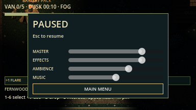

## Use the forest sites

Stand close and press **E**, with a clear path to the interaction point.

| Area | Interactions and trade-offs |
| --- | --- |
| **Abandoned Village** | Enter two furnished huts and search the required cache. Ring the square's bell to draw nearby enemies toward it, then slip away; the bell has a cooldown. The well stash awards two flares, a battery, and food once. |
| **Witch's Bog** | Search the ritual stash. The cauldron restores full flashlight charge once, but hexes your movement briefly and makes noise. |
| **Old Graveyard** | Search the repair cache among the graves. The crypt yields two flares once, with a loud stone-moving noise. |
| **Flooded Mill (west)** | Follow shallow channels and plank crossings around the waterwheel and gauge boiler. Its rare-tool altar is optional; watch the Boiler Saint's marked steam disk. |
| **Bramble Orchard (southwest)** | Fruit rows, trellises and vines mark the clearing. Search the rare-tool altar, then walk around the Seamstress's thorn patches or leave by another approach. |
| **Starless Observatory (northeast)** | A slit dome, telescope and radial tiled court identify the site. Hold the Wraith in your beam while retreating from the optional altar. |
| **Last-Car Rail Yard (southeast)** | Paired tracks, sleepers, switches, signal and scrap carts provide orientation. Cross away from the Conductor's inspection marker; the altar is optional. |
| **White Stone Quarry (far northwest)** | Stepped stone outlines, ladder markings, boulder clusters and survey rings surround the altar. Keep sideways space to dodge the Ram's locked charge. |
| **Drowned Chapel (deep south)** | Broken column bases, candle pews and a cross mosaic mark the court. Search the altar cautiously; flares attract its Candle Grazer instead of driving it away. |

The six new regions each offer **one rare tool per round**. Searching an altar
makes a 650px noise stimulus, so plan your exit first. If the belt is full and
the reward needs a new supply-type slot, nothing is consumed: drop a stack with
**G** and try again. These pockets have multiple entrances and open internal
routes. Their channels, floor markings and decorative props are walkable; they
do not introduce swimming, climbing, impassable machinery or new required parts.

Searching expedition items makes noise. Treat the stashes as preparation for the
next encounter, and plan a return route rather than spending every flare at once.

## Replay the expedition

Random Night is enabled whenever the menu opens. Uncheck it and enter a seed
to reproduce the camp, trails, item recipe, weather, and
encounter roster. The seed is also displayed in field notes and results.
After a round:

- **Try Another Night** returns to the menu. Choose/confirm a survivor and start a fresh random night in either mode.
- **Retry This Seed** keeps your survivor and seed, with the same layout and fresh items/supplies.
- **Main Menu** returns to mode selection.

In co-op, only the host chooses replay: everyone returns to the lobby with
readiness cleared; Retry Seed retains the world recipe. Guests wait for the host
or leave. Lost connections retry the same authority for five minutes; a stopped
host cannot be recovered through host migration.

Both modes vary building positions and surrounding trees within reserved camp
lots. Bunk cabins can trade places, as can the bathhouse and first aid building. Door paths, loot and field-map markers move together. Roof footprints
and main trails stay separate. Retrying a seed reproduces the camp too.

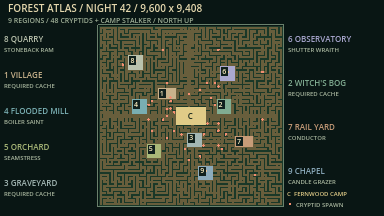

**Full-map example — Night 42.** Numbers match the region names around the map;
**C** marks Fernwood camp and coral dots mark the 48 cryptid starting positions.
The atlas includes Power Substation, Radio Relay Station, Logging Camp, Lakeshore
Boathouse, the Ranger Road/bridge and the chapel rescue area. Van caches rotate across eight
regions; labels identify possible cache regions rather than fixed objectives. North is up. This is an inspection
atlas; the in-game field map still reveals only explored trails.

## Screenshots

### New this update (17 October 2026)

Inspection lighting (ambient raised, sight mask off) so the art is readable;
normal nights are far darker. Captured by `tools/capture_showcase.gd`.

| Signal Fire hold-out | The Groundskeeper's parked mower |
| --- | --- |
|  | 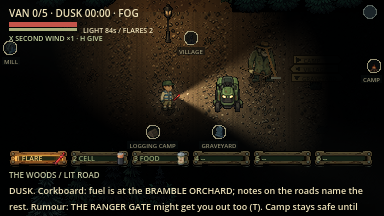 |

| Historical Scout prototype | Lost Camper |
| --- | --- |
| 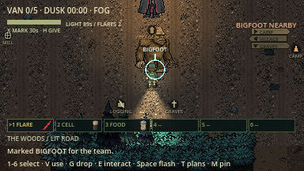 | 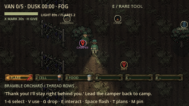 |

| The Stalker's Gift | Van finale |
| --- | --- |
| 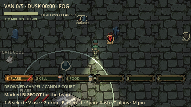 |  |

| Score, awards and badges | Camp Journal |
| --- | --- |
|  | 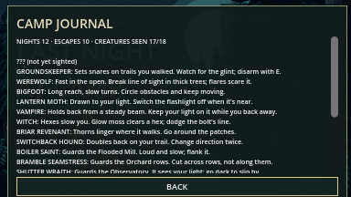 |

### The rest of the game

Actual Godot viewport captures with the current SpriteCook art, retaken on
17 October 2026 (see [screenshot sources](docs/screenshots/README.md)). The camp
images use Quick Camp. Region and landmark shots deliberately raise ambient
light and disable the sight mask so the art is visible; normal play keeps both
night lighting and sight restrictions. Close creature shots are inspection fixtures with
AI disabled and the camera offset for composition. The escape result comes from
a complete automated expedition with all enemies active.

| Campsite, tent and escape van | Furnished mess hall |
| --- | --- |
|  |  |

| Dark woods and flashlight | Field notes and explored trails |
| --- | --- |
| 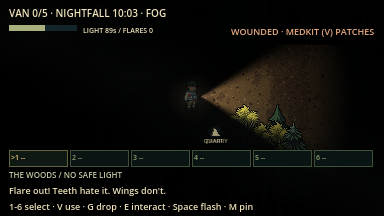 | 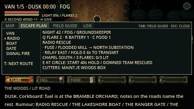 |


| Abandoned village | Witch's bog | Old graveyard |
| --- | --- | --- |
|  |  |  |

### Every creature

In-engine portraits of the original 21 woods creatures (AI paused, brightened lighting;
the werewolf, Mimic and Bog Hands shown in their true forms).

| The Vampire | The Werewolf | Bigfoot |
| --- | --- | --- |
|  |  |  |

| The Witch | The Lantern Moth | The Puffball |
| --- | --- | --- |
|  |  |  |

| The Scarecrow | Buster | The Peeper |
| --- | --- | --- |
|  |  |  |

| The Conductor | The Mimic (revealed) | The Night Owl |
| --- | --- | --- |
|  |  |  |

| The Bog Hands | The Toadstool Imps | Bear Hug |
| --- | --- | --- |
|  |  |  |

| The Lullaby Saint | The Seamstress | The Paparazzo |
| --- | --- | --- |
|  |  |  |

| Trash Jackal | The Ram | The Snuffer |
| --- | --- | --- |
|  |  |  |

New on 18 October (normal lighting, flashlight on, AI paused, each shown mid-tell):

| The Groundskeeper | The Cuckoo (two calls in) | The Banshee (drawing breath) |
| --- | --- | --- |
|  |  |  |

| The Slug (and its trail) | The Surveyor | The Hitchhiker (riding) |
| --- | --- | --- |
|  |  |  |

| The Tollkeeper | The Echo | The Fortune Teller (The Tower) |
| --- | --- | --- |
|  |  |  |

### New optional biomes

The following captures show each new region's centrepiece at gameplay zoom,
with the HUD hidden. Lighting is brightened and sight masking disabled for the
inspection tour; normal play keeps
night lighting and occlusion. The forest-site table above covers rewards, risks
and how to navigate each site.

| Flooded Mill — waterwheel and plank crossings | Bramble Orchard — fruit rows and trellises |
| --- | --- |
|  |  |

| Starless Observatory — dome and survey rings | Last-Car Rail Yard — tracks and signals |
| --- | --- |
|  |  |

| White Stone Quarry — terraces and stone piles | Drowned Chapel — columns and shrine |
| --- | --- |
|  |  |

### Supply belt


The selected slot is highlighted and its supply appears in the survivor's hand.
Use **1–6/keypad** to select, **V** to use, **G** to drop the stack and **E** to
recover units. Vehicle components and cutters remain separate from this limit.

| Loading the next night | Successful extraction |
| --- | --- |
|  |  |

## Art

The F5 escape props use one **16-piece SpriteCook sheet**, matched to the existing
camp art: transformer, breaker, mast, flare beacon, outboard, skiff, boathouse,
ranger booth/barrier, logs, workshop, pier, Lake Thing, bridge, marine fuel and
code notes. The batch cost **12 credits** (716 → 704). No paid animation or repeat
generation was needed. Source and derived IDs/hashes are in
[spritecook-assets.json](spritecook-assets.json); the reproducible slicer is
[tools/slice_escape_props.gd](tools/slice_escape_props.gd).

The game's art was redrawn with SpriteCook in October 2026:
- trees and bushes, all six survivors, the stalker and all 16 creatures;
- every item and belt icon, the van, tent, campfire and camp props;
- building interiors and furniture, the landmark props;
- seamless ground, floor, roof and water textures;
- (17 October) the Groundskeeper, Signal Fire props, snares, gift crate, rescue
  helicopter, orchard trees and trellises, ground decals that soften every path
  edge, and asphalt, gravel, flagstone, court-tile, orchard and plank surfaces.
  Roofs are shaded gables and interior walls are timber, so nothing in the world
  is a flat box any more (48 credits);
- (17 October, fifth batch, 132 credits; 524 kept in reserve) fences, gates,
  doors, fallen woodpiles, helipad, 26 kinds of trail-side forest dressing,
  every effect and marker (flares, blood, hex bolts, alerts, pins, marks), the
  wooden interface (panels, buttons, belt slots, map frame, skyline icons),
  illustrated loading, survivor-selection and lobby screens, survivor portraits,
  and real stepping walk cycles for the survivors, the Stalker and the
  Groundskeeper. Only light, weather, sparks and on-screen text are still
  drawn in code;
- the title screen.

See [art evidence](docs/evidence/spritecook/README.md). The stalker is now
noticeably bigger than the campers.


## Development and verification

Everything in this README is implemented and covered by automated tests. On
17 October 2026 the full headless suite (`tools/verify.py`) passed **134 steps**
(import, startup, every script and 30+ gameplay suites, including the active-AI
expedition bot), the two-peer network suite passed **375 assertions**, and the
voice suite passed (codec, routing and a two-process ENet round). Older
graphical and four-peer evidence is kept in [docs/evidence](docs/evidence).
What automation cannot prove is still open: human playtests of pacing and fun,
a real microphone and listening test, two separate computers over the internet,
Windows/Linux, and exported builds.

```sh
python3 tools/verify.py             # Import, parse, and headless gameplay checks
python3 tools/verify.py --graphical # Also render, play, and capture screenshots
python3 tools/verify_network.py --mode all --players 2
python3 tools/verify_network.py --mode all --players 4
python3 tools/verify_voice.py       # Proximity voice: codec, routing, two-process round
```

Verified on **macOS arm64 / Godot 4.7.2**. Human real-time balance testing,
real cross-machine Internet co-op, exported packages, and execution on
Windows/Linux remain unverified. The automated woods player uses navigation paths as a route guide;
the tests do not establish balance for every seed.

Latest [offline content rules and captures](docs/content_update.md) include the
six playable survivor roles, item belt and six new landmark/monster pairs.
ENet co-op is now implemented in both modes. Two/four-peer local execution and
scripted graphical two-window checks are recorded in the
[multiplayer guide](docs/multiplayer_guide.md). Human balance, real cross-machine
Internet, synchronized-audio listening, jitter/other-platform acceptance and
exports remain pending. Proximity voice uses TwoVoIP (Opus); see the
[multiplayer guide](docs/multiplayer_guide.md#proximity-voice).

The larger backlog includes 48 monster concepts and 18 biome designs. Ten
new monster types and six new regions now have first offline versions; deeper
powers, interiors and the remaining catalog are still planned.

- [Authoritative project brief](AGENT_BRIEF.md) — requirements and acceptance gates.
- [Graphics audit and map/help plan](docs/graphics_readability_plan.md) — current defects, captured evidence and the proposed interface overhaul (not yet implemented).
- [World graphics critique](docs/world_graphics_review.md) — building/area labels and proposed dramatic phase titles.
- [Sound gaps and recording list](docs/sound_gap_review.md) — existing wishlist, missing feedback and a prioritized sound pack.
- [Milestones](docs/milestones.md) — implementation plan and remaining work.
- [Gameplay overhaul](docs/fun_overhaul.md) — planned night phases, chases, hiding, map redesign, new escapes and replayability.
- [Survivor selection and co-op](docs/survivor_multiplayer_plan.md) — six archetypes, selection screens and the transition into voice.
- [Monster catalog](docs/monster_catalog.md) — 48 additional designs, their abilities and counterplay.
- [Biome design](docs/biome_design.md) — 18 detailed regions, randomized layouts, encounters and staged delivery.
- [Play together](docs/multiplayer_guide.md) — LAN/Wi-Fi/Internet setup, co-op controls and execution limits.
- [Architecture](docs/architecture.md) — world, AI, and authority boundaries.
- [Testing](docs/testing.md) — commands, coverage, and platform limits.
- [Development log](docs/development_log.md) — changes, failures, fixes, and evidence.
- [Original art and asset provenance](assets/README.md) — reproducible pixel-art sources.

Project rules in [AGENTS.md](AGENTS.md) require verified incremental commits and
ongoing pushes to GitHub, with a development log update for each increment.
The brief and design documents are maintained in Markdown only.
