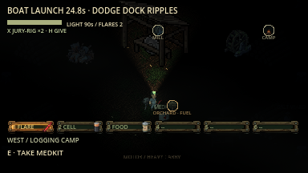
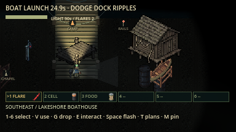
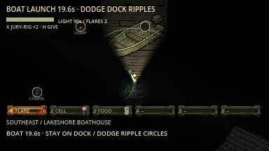
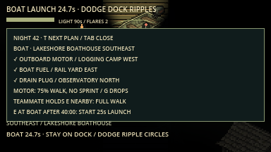
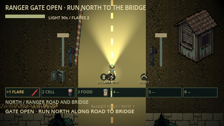
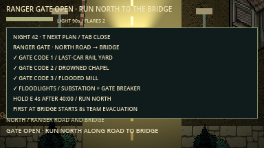
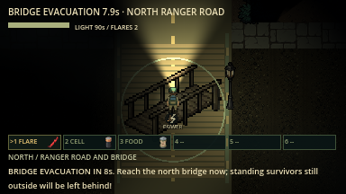

# Boat, Ranger Gate and F5 art polish

Woods Expedition offers the **Van plus one rumoured escape per night** (Radio
Rescue, Boat, Ranger Gate or, since F5c, Signal Fire); see the README. Tests use
`--all-escapes` to enable every escape on one seed. When offered, the first completed extraction ends the round. Boat and Gate
launch/open as soon as they are prepared (no clock gate). Quick Camp is unchanged.
Press **T** to cycle objective pages; **Tab** closes field notes. Human pacing
tests remain deferred by the user. This slice does not claim all of F5 is done:
Signal Fire, primary/rumoured escape selection and the revised van finale remain.

**20 October layout update:** all region positions, main roads and objective
pickup regions now vary by seed. See [current maps and verification](evidence/random_layout/README.md).
Older screenshots below preserve their original layouts/text.

## Boat

| Component | Location | Carrying |
| --- | --- | --- |
| **Outboard motor** | Seeded region named in T | Separate objective inventory, no belt slot. Carrier walks at 75%, cannot sprint or vault. **G** sets down the motor before dropping belt supplies. |
| **Marine fuel** | Seeded region named in T | Dedicated boat fuel, distinct from van fuel. No belt slot. |
| **Drain plug** | Seeded region named in T | Separate objective inventory, no belt slot. |

Carry all three to the **Lakeshore Boathouse (seeded position)**; E at the boat fits
carried parts. Installation is permanent and shared. Downing or disconnect drops
uninstalled parts beside the survivor, using the existing reachable-drop rules.

A standing, unhidden teammate can **hold E within 48 px** of the motor carrier,
with a clear path between them, to assist. The carrier walks at full speed;
neither can sprint while assisting. Release E, separate, hide or become downed
and assistance stops. Solo players can carry the same motor slowly with every role.

Once fitted, E starts the launch. Earn **25 seconds** with at least one living,
unhidden, awake, unheld survivor inside the **80px dock circle**, with clear
access to its center. Everyone stepping out pauses progress without resetting it;
multiple teammates do not speed it up. No need to keep holding E. Survivors can
move and use supplies. Solid lake banks keep walking on shore and dock; there is
no swimming. Ordinary seeded supplies are moved off solid water.

The **Lake Thing** fires from the lake every **0.5s**, switching sides every six
shots. Each **0.35s tell** locks the aim before a water projectile travels at
**170px/s**, dealing **18 damage** through normal wound/grace/protection rules.
Dodge inside the circle to keep progress moving. Walls stop shots; an active
flare within **32px** of a shot's path and clear sight cancels that shot.
Shots expire after three seconds. It does not aim at hidden survivors or
Christian's Nobody form, although existing shots can hit Nobody. Chapel signal
holders do not interrupt it. The local camera pulls back during the encounter
and restores normal framing on exit or completion.

[Current barrage capture and verification](evidence/boat_barrage/README.md).
The older art screenshots below show the previous ripple encounter/objective text.

| Logging Camp | Motorboat launch |
| --- | --- |
|  |  |

| Boathouse on the shore | Lake Thing warning |
| --- | --- |
|  |  |

## Ranger Gate

1. Check the T plan for **three distinct code fragments**. Objective placement
   spreads pieces for both offered routes into separate regions, including the
   destinations in its trail-distance scoring. The plan names their regions; the notes are physical pickups.
2. Carry them to **Ranger Gate on the far north road** and E to fit them. Fragments
   use no belt slots, drop on down/disconnect, and install once for the whole team.
3. Restore the **Power Substation** with the emergency fuse from the T plan, as for
   Radio Rescue. Then E at **the gate's left breaker** powers its floodlights and
   the road lamps. Camp blackouts do not undo this dedicated circuit.
4. Hold E at the gate for **four seconds**. Letting go, moving,
   being downed or changing operator resets incomplete progress. The arm opens
   on the host and every client. Evacuation stays locked until these steps are
   complete, even if someone explored beyond the closed central barrier.
5. Run **north along the lit road to the wooden bridge**, about 1,000 px from the
   gate. The first standing, unhidden survivor within 64px starts an **eight-second
   team evacuation window**. Gather on the bridge before it expires.

The gate alarm is a fixed sensed location. It calls the existing stalker from up
to 6,000 px, repeatedly while powered; other creatures hear its initial/opening
noise within 1,000 px and guardians retain their territory rules. The stalker
travels normally, keeps normal sight/attack rules, and is never teleported into
the road or given an unsensed survivor position. Its arrival timing depends on
where it was when the team armed the gate. Use lights, flares, cover and the
existing chase toolkit while travelling.

| Closed checkpoint | Open gate and lit road |
| --- | --- |
|  |  |

| Gate plan | Bridge evacuation |
| --- | --- |
|  |  |

## Shared outcome

At departure, **standing and unhidden** survivors inside the route's circle and
with a clear path to its centre escape. If any standing survivor escapes,
connected downed teammates anywhere are recovered too. Standing survivors
outside, hidden survivors and van passengers are left behind by these routes.
No standing survivor at extraction means defeat. All-down rules still apply; there is no dawn deadline.
Results identify **BOAT** or **RANGER GATE** on every peer.

## Art and execution limits

One SpriteCook **16-piece sheet**, generated with Nano Banana 2.1 at 1K and matched
to the owned camp-object sheet, cost **12 credits** (716 → 704). It supplies the
transformer, breaker, mast, signal beacon, motor, skiff, boathouse, checkpoint,
barrier, logs, workshop, pier, Lake Thing, bridge, fuel and code notes. Alpha
source/edges were inspected; cutoff 130 was retained. No repeat generation,
paid animation or paid cleanup was needed. Sources and cropped derivatives are
recorded by asset ID/hash in [the manifest](../spritecook-assets.json).
[The slicer](../tools/slice_escape_props.gd) preserves the source and enlarges
native pixels with integer nearest-neighbour sampling for runtime sizing.

These are actual Godot night captures with enemies disabled for inspection and
camera zoom/offset adjusted to show props. The atlas is an inspection overlay;
the in-game map still reveals only explored trails.

Host authority covers parts, assistance, attacks, gates, holds, countdowns and
results. Current boat shots/occupancy require `lnac-net-33`; the original art
evidence below used earlier protocols. See [execution evidence](evidence/boat_gate/README.md)
and [multiplayer setup](multiplayer_guide.md). Automated fixtures use placements
and accelerated clock/countdown tails. They do not prove normal-speed human
balance, real cross-machine Internet or Windows/Linux/export behavior. No
microphone feature or new audio asset was added.

## Playtest clarity update — 18 October 2026

Fit motor, marine fuel and drain plug with E on the **BOAT REPAIR** pad on the
Lakeshore dock (now seeded around the outskirts), separate from the Camp Boathouse. Its MOTOR /
FUEL / PLUG labels each change to OK. The plan names whoever carries each part;
carriers are directed to the dock. E again after all three are fitted starts the
existing 25-second launch; the 80px extraction circle and Lake Thing remain.
Inactive routes do not get objective annotations or gate barriers. Region names
are geographic landmarks and remain visible on other nights.
