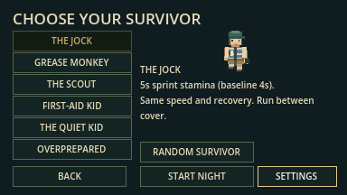
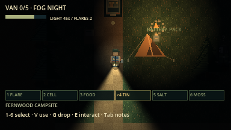
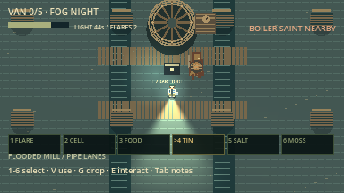
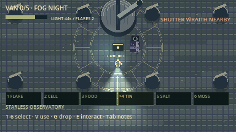
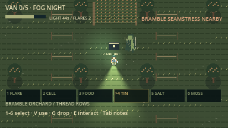
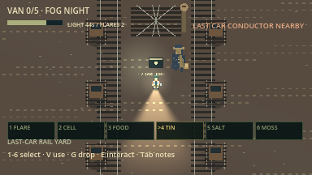
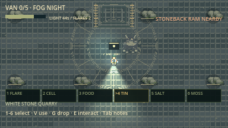
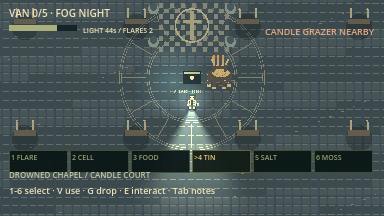

# Offline survivors and forest content

This update implements six survivor choices, six additional optional biomes,
seven additional cryptid species and a six-slot supply belt before multiplayer,
as requested. It began as an offline content increment. The current build also includes
[ENet co-op](multiplayer_guide.md); full human balance, real cross-machine Internet,
synchronized-audio listening and proximity voice acceptance remain pending.

## Radio Rescue regions (F5a)

F5a added the north Power Substation and east Radio Relay Station. The current
forest has **fourteen regions** after F5b. These support a secondary expedition escape with an
emergency fuse, distress transmission, three permanent signal holders and a
40-second chapel landing-zone finale. See the [illustrated Radio Rescue guide](radio_rescue.md).
The van remains available; the first completed extraction ends the night.

## Boat, Ranger Gate and SpriteCook polish (F5b)

Logging Camp, Lakeshore Boathouse and Ranger Road/Bridge add two more escape
chains. A heavy motor supports solo carrying or a nearby held-E helper. Boat
launches in 25s with fixed, dodgeable Lake Thing attacks. Gate needs three seeded
regional fragments and floodlights, followed by a bridge run. T cycles all four
plans; accepted objectives, carries, lamps and results replicate. See the
[illustrated Boat/Gate guide](boat_gate.md).

One matched 16-prop SpriteCook batch cost 12 credits (716 → 704), replacing the
flat F5 machinery and adding original boat, checkpoint and Lake Thing art.

## Rendering and denser roaming update

Survivors now retain their texture for the actor lifetime instead of loading a
temporary texture during drawing. All six roles pass an actual rendered-pixel
check, addressing the white-block bug. The belt keeps selection keys and names
but removes trailing counts; stacks and the six-type limit are unchanged.

The population is now 48 cryptids plus the stalker, with 24 additional seeded
roamers around camp approaches (outside camp/major landmark footprints).
Relay Jackals flank only visible targets and search longer; Ration Moths hear
ration use at its original location; Lens Eaters telegraph a capped light-charge
attack that you can avoid by turning away or using cover. These encounters are
not biome-bound. Flares interrupt pending charges, and Maintenance offers a
three-flare preparation stash. Human difficulty tuning remains pending.

## Survivors and belt

The menu opens selection before loading. Each card shows its exact advantage
and an animated original outfit preview. Choose with mouse or keyboard focus /
Enter; Back preserves mode/seed, Random Survivor reveals a separate role choice,
and Settings keeps menu music/mixer available. The choice saves locally.
Retry preserves role/seed. Another Night returns to the menu for fresh selection.

| Role | Effective advantage over baseline |
| --- | --- |
| Jock | 5s stamina instead of 4s; same recovery/speed |
| Grease Monkey | 1.5s ignition instead of 2s; +1 spare battery |
| Scout | 0.8 light drain/s instead of 1 in woods; +1 ration |
| First-Aid Kid | 2.25s medkit teammate revive instead of 3s; +1 medkit, +1 flare |
| Quiet Kid | Sprint AI hearing reach ×0.75 after weather; playback/sight unchanged |
| Overprepared | +1 flare, +1 battery, +1 ration |

All roles can collect every part and escape alone. No self-revive. Configurations
are private copies and spawn bonuses apply once. A medkit is required for every revive (3s, or 2.25s as First-Aid Kid).
Downs last indefinitely, drop all gear beside the body, and are rescued by a
successful teammate van escape. All-down is defeat.
The van still departs after 8s; changing the ignition/revive actor resets progress.

The belt holds **six supply types**, with same-type stacks. Select using **1–6
or keypad 1–6**, use with **V**, drop the selected stack with **G**, recover each
unit with **E**. Q/R/C remain convenience shortcuts. A full belt refuses a new
supply type without consuming its pickup or landmark reward. Vehicle parts and
reusable cutters have a separate unlimited objective pouch. Medkits are used by
holding E at a downed teammate, rather than V. The hand displays the held supply.

| Rare item | Effect |
| --- | --- |
| Noise tin | Three noise pulses after 1.5s, 3.5s and 5.5s; 480px hearing reach |
| Salt ward | 4 seconds of protection from physical hits; no health restoration |
| Glow moss | +35 light charge (capped at 90), removes the current hex |

## Regions and encounters

The full-map example is generated from the current Night 42 world recipe.
Numbers identify all fourteen regions; C marks camp and coral dots show cryptid
starting positions. This inspection atlas is separate from the explored-trail
field map used during play.

The five-part van recipe is preserved; locked caches now rotate across eight
regions under F4. Six guardian pockets remain optional for van escape, with
graph-connected loops, multiple entrances and 32px approach aprons. All eleven
regions fit inside the existing finite forest. The six remote ruins remain.
Rescue regions add solid machinery footprints; the boathouse has solid water
banks around a reachable dock, and the ranger arm opens through host-owned state;
other biome scenery still represents walkable floors, shallow channels and dressing.
Interior architecture, deep water, advanced quests and varied region modules from
the larger biome design remain future work. The variant footprint is currently
fixed; the surrounding maze, ordinary supplies and weather remain seeded.

| Region | Visual identity | Guardian and current counterplay |
| --- | --- | --- |
| Flooded Mill | Waterwheel, gauge boiler, shallow channels and plank crossings | Boiler Saint marks a visible spot for 1.2s, then creates a 2.2s steam slow; leave the 23px disk |
| Bramble Orchard | Fruit rows, trellises and vines | Seamstress marks temporary thorn patches; walk through or leave before activation |
| Starless Observatory | Slit dome, telescope, tiled radial observation court | Shutter Wraith stops pursuing while visibly illuminated in the beam; move away before battery runs out |
| Last-Car Rail Yard | Paired tracks, sleepers, switches, signal and scrap carts | Conductor marks a brief inspection slow disk; sidestep its warning |
| White Stone Quarry | Stepped stone outlines, ladders, rock clusters and survey rings | Stoneback Ram locks an observed direction, warns for 1.2s, charges for 0.55s, then waits for cooldown |
| Drowned Chapel | Broken column bases, pews, candles and cross mosaic | Candle Grazer investigates visible flares and consumes one on contact; leave while it feeds |

Each new region has a one-use rare-tool altar. Searching makes a 650px noise
stimulus; its local guardian can investigate. Guardians ignore survivors/noise
outside their home bounds and constrain destinations to their region. Leave their
zone to break pursuit. Slow patches expire, never edit collision/navigation,
never deal direct damage and cannot block exits. They affect each actor once.

**Switchback Hounds** roam ordinary trails, hear farther (320px before weather),
and search longer (12s). Sight/noise triggers pursuit; their locked straight
charge has a visible 1.2s warning and collides with walls. Turn aside during the
tell and walk after breaking sight. There is no hidden position tracking.

The population remains **48 cryptids plus one stalker**, across **16 cryptid
species**. The six prior species retain their core behaviors and receive visual
trim/detail; the stalker receives coat seams and belt detail. Original directional
pixel sheets add silhouettes, equipment, fur, stone plates, brass gauges, lenses,
clothing and candles. New monsters currently reuse the registered revenant call
with the existing proximity/attenuation limits; bespoke calls are not claimed.
The deeper catalog powers (pipe networks, authored rail-signal activation,
flare-feeding glow, junction threads) are not implemented by these first versions.

## Illustrated player guide

The [README monster guide](../README.md#know-what-is-following-you) now lists
all 16 cryptid species and the stalker, with habitat, visible tells and responses.
Its [new monster close-ups](../README.md#new-monster-close-ups) show all seven
new species, and the [forest-site guide](../README.md#use-the-forest-sites)
explains all nine major regions, approximate directions and optional rewards.
The [biome gallery](../README.md#new-optional-biomes) embeds all six new region
screenshots directly in the README.

## Rendered evidence and limits

These are unedited engine viewport captures from `content_expansion.gd`.
The biome tour disables sight masking, brightens ambient light and positions
actors for art inspection. It is not a human playthrough or production visibility
proof. Selection and the belt use ordinary UI/night rendering. Automated fixtures
check role values in both expedition flags, supplies/lifecycle, ignition boundaries,
selection, keypad/number input, item recovery, zone overlap/entrances and leashes.
Other regression suites check real native routes, occlusion and complete input
rounds. Fixtures do not prove all-role normal-speed balance or co-op.

Verified environment: macOS arm64 / Godot 4.7.2. Windows/Linux, exported packages,
human microphone permissions and real cross-machine Internet sessions remain unverified. No microphone
capture or permission request is introduced.
