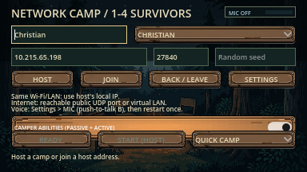
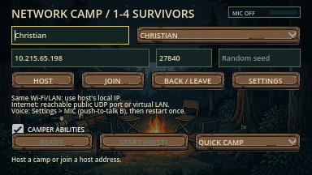
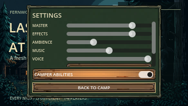
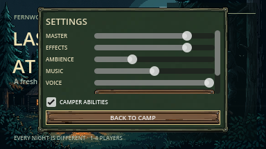

# Compact camper-abilities control

19 October 2026; Godot 4.7.2, macOS Apple M2, 384×216 native viewport.
This addresses the on/off control in the lobby and Settings. The in-game ability
HUD and connection flow retain their published behavior. No new artwork or credits.

The old control inherited the gold Button background and stretched across the
row. The new checkbox has a flat background, compact label, native check mark
and keyboard focus. Settings uses its content width; the lobby reserves 140×16
instead of 356×16. Existing signal handlers, readiness reset, round locking and
dedicated configuration are unchanged.

| Screen | Before | After |
| --- | --- | --- |
| Lobby |  |  |
| Settings |  |  |

[Graphical diagnostic](graphical.log): 110 assertions, zero failures/errors/warnings;
includes actual menu/lobby output inspected above. Any gameplay views from this
shared diagnostic are staged seed42, normal lighting/sight, frozen enemies and
night clock, supplied ability samples, microphone capture off. These two menu
captures contain no gameplay or forced-all-escape fixture.

[Real ENet rule checks](rules.json): nine local processes, 79 assertions across
four-person listen hosting and dedicated hosting, zero failures/errors/warnings.
Guests cannot change the rule; disabled starting cash/samples, passives and
actives remain disabled. Local macOS diagnostics do not add Internet, target-OS,
microphone or human usability acceptance.

Reproduce with `godot --audio-driver Dummy --path . --fixed-fps 60 --script
res://tests/integration/ability_feedback.gd -- --capture` and
`python3 tools/verify_camper_rules.py`. Microphone capture stays off.
