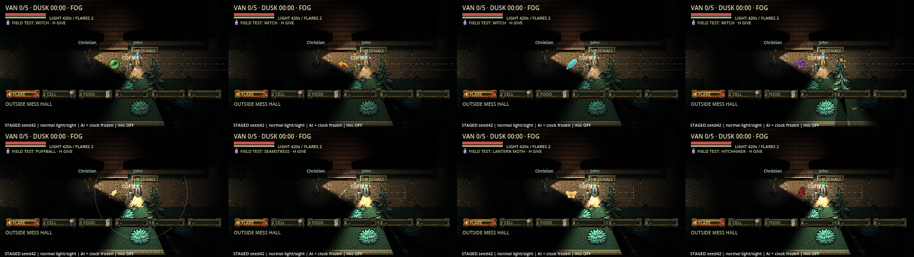
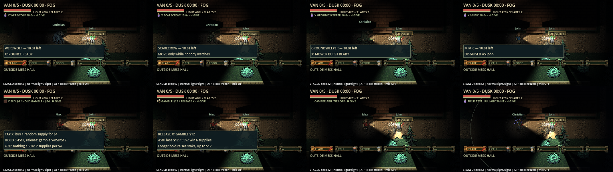
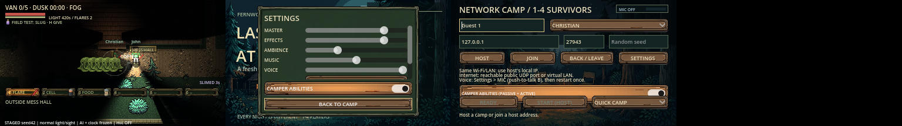

# Ability feedback follow-up evidence

19 October 2026, macOS Apple M2, Godot 4.7.2 Compatibility/OpenGL. These are
**staged diagnostic captures**: seed42, normal fog/lighting/sight, enemies and
night clock frozen, samples/positions supplied, microphone off. Normal escape
selection is retained. The captures do not establish human scare/balance,
Internet, exported-platform or real-microphone/listening acceptance.

[Delivery audit and player rules](../../ability_feedback_review.md) ·
[Machine-readable executed results](results.json).

| Executed gate | Result |
| --- | --- |
| Required headless import / five-frame startup | Clean; no engine errors/warnings |
| `four_survivors.gd` | 164 checks, 0 failures; all 30 copies, current-player Mimic, disabled passives/actives, 420s/560s light rates |
| `ability_feedback.gd -- --capture` | 110 checks, 0 failures; actual flight/impact, walls, ward reflection, Cuckoo calls/rewind effects, Saint loop creation/stop, form timers, visible UI captures |
| `movement_prediction.gd` | 81 checks, 0 failures |
| `stalker_distance.gd` | 17 checks, 0 failures; distance/sight gates, walking navigation, beam fade, physical card range and speed cap |
| `sound_feedback.gd` | 27 checks, 0 failures; existing cues, once-only replay and loop cleanup |
| `layout_polish.gd` | 1,323 checks, 0 failures |
| Graphical `render_replication.gd` | 8 checks, 0 failures |
| `python3 tools/verify_camper_rules.py` | Four-player listen authority/3 guests and production dedicated authority/4 guests all pass; all four roles disabled, clients cannot override, no microphone |
| `python3 tools/verify_network.py --mode camp --players 2` | Normal enabled-default host 114, guest 30, late join 2; 0 failures, clean logs |
| `python3 -m unittest discover -s tests/tools -p test_server_launcher.py` | 5 pass; flag forwarding/source preparation |

Godot integration commands use `--path . --audio-driver Dummy --fixed-fps 60
--script res://tests/integration/<name>.gd`, with `--headless` except the graphical
feedback/render gates. Raw selected logs and JSON are beside this file; additional
local logs live under ignored `artifacts/ability_polish/`.

## Inspected output

All eight projectile appearances, form timers/actions, native status effects,
Max buy/gamble explanations, disabled HUD, offline Settings and lobby control were
opened and inspected. The readout card sits above the belt and hides behind the
notebook. Settings has a bounded scrolling audio area so Back remains visible.
Nameplates render above roofs but behind the sight mask, using presentation-only
identity. Guides use one ray per boundary segment rather than repeated tiny ray
steps. No clue/target-discovery scan is added.

Artwork: one SpriteCook asset `bdbb8c47-eab9-4a95-b8fa-6d5b3d7bb35f`, NB2.1,
12 credits, 308 remaining. Alpha cutoff 130 was inspected unchanged; no paid
reroll, animation or cleanup. [Asset hashes](../../../spritecook-assets.json) and
[reproducible slicing](../../../tools/slice_ability_effects.gd).

The gallery under ignored `artifacts/ability_gallery/` stays private. All 52 MP4s
were refreshed against this implementation, fully decoded and visually sampled
across nine contact sheets. It includes all 30 Christian interactions and variants,
plus the other three campers. Staged bright fixtures, controlled AI, hidden
sight/roofs and microphone-off conditions are labelled in the recordings and local
README. No additional SpriteCook credits were spent on recordings.
