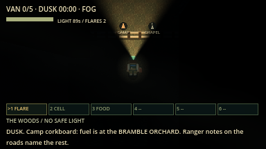
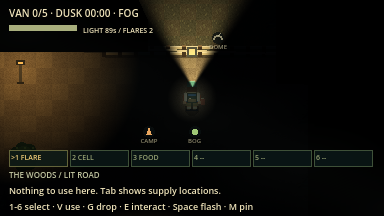

# Shortcut gates, fences and new sounds evidence (overhaul F4b-2)

macOS arm64 / Godot 4.7.2, 16 October 2026. Network rules version `lnac-net-10`.

| Command | Result |
| --- | --- |
| `python3 tools/verify.py` | 93/93 steps passed, no errors or warnings ([summary](verify_summary.json)) |
| `godot --headless ... res://tests/integration/barriers.gd` | 32 assertions passed ([log](barriers.log)) |
| `godot --audio-driver Dummy ... res://tests/integration/audio_polish.gd -- --audio-test --capture` | 96 assertions with real output, all passing (headless [log](audio_polish.log)) |
| `python3 tools/verify_network.py --mode all --players 2` | 6 processes / 269 assertions passed ([summary](summary_all_2.json)) |
| `python3 tools/verify_network.py --mode all --players 4` | 8 processes / 455 assertions passed ([summary](summary_all_4.json)) |

| Fence across a trail (vault from here) | Latched shortcut gate (latch box) |
| --- | --- |
|  |  |

New-sound levels were set from full-file decodes, not by ear. A listening pass
is still needed. Not verified: human route feel, other platforms.
