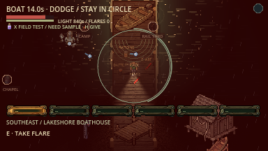

# Boat barrage — 20 October 2026

The Lake Thing now fires fixed-aim water projectiles every 0.5 seconds after a
0.35-second tell. Shots travel at 170px/s, deal 18 damage through ordinary player
hit handling, and expire after three seconds. Swept collision prevents tunnelling;
solid cover and an active flare within 32px of a shot's path can stop it.
Shots originate in the lake, switching sides every six shots. Nobody form is
excluded from aiming; existing projectiles can still hit its body.

The boat needs 25 earned seconds. At least one living, visible, awake, unheld
survivor within the 80px circle and with clear access advances progress. Everyone
leaving pauses it without resetting. Extra teammates do not accelerate it.
Existing extraction/downed-team rescue behavior remains. The local camera pulls
back near the active circle and restores its original framing on exit/completion.
Host authority owns damage, progress and shots; snapshots carry the state.
Update clients/server together to **lnac-net-33**. No server deployment occurred.

The current capture reflects removal of the small aim-point circles and
trajectory aiming lines. Source flash, moving projectiles/trails and the dock
progress circle remain. Attack timing and collision are unchanged. The native
32-check suite and required import/startup passed again for this drawing-only
follow-up.



This is a **staged graphical fixture**, ordinary seed 13 with Boat/Van only,
components preinstalled, frozen enemies/director and manually posed survivor and
projectiles. Normal Witching Hour lighting is retained; readable unshaded water
shots/circle do not create gameplay light. The transient phase banner is hidden
for capture. No microphone capture or paid asset generation. This is a screenshot,
not a recorded playthrough or human difficulty assessment.

[Machine-readable results](results.json): native mechanics/camera 32 checks,
field escapes 57, supplied audio routing 35, real ENet listen-host/client 261,
four-client dedicated 153, all zero failures on the reported final runs. The
first dedicated run timed out on its synthetic voice relay; one retry passed.
The network suite retains its labelled forced all-escape setup. No Internet,
cross-machine, exported-build, Windows/Linux or human listening acceptance.

The supplied water splash plays once on body/wall impact; flare cancellation
is silent. Playback routing is tested separately from AI hearing: this change
adds no AI hearing stimulus. No new audio asset or gain change was required.

Reproduce local targeted checks:

```sh
godot --headless --path . --import
godot --headless --path . --quit-after 5
godot --headless --path . --fixed-fps 60 --script res://tests/integration/boat_barrage.gd
godot --path . --fixed-fps 60 --script res://tests/integration/boat_barrage.gd -- --capture
godot --headless --path . --fixed-fps 60 --script res://tests/integration/field_escapes.gd -- --all-escapes
godot --headless --path . --fixed-fps 60 --script res://tests/integration/october_audio.gd
```

Raw logs/capture harness output live in ignored `artifacts/boat_barrage/`.
