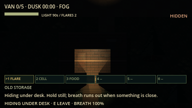
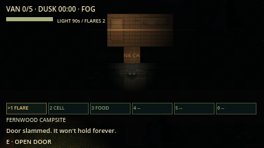
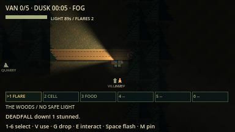

# Hiding, doors and knock-overs evidence (overhaul F3b)

macOS arm64 / Godot 4.7.2, 16 October 2026. Network rules version `lnac-net-7`.

| Command | Result |
| --- | --- |
| `python3 tools/verify.py` | 87/87 steps passed, no errors or warnings ([summary](verify_summary.json)) |
| `godot --audio-driver Dummy --path . --fixed-fps 60 --disable-vsync --script res://tests/integration/chase_props.gd -- --capture` | 46 assertions passed (43 headless, see [log](chase_props.log)), after the playtest fixes |
| `python3 tools/verify_network.py --mode all --players 2` | 6 processes / 269 assertions passed ([summary](summary_all_2.json)) |
| `python3 tools/verify_network.py --mode all --players 4` | 8 processes / 455 assertions passed ([summary](summary_all_4.json)) |

| Hidden in a cabin | Door slammed (beam blocked) | Deadfall across a trail (inspection lighting) |
| --- | --- | --- |
|  |  |  |

Hiding and door captures use normal Dusk fog lighting. The deadfall capture
raises ambient light and disables the sight mask so the whole wall-to-wall fall
line is visible; normal play is darker. Not verified: human
feel of breath and door timings, graphical network windows, other platforms.
