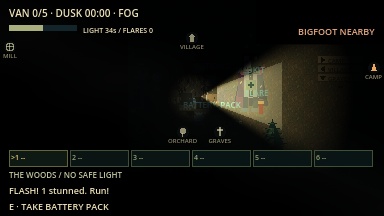

# Chase toolkit evidence (overhaul F3a)

macOS arm64 / Godot 4.7.2, 16 October 2026. Network rules version `lnac-net-6`.

| Command | Result |
| --- | --- |
| `python3 tools/verify.py` | 84/84 steps passed, no errors or warnings ([summary](verify_summary.json)) |
| `godot --audio-driver Dummy --path . --fixed-fps 60 --disable-vsync --script res://tests/integration/chase_toolkit.gd -- --capture` | 30 assertions passed (29 headless, see [log](chase_toolkit.log)) |
| `python3 tools/verify_network.py --mode all --players 2` | 6 processes / 261 assertions passed ([summary](summary_all_2.json)) |
| `python3 tools/verify_network.py --mode all --players 4` | 8 processes / 439 assertions passed ([summary](summary_all_4.json)) |

Not verified: human close-call versus down ratio, the solo 20 s window's
balance, graphical network windows for this increment, other platforms.
