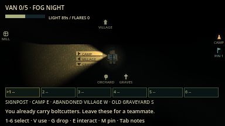
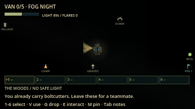
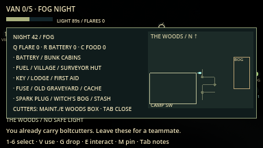

# Navigation aids evidence (overhaul F1)

macOS arm64 / Godot 4.7.2, 16 October 2026. Network rules version `lnac-net-4`.

| Command | Result |
| --- | --- |
| `python3 tools/verify.py` | 78/78 steps passed, no errors or warnings ([summary](verify_summary.json)) |
| `godot --audio-driver Dummy --path . --fixed-fps 60 --disable-vsync --script res://tests/integration/navigation_aids.gd -- --capture` | 48 assertions passed, including three graphical captures |
| `python3 tools/verify_network.py --mode all --players 2` | 6 processes / 248 assertions passed ([summary](summary_all_2.json)) |
| `python3 tools/verify_network.py --mode all --players 4` | 8 processes / 414 assertions passed ([summary](summary_all_4.json)) |

The headless [suite log](navigation_aids.log) holds 45 assertions; the
graphical run adds the three capture checks. Network runs are headless local
ENet processes. Real cross-machine play and human pacing remain unverified.

| Signpost in the beam | Skyline edge markers | Field map regions and pins |
| --- | --- | --- |
|  |  |  |

Captures use normal fog-night lighting with the sight mask on. The field-map
capture shows the wall-map region outline (BOG) before it has been visited, plus
the pin flag. The repeated "already carry boltcutters" notice is left over from
the scripted tool checks.
