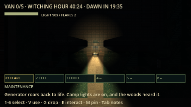

# Night phases evidence (overhaul F2)

macOS arm64 / Godot 4.7.2, 16 October 2026. Network rules version `lnac-net-5`.

| Command | Result |
| --- | --- |
| `python3 tools/verify.py` | 81/81 steps passed, no errors or warnings ([summary](verify_summary.json)) |
| `godot --audio-driver Dummy --path . --fixed-fps 60 --disable-vsync --script res://tests/integration/night_phases.gd -- --capture` | 41 assertions passed (40 headless, see [log](night_phases.log)) |
| `python3 tools/verify_network.py --mode all --players 2` | 6 processes / 251 assertions passed ([summary](summary_all_2.json)) |
| `python3 tools/verify_network.py --mode all --players 4` | 8 processes / 421 assertions passed ([summary](summary_all_4.json)) |

Clock jumps use the production `skip_to`, which applies every skipped phase
once. Network runs are headless local ENet processes. Not verified: a human
40–60 minute night, light/supply balance across a full night, graphical
network windows for this increment, and other platforms.
