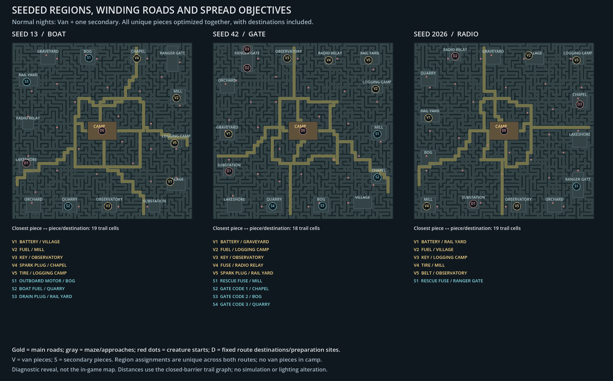
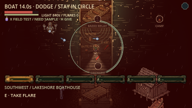

# Seeded layouts and spread objectives — 20 October 2026



The old generator randomized the smaller maze but kept almost every region near
a fixed coordinate and built the same rectangular road ring/straight spokes.
The Orchard therefore stayed southwest. That implementation did not provide the
requested large-scale seed variation.

Now all fourteen region identities move around a seeded, jittered outer perimeter.
The road loop has seeded bounds and eight bending control points; winding roads
connect the fixed camp exits to variable outer endpoints. Maze links and region
approaches also vary. The central camp/exits and each region's internal artwork
retain their conventions; this is not a random rotation of a fixed whole map.
The radio's three fixed sites use widely separated perimeter slots whose bearings
change with the seed. Region overlap is rejected before carving, with bounded
retries and a roomy fallback. The Ranger clearing fits its complete bridge road.

## Objective spacing

Normal nights still offer Van plus one seeded secondary. Every unique objective
piece for **both offered routes** is assigned a distinct region, excluding regions
with fixed destinations/preparation sites. That means five van parts plus three
Boat/Signal pieces, one Radio fuse or four Gate pieces. Van parts stay outside
camp; battery/key availability, three locked caches and phase gates remain.
All fourteen region types are eligible, including Quarry when it is not a fixed
destination. Fixed cardinal region pools and fixed Boat/fuse pickup locations
are superseded. T, clue bearings, ranger notes and region labels use actual
seeded positions; discovering caches remains necessary for their map markers.

The optimizer exhaustively considers legal region subsets. It sorts all pairwise
trail distances between pieces and fixed anchors, then maximizes the shortest,
the next shortest, and so on. Anchors include camp and the offered route's dock,
pyre, power/relay/landing sites, or gate/bridge. This is a maximum-spread choice
**among the legal region anchors for that generated layout**. Distances are
192px trail-graph steps with optional gates/fences closed, not exact native
navigation length, continuous-world optimization or measured encounter rates.
Seeded tie-breaking and item assignment remain reproducible.

For the illustrated seeds, the closest piece-to-piece/destination distances are
19, 18 and 19 graph cells respectively. The Gate's fixed gate/bridge pair is only
six cells apart and cannot be moved independently; the diagram's statistic
excludes fixed-to-fixed pairs. Both are still included in optimization scoring.
[Source plan data](plans.json) records actual region/road/objective assignments.

The **forced all-escape diagnostic** has fifteen unique pieces for fourteen
regions. It uses per-route spread and bounded separate pickup offsets when a
region is reused; it is not the normal global-uniqueness layout. This exception
is labelled in navigation and online evidence rather than claimed as normal play.

## Reachability and existing mechanics

Every clearing stays connected with all gates/fences closed. Shortcut gates can
move back along their own corridor when a winding road junction is too wide for
a valid barrier; opening remains latched from the region side. Native checks
cover collision, vaults, gate opening and actual pickup/escape paths. Ordinary
supplies that would fall under relocated region machinery move to the clearing's
open southern edge. Diagnostic reused objective anchors stay inside their region.

All 38 creatures plus Stalker remain. The 14 circuit/15 interior roaming-start
policy, 1100px camp buffer and 600px separation target remain; guardians move
with their regions. The eight checked seeds retain <=1600px coverage gaps.
Region/road changes do not increase monster counts or change their abilities.



The overview is a **native diagnostic diagram**, revealing all regions, pieces
and starts rather than the discovery-limited player map. It has no simulated
movement, world lighting change, forced escape routes or microphone capture.
The actual boat screenshot uses ordinary seed13 Boat/Van, staged installed
parts/player/projectiles, frozen AI/director and normal Witching Hour lighting.
Both images were opened and inspected. Graphics checks use Dummy audio output.

## Executed checks and limits

[Results and selected raw metrics](results.json) include normal-plan diversity,
eight detailed seeds plus 32 geometry cases and explicit fallback, 24-seed clue checks, outer-band/
monster coverage, native navigation across twelve seeds, roads, barriers,
Boat/Gate/Signal and real ENet listen-host/four-client dedicated regressions.
Navigation and network escape fixtures deliberately force all routes.
Required import/startup, Markdown file links and whitespace checks pass.
The old under-60s travel assertion described fixed inner regions; it is superseded
by all-fourteen-region reachability and a bounded detour check, with measured
walk times recorded. No new human full-round pacing/balance acceptance.

An early navigation pass found a supply inside relocated machinery and an
all-route fixture part shifted beyond its clearing; both were corrected and
navigation rerun. An early shortcut check found too few valid junction gates;
testing earlier links on those same corridors preserves the shortcut feature.
A CoreAudio graphical fixture reported 24 leaked native instances on exit;
Dummy-output graphics passes cleanly. No audio assets/playback behavior changed,
and physical-device listening/resource acceptance is not extended by this work.
Internet, cross-machine, exports and Windows/Linux remain unverified.

Update every client and server together to **lnac-net-34** and begin a fresh
night. No server deployment or packaged ZIP/PCK refresh was performed.

```sh
godot --headless --path . --import
godot --headless --path . --quit-after 5
godot --headless --path . --fixed-fps 60 --script res://tests/integration/randomized_layout.gd
godot --headless --path . --fixed-fps 60 --script res://tests/integration/outskirts_layout.gd
godot --headless --path . --fixed-fps 60 --script res://tests/integration/navigation_seeds.gd -- --all-escapes
godot --path . --audio-driver Dummy --script res://tools/capture_random_layouts.gd
python3 tools/verify_network.py --mode woods --players 2
python3 tools/verify_dedicated.py --mode woods --players 4
```

Other exercised suites: `road_network.gd`, `rotation_clues.gd`, `barriers.gd`,
`field_escapes.gd -- --all-escapes`, `signal_fire.gd` and native
`boat_barrage.gd -- --capture`. Raw iteration logs are ignored in
`artifacts/random_layout/`; the committed diagram tool regenerates the overview.
