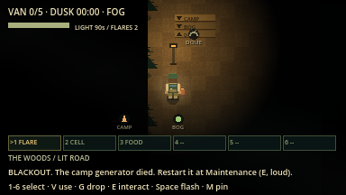
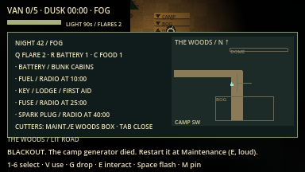

# Road network evidence (overhaul F4a)

macOS arm64 / Godot 4.7.2, 16 October 2026. Network rules version `lnac-net-8`.

| Command | Result |
| --- | --- |
| `python3 tools/verify.py` | 89/89 steps passed, no errors or warnings ([summary](verify_summary.json)) |
| `godot --audio-driver Dummy --path . --fixed-fps 60 --disable-vsync --script res://tests/integration/road_network.gd -- --capture` | 22 assertions passed (19 headless, see [log](road_network.log)) |
| `python3 tools/verify_network.py --mode all --players 2` | 6 processes / 269 assertions passed ([summary](summary_all_2.json)) |
| `python3 tools/verify_network.py --mode all --players 4` | 8 processes / 455 assertions passed ([summary](summary_all_4.json)) |

Walking time from the camp centre along native navigation (night 42, 70 px/s):

| Region | Seconds | Region | Seconds |
| --- | --- | --- | --- |
| Old Graveyard | 17.5 | Bramble Orchard | 43.7 |
| Witch's Bog | 28.0 | Drowned Chapel | 44.9 |
| Abandoned Village | 30.1 | Rail Yard | 50.1 |
| Flooded Mill | 40.5 | Observatory | 54.8 |
| | | White Stone Quarry | 69.4 |

| Lit ring road with lamp post and signpost | Field map printing the roads |
| --- | --- |
|  |  |

The stale "BLACKOUT" banner in the captures comes from the scripted lamp
check just before them; the lamps are on. Not verified: human route feel, light
performance on slower hardware, other platforms.
