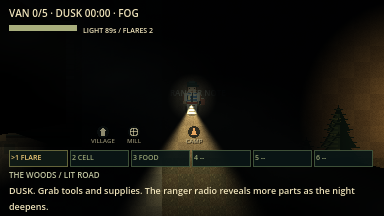
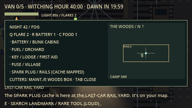

# Rotating regions and clue chain evidence (overhaul F4b-1)

macOS arm64 / Godot 4.7.2, 16 October 2026. Network rules version `lnac-net-9`.

| Command | Result |
| --- | --- |
| `python3 tools/verify.py` | 91/91 steps passed, no errors or warnings ([summary](verify_summary.json)) |
| `godot --audio-driver Dummy --path . --fixed-fps 60 --disable-vsync --script res://tests/integration/rotation_clues.gd -- --capture` | 16 assertions passed (14 headless, see [log](rotation_clues.log)) |
| `python3 tools/verify_network.py --mode all --players 2` | 6 processes / 269 assertions passed ([summary](summary_all_2.json)) |
| `python3 tools/verify_network.py --mode all --players 4` | 8 processes / 455 assertions passed ([summary](summary_all_4.json)) |

Night 42 places fuel at the Bramble Orchard (west), the fuse at the Abandoned
Village (north) and the spark plug at the Last-Car Rail Yard (east).

| Ranger note on the lit road | Pack: corkboard, note and mapped clues |
| --- | --- |
|  |  |

Not verified: human feel of the clue chain, other platforms.
