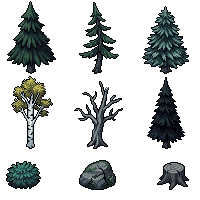
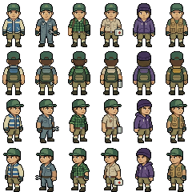
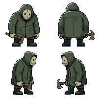
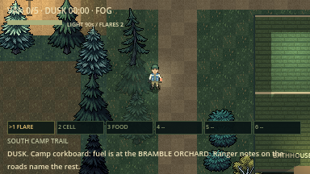

# SpriteCook art pass evidence (16 October 2026)

Three Nano Banana 2.1 pixel-art generations (12 credits each; 4 of 40 credits
remain on the free tier, so the budget ran out here). Asset IDs:
[spritecook-assets.json](../../../spritecook-assets.json).

| Generated sheet | Became |
| --- | --- |
|  | 3 pines, birch, new spruce and dead tree, shrub, boulder, new stump |
|  | All six survivor walk sheets (edit of [old poses](before_survivor_poses.png)) |
|  | The stalker, now 40×48 frames (edit of [old poses](before_stalker_poses.png)) |

In game (inspection lighting with the sight mask off; normal nights are dark):

**Creatures (second batch, 44 more credits):** four 4×4 grids, each an edit of
the old creature poses: [A](creatures_A_sheet.png) (werewolf, Sasquatch,
vampire, witch), [B](creatures_B_sheet.png) (revenant, lantern moth, hound,
jackal), [C](creatures_C_sheet.png) (ration moth, Lens Eater, Boiler Saint,
Shutter Wraith) and [D](creatures_D_sheet.png) (guardians, Nano Banana 2 Lite).

The generated figures came out larger than requested (survivors about 28×55,
stalker about 70×90), so they were area-downscaled and snapped back to each
figure's own palette. Walk frames are a 1 px step-bob with alternating legs,
not drawn animation. Terrain tiles and code-drawn buildings keep their
original art. Some generated side views faced the wrong way; the importer
mirrors or swaps those rows per species.
