# SpriteCook art pass evidence (16 October 2026)

Three Nano Banana 2.1 pixel-art generations (12 credits each; 4 of 40 credits
remain on the free tier, so the budget ran out here). Asset IDs:
[spritecook-assets.json](../../../spritecook-assets.json).

| Generated sheet | Became |
| --- | --- |
|  | 3 pines, birch, new spruce and dead tree, shrub, boulder, new stump |
|  | All six survivor walk sheets (edit of [old poses](before_survivor_poses.png)) |
|  | The stalker, now 40×48 frames (edit of [old poses](before_stalker_poses.png)) |

In game (inspection lighting with the sight mask off; normal nights are dark):

**Creatures (second batch, 44 more credits):** four 4×4 grids, each an edit of
the old creature poses: [A](creatures_A_sheet.png) (werewolf, Sasquatch,
vampire, witch), [B](creatures_B_sheet.png) (revenant, lantern moth, hound,
jackal), [C](creatures_C_sheet.png) (ration moth, Lens Eater, Boiler Saint,
Shutter Wraith) and [D](creatures_D_sheet.png) (guardians, Nano Banana 2 Lite).

**Everything else (third batch, from 800 credits; 84 used, 716 left):**
- [items](items_sheet.png): pickups and belt icons;
- [camp objects](camp_objects_sheet.png): van, tent, campfire, cache crate,
  generator, lamp posts, notice board, picnic table, outhouse, woodpile, barrel,
  toolbox;
- [furniture](furniture_sheet.png): every interior;
- [landmarks](landmarks_sheet.png): bell frame, well, cauldron, crypt, graves,
  altars, waterwheel, observatory, rail signals, columns, shrine, woods ruins;
- seamless [ground](ground_textures_sheet.png) and [material](material_textures_sheet.png)
  textures for grass, forest floor, trails, roads, floors, roofs, water,
  cobbles, bog and graveyard;
- the [title illustration](title_art.png).

| Title screen | Camp from above | Workshop interior |
| --- | --- | --- |
| 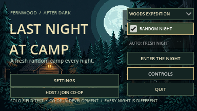 | 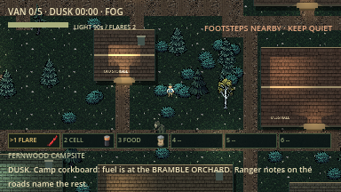 | 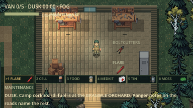 |

| Campsite | Mess hall | Bathhouse | Village square |
| --- | --- | --- | --- |
| 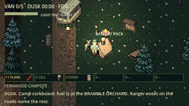 | 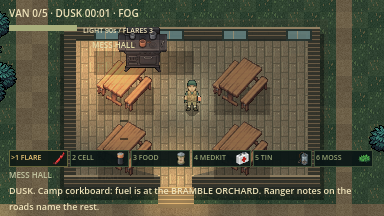 | 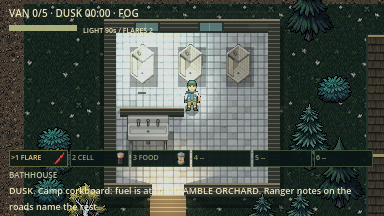 | 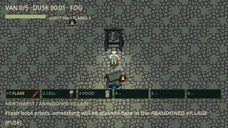 |

Inspection captures raise ambient light; normal nights are dark.

The generated figures came out larger than requested (survivors about 28×55,
stalker about 70×90), so they were area-downscaled and snapped back to each
figure's own palette. Walk frames are a 1 px step-bob with alternating legs,
not drawn animation. Terrain tiles and code-drawn buildings keep their
original art. Some generated side views faced the wrong way; the importer
mirrors or swaps those rows per species.

**Fourth batch (17 October, 48 credits; 656 left):** four NB 2.1 generations to
replace the last boxy and placeholder art.
- [Groundskeeper](groundskeeper_sheet.png): an edit of the stalker pose grid, so
  the F7 headline killer has real art (`tools/import_spritecook_groundskeeper.gd`).
- [Night props](night_props_sheet.png): signal pyre (unlit/lit), kerosene, flare
  gun, snare (open/sprung), gift crate, signpost, rescue helicopter, apple tree,
  trellis, mossy log, tires, drum, cooler, glow mushrooms.
- [Ground decals](ground_decals_sheet.png): grass tufts, ferns, rocks, leaves,
  puddles, flowers and more, scattered (seeded) along every camp road edge and
  woods trail edge so paths no longer end in hard straight lines, and sparsely
  across grass and trails to hide texture tiling.
- [Surface textures](surface_textures_sheet.png): asphalt (Ranger Road),
  quarry gravel, mossy flagstones, court tiles, orchard soil, dock planks
  (docks, bog boardwalk, mill decks, cabin walls and thresholds), a calmer lawn
  for camp grass, leaf litter and mossy floor.

Code-side, with no credits: gable roofs with a lit and a shaded slope, ridge
cap, eaves, fieldstone chimney and shingled porch awning; plank interior walls
and mullioned windows; textured bog pools; pointed signpost planks; one label
per stash of identical pickups.

| Camp road edges | Ranger Road | Drowned Chapel | Witch's bog |
| --- | --- | --- | --- |
| 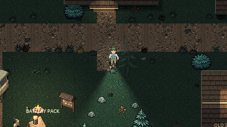 | 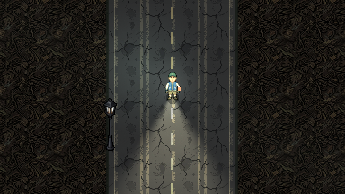 | 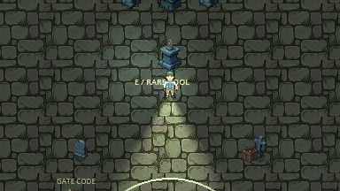 | 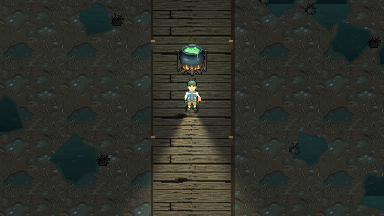 |

| Signal pyre | Groundskeeper on a trail | Orchard | Flooded Mill | Interior walls |
| --- | --- | --- | --- | --- |
| 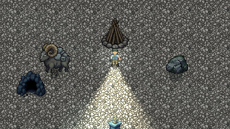 | 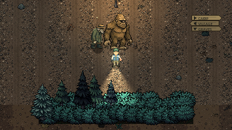 | 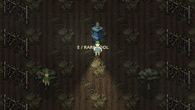 | 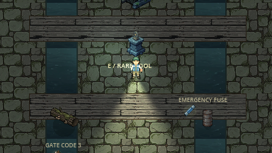 | 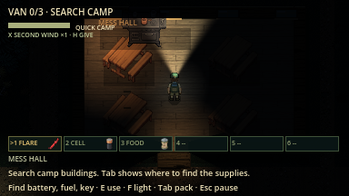 |

**Fifth batch (17 October, 132 of an approved 196 credits; 524 left):** the user
asked that everything on screen come from SpriteCook, backgrounds included.
- [World objects](world_objects_sheet.png): fences, gates (open/closed), cabin
  doors, a fallen woodpile, helipad, raised barrier arm, abandoned car,
  scarecrow, fire pit, totem, fallen tree, torn tent.
- [Forest dressing](forest_dressing_sheet.png): rock formations, ferns, berry
  bushes (also the woods hiding spots), fairy rings, hollow logs, hunting stand,
  missing-person poster, bones, standing stones, bicycle, shrine and more,
  scattered (seeded) beside about one in ten straight trail sections.
- [Effects and markers](effects_sheet.png): flare, blood, noise tin, hex bolt,
  thorns, map pin, help call, Scout mark, lake ripple, stun stars, alert and
  suspicion bubbles.
- [Interface](ui_sheet.png): wooden panels, buttons and belt slots (nine-slice
  theme), the field-map frame and skyline icons.
- Backgrounds: [loading screen](loading_art.png), [survivor selection](selection_art.png),
  [co-op lobby](lobby_art.png), plus six [survivor portraits](portraits_sheet.png).
- Walking: one edit each of the survivor, stalker and Groundskeeper grids into
  [mid-stride](survivors_stride_sheet.png) poses ([stalker](stalker_stride_sheet.png),
  [Groundskeeper](groundskeeper_stride_sheet.png)); the importers now build real
  stepping walk cycles instead of a 1-pixel bob. Full SpriteCook animation sets
  (about 130 credits per character) were judged too expensive.
