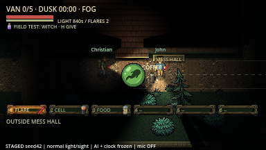
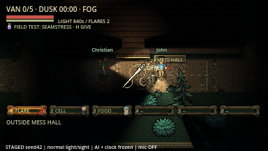
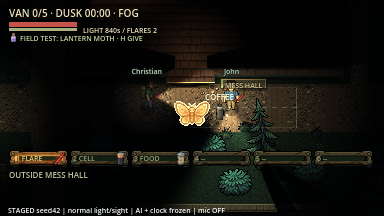
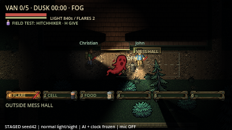
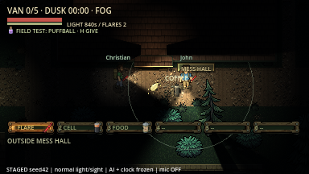

# Larger Christian straight shots — 20 October 2026

Witch (all four curse appearances), Seamstress, Lantern Moth and Hitchhiker
copies now draw at **36px** in flight instead of 18px and hit bodies within
**20px** of the swept path instead of 10px. Windup previews grow from 12px to
24px; local width guides match. The broad-phase target query includes the wider
edge. Reflected Witch shots start beyond the reflector's enlarged hit radius,
so the returning shot can hit Christian rather than immediately hitting the ward
user again. Speed, range, durations, native monster attacks and effect areas are
unchanged. Puffball's spore lob retains its original width and burst size.

| Witch bubble | Seamstress needle |
| --- | --- |
|  |  |

| Lantern Moth | Hitchhiker |
| --- | --- |
|  |  |



Actual native captures, macOS arm64/Godot 4.7.2, staged seed42 actor poses and
selected samples, frozen enemies/clock, normal Dusk lighting/sight, microphone
off. No paid assets. These demonstrate rendering, not human aiming/balance.

The extended ability-feedback suite checks delivery at 19px and rejection at
21px for all four straight families, the unchanged spore lob, wall blocking,
ward reflection back to Christian and the existing ability/audio routes.
Headless **114 checks**, native **135 checks**, zero assertion failures on final
runs. Required import/startup, Markdown file links and whitespace checks pass.
[Machine-readable results](results.json).

Early verification exposed a real reflected-shot self-collision, corrected by
clearing the larger radius. The tests also needed to free their extra swap
survivor between fixtures and release earlier native one-shot audio streams
before each independent cast, preventing fixture interference/voice-pool
saturation. Audio assets, routing and production voice limits were not changed.
No new multiplayer/Internet, human listening, exported-build or Windows/Linux
acceptance. Host hit logic and all peers' drawing use the same scale helper;
no network schema change was required.

```sh
godot --headless --path . --import
godot --headless --path . --quit-after 5
godot --headless --path . --fixed-fps 60 --script res://tests/integration/ability_feedback.gd
godot --path . --fixed-fps 60 --script res://tests/integration/ability_feedback.gd -- --capture
```

Raw iteration/final logs are ignored under `artifacts/wide_samples/`.
