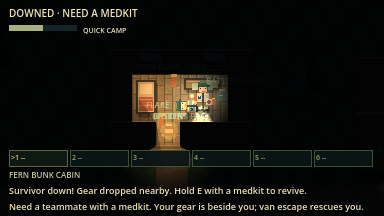
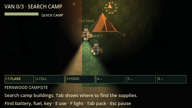
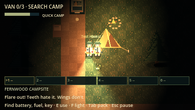
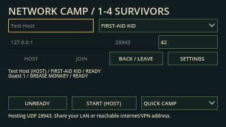
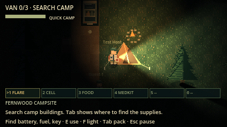
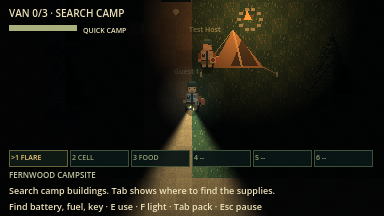

# Play together: LAN, Wi-Fi and Internet

The source build now includes **1–4 player ENet listen-server co-op** in Quick
Camp and Woods Expedition. One survivor hosts; the others join that machine.
Both modes keep the current survivor choices, items, enemies and escape rules.
Voice chat follows the first [gameplay overhaul](fun_overhaul.md) slices; no
microphone is opened or requested.

## Radio Rescue (expedition)

All peers must use rules `lnac-net-12` (the same build). The host owns the fuse,
substation, six-second relay hold, persistent signal lights, countdown and
extraction results. Clients send the usual E/hold intents. **T** switches only
that player's objective page. A remote operator can complete the whole chain;
any successful rescue also recovers connected downed teammates. Everyone standing
must be inside the chapel landing circle; the van does not count as radio rescue.
See the [Radio Rescue walkthrough](radio_rescue.md). Cross-machine and human
pacing acceptance remain pending.

## Boat and Ranger Gate (F5b)

Both additional expedition routes are host-owned: parts, motor assistance, dock
attack tells/strikes, floodlights, gate collision, holds, bridge countdown and
results replicate. T cycles four local plans without sending objective-page
choices to teammates. Boat recovers standing survivors in its 80px dock circle;
bridge recovery uses 64px. A successful extraction also recovers connected downed
teammates. The first completed escape ends the round. The [Boat/Gate guide](boat_gate.md)
explains exact parts and counterplay. Quick Camp keeps its original van rules.

## Host and join

1. Everyone uses the same repository revision and Godot 4.7.2, then runs
   `python3 tools/run_game.py` (or opens `project.godot` and presses F5).
2. Open **Host / Join Co-op** from the title screen. Set your name and survivor.
3. The host chooses a UDP port (default **27840**) and presses **Host**. Choose
   **Quick Camp** or **Woods Expedition** and optionally enter a positive seed;
   an empty/zero seed starts a fresh random night.
4. Guests enter the host address and the same port, then press **Join**.
5. Everyone marks **Ready**. The host presses **Start (Host)**. Changing survivor,
   mode or seed clears readiness; the host locks the roster, roles, rules and
   world seed at start. Duplicate survivor roles are allowed.

| Connection | Address guests enter | Setup |
| --- | --- | --- |
| Same computer | `127.0.0.1` | Open another copy for local testing. |
| Same LAN / Wi-Fi | The host's local IP, such as `192.168.1.50` | Both devices must reach each other; guest-network/client isolation can prevent this. Allow Godot/game UDP through the host firewall if blocked. |
| Internet, direct IP | The host's public/reachable address | Forward the chosen **UDP** port to the host computer and allow it through the firewall. A private LAN address is not reachable from outside that LAN. |
| Internet, virtual LAN | The host's address on an already configured virtual LAN/VPN | All players join that network first. Use its host address and allow UDP on that interface. No game-managed VPN, relay or account is required or provided. |

Godot's [official hosting guidance](https://docs.godotengine.org/en/4.7/tutorials/networking/high_level_multiplayer.html#hosting-considerations)
explains LAN addresses and UDP port forwarding. Carrier-grade NAT or a router
you cannot configure can prevent direct hosting; use a suitable existing virtual
LAN instead. Wi-Fi is a local connection method, not automatic Internet hosting.
The game provides no matchmaking, automatic NAT traversal, relay or UPnP setup.

Connection failure, incompatible rules, full/running camps and host loss show a
message. A new player can join only in the lobby. Leave the current round before
changing survivor; there is no mid-round reconnect that refreshes supplies.

## During the round

**WASD/arrows** move, **Shift** sprints, **E** interacts, and **hold E** revives or
starts the repaired van. **1–6/keypad** selects a belt item; **V** uses it and
**G** drops its stack. **Q/R/C** remain flare/battery/food shortcuts. Required
vehicle parts and reusable cutters remain separate from the six supply slots.
Map pins (**M**) are sent to the host, which keeps each player's newest three
and shares them with everyone. The host also owns the progress-paced night (phases), part reveals, storms and blackouts.
Flash-stuns (Space) and help calls are host-validated intents.
Hiding, doors and knock-overs use the normal E intent; the host owns breath,
door breaking and blocking. The road network changes the generated woods, so
both copies must run rules version `lnac-net-10`. Vaults and gate openings are
host-validated E actions. Clue knowledge (ranger notes,
regions visited) is shared by the whole team.
Nearby teammates show their names; each survivor keeps their own flashlight,
limited sight, stamina, inventory and role advantage.

The host validates movement, pickups, supply use, damage, revives, AI and the
vehicle. A contested pickup awards once. One survivor owns a revive/ignition
hold; changing actor resets progress. Everyone can install every component.
The starter boards automatically; others press E beside the running van before
its eight-second countdown ends. Downed teammates are also rescued when at least one passenger escapes; living
survivors outside the van are left behind.

**Esc opens your local settings/menu; it does not pause the shared world.**
Your survivor stops sending movement while that menu is open and can still be
caught. The first hit wounds; a second downs. A downed teammate stays down
indefinitely and can crawl and press E to call for help. Any teammate can hold E
to revive: 6s bare-handed, or 3s (2.25s as First-Aid Kid) with a medkit, which
is consumed. Revived survivors come back wounded. Further hits never permanently
kill them. All parts, tools and supplies drop beside their body on down or disconnect,
so teammates can recover them with E. When everyone is down the round is lost. Alternating downs after successful
revivals do not count toward a cumulative loss. A press of E collects nearby
dropped gear; holding E revives. Enemies ignore downed bodies, pursue standing survivors or
resume searching/patrolling. The stalker now sweeps central camp early.
Empty interactions, pickup/belt errors and supply feedback display only on the
acting player’s HUD; shared team events still announce to everyone.
Every survivor’s flashlight and flare lights render on all peers, with local
wall shadows and woods sight occlusion. Leaving does not grant fresh supplies or permit an
active-round rejoin.

The host chooses **Return to Lobby** or **Retry Seed / Lobby** on the results
screen. All remaining peers return together, with readiness cleared. Retry keeps
the seed; another night uses a fresh seed. Roles may be changed before the next
start. A host disconnect ends the session and returns clients to the menu; there
is no host migration. Leaving from the pause/results menu disconnects you.

## Rescue and shared lighting examples





## Screenshots





These are actual engine captures from the scripted two-window test, with host-only
placements/AI pauses for isolated authority checks. They are not a human balance
playthrough or evidence of two separate physical computers.

## What has been verified

The network harness launches independent real ENet host/client processes rather
than local actor stand-ins. Two- and four-peer tests cover both modes, ready/rule
locking, movement visible to other peers, contested pickup single-award, rejected
forged role/action/nonfinite inputs, shared injury/revive, supply nonduplication,
dropped items/flares, woods projectiles/patches, ignition/boarding/escape,
synchronized retry, disconnect objective recovery, missing-snapshot-piece recovery
and host-loss cleanup. Snapshot payload pieces are bounded below the UDP MTU. Late
joins are refused. Graphical two-peer runs capture both views.

```sh
python3 tools/verify.py
python3 tools/verify_network.py --mode all --players 2
python3 tools/verify_network.py --mode all --players 4
python3 tools/verify_network.py --mode all --players 2 --graphical
```

Verified environment: **macOS arm64 / Godot 4.7.2**, with independent processes
on loopback. A real two-computer LAN/Wi-Fi or cross-network Internet/VPN round,
human co-op/balance, Windows/Linux, exported packages, high latency/jitter and
synchronized-audio listening acceptance remain **unverified**. Direct-IP/VPN
routing is implemented through ENet, but these local tests do not prove a
particular router/firewall/network arrangement works.

## Proximity voice

Implemented 17 October 2026 with [TwoVoIP](https://github.com/goatchurchprime/two-voip-godot-4)
6.6 (MIT, Opus codec, RNNoise denoiser, Speex automatic gain). Only the desktop
libraries (macOS universal, Windows and Linux x86_64, debug and release) are
vendored in `addons/twovoip/` with its licence; the source clone lives outside
the project.

TwoVoIP's Linux and Windows libraries crash the Godot **editor** when it loads
them (a divide-by-zero inside the library while the editor starts, which also kills
`--headless --import`; reproduced on Ubuntu 26.04 with both the standard and the
.NET/Snap Godot 4.7.2). The game itself runs them fine. So `addons/twovoip/` has a
`.gdignore`: the editor never sees or loads it, and the Voice autoload loads it
at runtime with `GDExtensionManager.load_extension`. Exported builds would have
to ship the addon folder and its libraries explicitly (no exports yet).

- **Opt-in.** Off by default. Settings/Esc menu **MIC**: Off, Push to talk (hold
  **B**), Open mic (gain-scaled level gate with 0.6 s hang). Choosing voice writes
  `audio/driver/enable_input` to `user://engine_overrides.cfg`, read by the engine
  at the next launch. The microphone, and macOS's permission prompt, start only
  for players who turned voice on (on macOS CoreAudio waits on that prompt at
  start-up, so the project keeps input off by default). Restart once after enabling.
- **Routing.** Lobby: everyone. Round: alive, downed and boarded survivors hear
  each other positionally (`AudioStreamPlayer2D` at the speaker, silent beyond
  420 px, low-pass "VoiceMuffled" bus when a wall blocks line of sight).
  Escaped, dead and left-behind players share a ghost channel; the living never
  hear it, and ghosts can still listen to the living by position. Monster AI
  never hears voice.
- **Transport.** 20 ms mono Opus frames at 24 kbit/s (about 60–70 bytes each)
  are sent as unreliable-ordered RPCs on ENet channel 3, relayed by the host,
  separate from snapshots (1) and input (2). Receivers drop empty packets,
  packets over 400 bytes, late packets, and more than 75 packets/s per peer.
  A three-packet jitter buffer starts each utterance; a single lost packet is
  rebuilt with Opus forward error correction.
- **Privacy.** No voice is recorded, saved or logged. Like gameplay traffic, ENet
  voice is **not encrypted**; use a trusted LAN/VPN for private conversations.

**Verified (headless):** `python3 tools/verify_voice.py` runs `voice_chat.gd`
(24 checks: real Opus encode/decode, FEC, routing table, limits, settings) and
`voice_peer.gd` in two processes over ENet (lobby exchange: 73 packets each way,
about 70,000 decoded frames per side; then a real Quick Camp round: positional
voice from the teammate's survivor, silence beyond range, ghosts isolated from
the living; 7 client + 12 host checks). 17 October: a user test found received
voice was silent (playback started paused); fixed, and the two-process test now
checks the mixer's actual output level. **Not verified:** a human listening test
after the fix. The unattended probe could not answer macOS's microphone
permission dialog, and cross-machine Internet latency was not measured.
