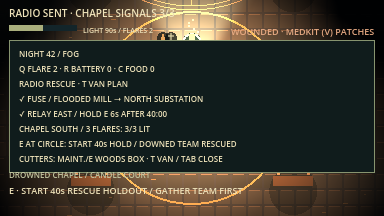

# Radio Rescue — F5a

Woods Expedition now has a second way out alongside the van. Every expedition
contains the rescue chain; Quick Camp stays van-only. This is the first F5 slice,
not completion of the Boat/Ranger Gate/Signal Fire or primary-escape rotation plans.

| Place | What to do |
| --- | --- |
| **Flooded Mill, west woods** | Collect the **emergency fuse**, beside the central reward area. This is distinct from a possible van fuse. It uses no supply-belt slot. |
| **Power Substation, north spoke** | E at the cabinet fits the fuse and restores the dedicated rescue circuit. This progress survives camp blackouts and player downs. |
| **Radio Relay Station, east woods** | Follow the short approach from the east spoke. Hold E at the ladder for **6 seconds**, representing the climb and transmission. The channel opens at **40:00**. Release, movement, downing, disconnect or changing operator resets an incomplete hold. |
| **Landing zone, south of Drowned Chapel** | E at each of three holders consumes **one flare**. Three extra flares lie beside the circle. Signals remain lit; ordinary Q/V flares do not fill holders. Prepare signals before or after transmitting. |
| **Landing circle centre** | Once the call is sent and all signals are lit, gather the team and E here to start a **40-second holdout**. Starting is explicit so solo players have time to return from the relay. |

At rescue arrival, standing, unhidden survivors within the **96 px circle** and
with a clear path to its centre escape. If any standing survivor escapes,
connected downed teammates anywhere also escape. Standing survivors outside,
hidden players and van passengers are left behind by this rescue. If nobody
standing is recovered, the round ends in defeat. The first escape countdown
to finish ends the round; dawn and all-down rules also remain active.

Signals light the area and repeatedly make bounded noise, drawing monsters that
can hear them. They do **not** grant a permanent flare repulsion field. Ordinary
flares keep their existing nine-second light/repulsion rules. Resident guardians
retain their territorial limits; rescue never teleports a monster or gives it
unsensed player positions. The chapel's Candle Grazer remains a local threat.

**T** opens and switches the local radio/van objective page. **Tab** closes field
notes. New regions have field-map outlines, signpost names and skyline symbols;
after transmission the chapel skyline label identifies rescue. No monster or
unexplored-path radar is added.

## Night views

These are actual Godot renders at normal night exposure with enemies disabled
for inspection. The camera zoom/offset is adjusted to show each structure.
The plan screenshot opens the local objective page. The atlas is an inspection
overlay of seed 42; the in-game map still reveals only explored trails.

| Substation | Relay |
| --- | --- |
|  |  |

| Landing signals | Objective page |
| --- | --- |
|  |  |

## Authority and verification

The host validates proximity, survivor status, sight, fuse ownership, flare stock,
channel time and the active operator. Accepted progress, signals, lights,
countdown and results replicate in snapshots. Clients send existing interaction
and hold intents; objective-page selection stays local. Rules are `lnac-net-11`;
all copies must use the same build. Restart reconstructs fresh rescue state.

`tests/integration/radio_rescue.gd` checks seeded generation, native navigation to
every action, fuse pickup/drop/recovery, time gating, hold resets, operator
changes, signals, pause, state restoration and extraction boundaries. The
network harness drives the entire chain from a remote peer in its second round.
Host-only placements and accelerated clock/countdown tails isolate authority;
they do not constitute normal-speed pacing or cross-machine Internet acceptance.
The user explicitly deferred human playtests for this slice.

The regions reuse existing SpriteCook materials/props with original drawn
machinery, a triangulated mast, ladder, insulators, guy wires, cabinet and
animated signal sparks. Elevated machinery can render above the ground sight
mask only from its own clearing with a visible front anchor. No floor or
creature is redrawn above fog. No new SpriteCook credits were spent.
